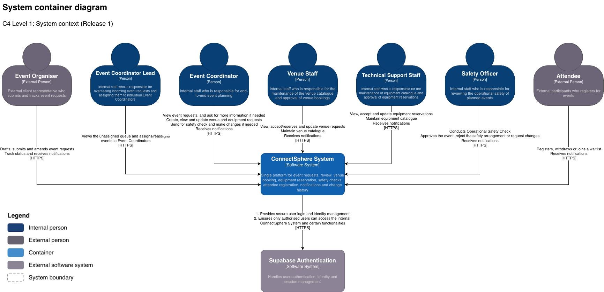
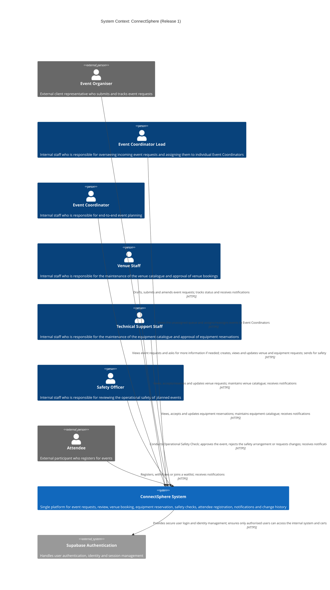
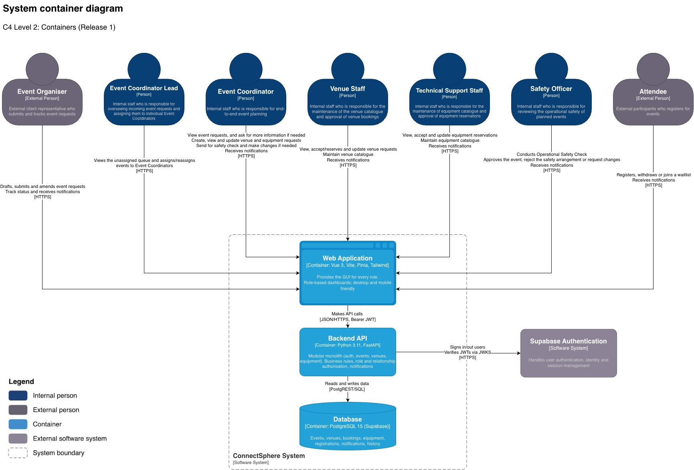
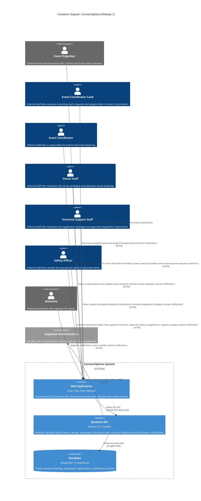
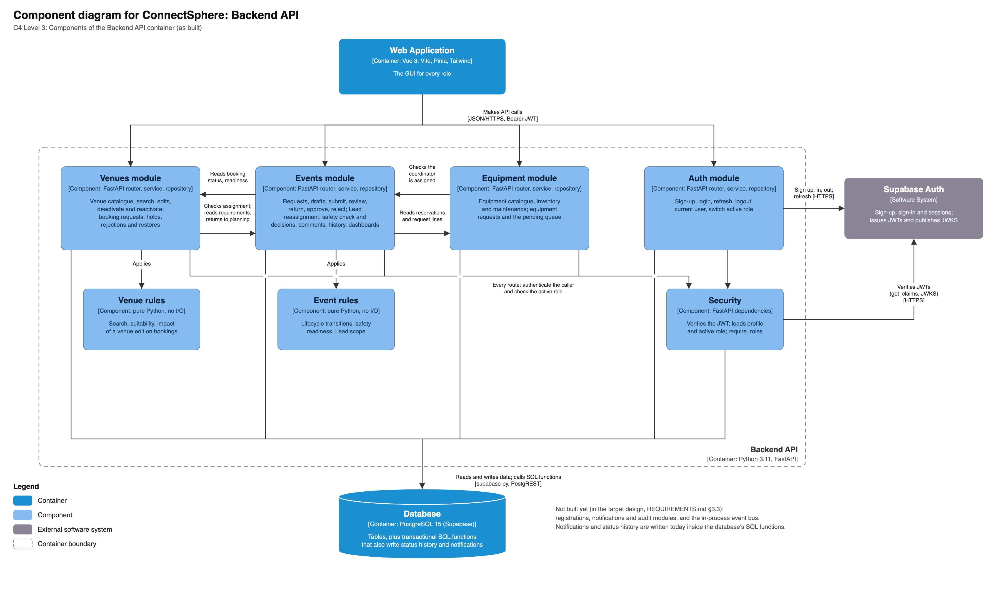
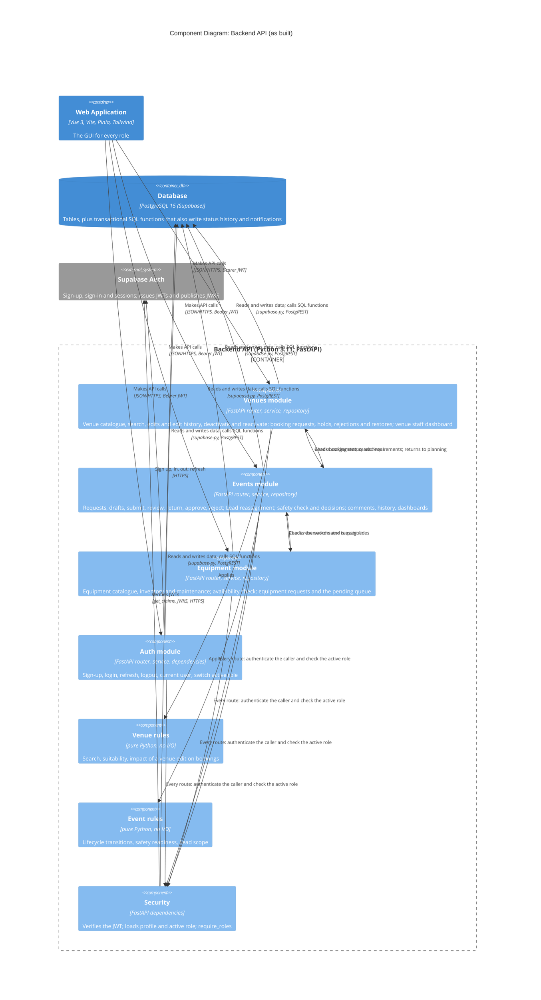
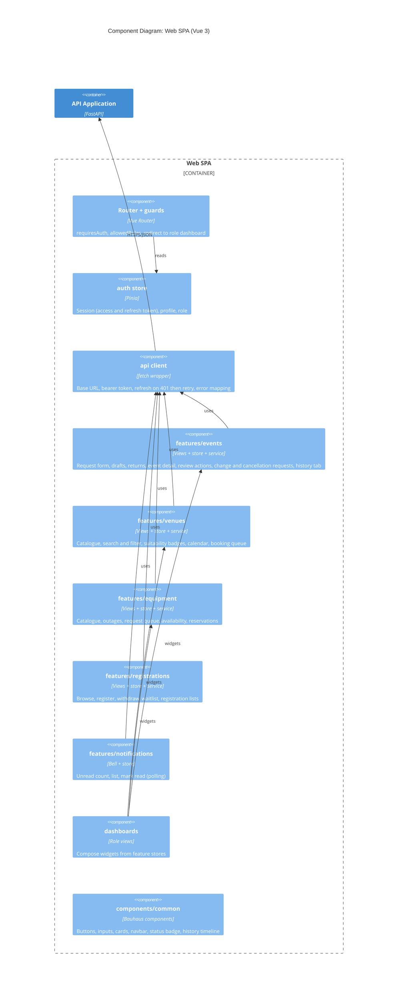
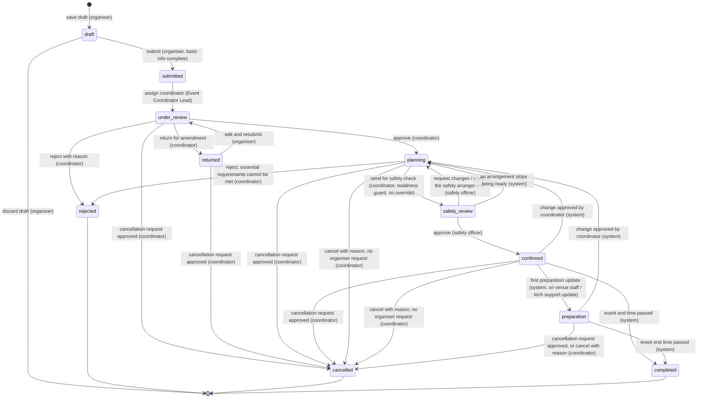

# ConnectSphere — Requirements & System Design

**Status:** living document, v0.4 (13 Oct 2026, Sprint 3). v0.2 applied the Session 1 customer clarifications; v0.3 applies the Session 2 answers (§12) and closes the §9 questions they resolved; v0.4 applies the Session 3 answers on the Week 7 changes (§13).

`docs/BUILD_LOG.md` records what was *built*; this file records what the system *should do*. Update this file whenever the customer clarifies a rule.

**Sources, in priority order (latest clarification wins):**
1. **Session 3 Clarification Answers** (the Week 7 change notice: Event Coordinator Lead, Safety Officer, Preparation, setup/turnaround, multi-venue events, hold expiry), cited as **`QA3-<n>`**, where `<n>` is the row number in §13 (the customer's sheet, header = row 1, so the customer's own "Refer row 13" is QA3-13). Where Session 3 differs from an earlier session or from the Week 7 change notice's backlog wording, Session 3 wins. The **Session 3 meeting summary** (§13.1) is cited as **`M3`**. Where M3 and a written answer differ, the rule says which one was followed and why.
2. **Session 2 Clarification Answers**, cited as **`QA2-<n>`**, where `<n>` is the row number in §12. Where Session 2 differs from Session 1, Session 2 wins (for example QA2-24 supersedes QA-15 on dual roles).
3. **Session 1 Clarification Answers (G8)**, cited as **`QA-<row>`**, where `<row>` is the spreadsheet row number. For example, QA-18 is the "approved vs confirmed" answer.
4. **Week 4 Project Instructions**: the 20 core features for the Week 12 release, cited as **`W4`**.
5. **Week 1 Customer Briefing**: the full system vision, cited as **`W1 §n`**.

**Standing guidance from the prof:**
- **Change can come at any time and in any form, not only as new features.** The product backlog changes constantly, so the design must absorb new or changed rules without rework. This is why §3 favours configurable rules, a single state machine, and event-driven side effects.
- **Week 1 features that are not among the 20 core features stay in the product backlog at lower priority** (§8).

**How rules are labelled:**
- A rule with a `QA3-`, `QA2-`, `QA-`, `W4`, or `W1` citation is **customer-confirmed**.
- **[Team decision]**: the customer explicitly left this to us. We chose it, and it is ours to justify.
- **[Assumption]**: not yet answered by the customer. Each one is listed in §9 to ask at the next Q&A.

---

## Contents
1. [Scope and priorities](#1-scope-and-priorities)
2. [Roles, accounts and access rules](#2-roles-accounts-and-access-rules)
3. [System design (C4 model)](#3-system-design-c4-model)
4. [Domain model](#4-domain-model)
5. [Event lifecycle](#5-event-lifecycle)
6. [Core feature behaviour specifications](#6-core-feature-behaviour-specifications)
7. [Cross-feature consistency rules](#7-cross-feature-consistency-rules)
8. [Lower-priority backlog](#8-lower-priority-backlog)
9. [Open questions for the customer](#9-open-questions-for-the-customer)
10. [Non-functional requirements](#10-non-functional-requirements)
11. [Explicitly out of scope](#11-explicitly-out-of-scope)
12. [Session 2 clarification answers](#12-session-2-clarification-answers)
13. [Session 3 clarification answers](#13-session-3-clarification-answers)

---

## 1. Scope and priorities

| Priority | Meaning | Contents |
|---|---|---|
| **P1 (Core)** | Must work end-to-end by Friday of Week 12 | The 20 core features (§6) |
| **P2 (Enablers)** | Not listed as core features, but required by them or by explicit clarifications | Change history visible in the UI (QA-70) · Event Coordinator Lead assignment queue (W7 CR-05, QA3-12) · venue and equipment catalogue data entry · role dashboards (QA-51) · CI pipeline |
| **P3 (Backlog)** | Kept in the product backlog but not planned for release 1 | Week 1 features outside the core 20 (§8) |

The release is judged on **coherent end-to-end workflows** (W4). This is the reference workflow it must demonstrate:

1. Organiser drafts and submits a request.
2. The request enters the **unassigned queue**, and an **Event Coordinator Lead assigns** a coordinator (QA3-12, QA3-37).
3. The coordinator reviews it and **returns it for amendment**; the organiser edits and resubmits.
4. The coordinator approves it, and planning begins.
5. The coordinator runs a venue search and suitability check for each venue the event needs, then submits a booking request per venue, which **tentatively holds** it (with an expiry) for its occupied interval, setup and turnaround included.
6. Venue staff approve each booking.
7. Equipment is requested and **fully reserved** by tech support.
8. Every required arrangement is approved, so the coordinator **sends the event for the Operational Safety Check**; the **Safety Officer approves** it and the event is **Confirmed** (QA3-2, QA3-3).
9. Venue staff and tech support record preparation progress per venue, and the first update moves the event to **Preparation** (QA3-45, M3).
10. Attendees register within the organiser's registration window.
11. The organiser requests a significant change and the coordinator approves it. The event returns to Planning, and **only the arrangements the change touches go back to staff** (CR-R5): nothing is reset automatically (QA3-51). The event always passes a new safety check. Everyone affected is notified.
12. Alternatively, the organiser requests cancellation, the coordinator approves it, reservations are freed, and attendees are notified.

---

## 2. Roles, accounts and access rules

### 2.1 Accounts

| Rule | Source |
|---|---|
| **ACC-R1:** There is **no system administrator role.** The Week 7 changes don't introduce one (QA3-18). | QA-3, QA2-1, QA3-18 |
| **ACC-R2:** **Event Organisers and Attendees sign up themselves.** At sign-up they choose one of these two roles and nothing else. | QA-3, QA-4, QA2-1 |
| **ACC-R3:** **Internal staff accounts (Coordinator, Venue Staff, Tech Support, Safety Officer, Event Coordinator Lead) are system defaults**: created by seed or migration, never through sign-up. | QA-3, QA2-1, QA3-18 |
| **ACC-R4:** An account **may hold two or more roles**, except an Event Coordinator Lead, who holds no other role (AUTH-R7, M3), so one person can finish a task that spans both (for example Coordinator and Venue Staff). This **supersedes** Session 1's "strictly one role" (QA-15). How roles are managed in the UI is ours to choose. **[Team decision]** Implemented in SCRUM-74/75 as an explicit, session-scoped active-role switcher rather than a union-of-permissions model: `user_roles` holds the roles an account is allowed to act as; `profiles.role` is that account's default role for a brand-new login session; `session_active_roles` (keyed by the JWT `session_id`) holds the role the caller actively switched to for the current session, so a switch on one device never affects another concurrent session for the same account. A nav dropdown (`Nav.vue`) lets the user pick which held role to act as; the profile page (`ProfileView.vue`, SCRUM-78) separately lists every role the account holds, so a multi-role user has a persistent view of all their roles, not just whichever one is currently active. Access follows the **active** role at both layers (SCRUM-76): `require_roles` in the API and RLS's `private.current_user_role()` both read the role the session is acting as, so holding a role the session is not acting as never grants its access, whether the request comes through the API or straight to the database. `current_user_role()` returns the `session_active_roles` row for the JWT's `session_id` and this user, falling back to `profiles.role` when the session never switched or the token has no `session_id`. (Until SCRUM-76 this function read `profiles.role`, and this rule called that an intentional gap; it stopped being one once a switched role could differ from the default at the database.) Granting an account a second role has no in-app path yet — a system admin inserts directly into `user_roles` via SQL; building a grant UI/endpoint is a follow-up story. Sign-up doesn't add a role to an existing account either: an email that already has an account is refused (409, SCRUM-80), so an organiser who also wants to register for events as an attendee needs `attendee` granted the same way, or a second account with a different email. **[Assumption]** (SCRUM-80). Two composite foreign keys enforce "revoking a role ends access" at the database level rather than by convention alone: `session_active_roles (profile_id, role) → user_roles`, so revoking a role a session actively switched into invalidates that session immediately, and `profiles (id, role) → user_roles`, so `profiles.role` itself can never point at a role the account no longer holds — an admin revoking someone's *default* (never-switched) role must first repoint `profiles.role` to a role they still hold, in the same transaction, or the revoke is rejected. | QA2-24 (supersedes QA-15) |
| **ACC-R5:** An Organiser records an organisation name at sign-up, which links them to a client profile. ConnectSphere maintains client profiles. **[Assumption]** Until a client-profile story exists, sign-up (SCRUM-80) requires the organisation name and stores it as plain text on `profiles.organisation_name`, with an optional phone number. Nothing links it to a client record yet. | QA-90 |
| **ACC-R5b:** Attendee sign-up collects a name, email and password only; it does not ask for an organisation name or phone number. | SCRUM-83 AC2 |
| **ACC-R6:** The authentication mechanism is a team choice. We use Supabase Auth with email and password. **[Team decision]** Users sign in with their **email**; there is no separate username. SCRUM-48's acceptance criteria say "username and password", but Supabase Auth's `sign_in_with_password` is email-based and `profiles.email` is the unique identifying field. If the customer asks for a non-email username, that is a schema and auth-flow change, not a relabelled login field. | QA-50 |
| **ACC-R7:** A signed-up account can log in immediately. The email address is **not** verified, and an email that already has an account is refused. **[Team decision]** Sign-up creates the account through the Supabase admin API, already confirmed ([ADR-0003](adr/0003-signup-via-admin-api-without-email-confirmation.md)). | SCRUM-80 AC3, AC6; SCRUM-83 AC3, AC7 |
| **ACC-R8:** A password has at least 8 characters, including at least one letter and one digit. **[Team decision]** Checked by the API (`SignupRequest`) and the sign-up page, and matched by Supabase's minimum password length (8). "Digit" means a decimal digit (`str.isdecimal`, `\p{Nd}`), the same on both sides. If Supabase's own policy is ever stricter, its reason is returned as a 422 on `password`. | SCRUM-80 AC4, SCRUM-83 AC5 |
| **ACC-R9:** The **Event Coordinator Lead does not administer accounts.** The Lead manages event assignments only: they don't create accounts, assign or change roles, or deactivate users, internal or external. External users keep registering themselves (ACC-R2); internal accounts stay with the existing setup (ACC-R3). | QA3-18, QA3-19, QA3-20, QA3-21 |
| **ACC-R10:** **No active work may sit with an inactive coordinator.** Before a coordinator account is deactivated, a Lead reassigns every active event it holds to another coordinator (§6.5 LA-R8). **[Team decision]** There is no deactivation screen (ACC-R9), so the rule is enforced where deactivation happens: the database refuses to deactivate a coordinator who still holds an active event, naming the events. This **replaces** CR-101 AC6 ("their active events go back to the unassigned queue"). | QA3-22 |

### 2.2 Access matrix

Access depends on **role** *and* on the user's **relationship to the event** (W4, W1 §8b). A role check alone is not enough. The customer confirmed the split: authentication assigns identity and role; event information management enforces field-level, context-based view and edit rights from role plus event ownership (QA2-3).

| Capability | Event Organiser | Event Coordinator | Venue Staff | Tech Support | Attendee |
|---|---|---|---|---|---|
| Create, edit, or discard drafts | Own | – | – | – | – |
| Edit request after return for amendment | Own | – | – | – | – |
| View event (full planning detail) | Own events (QA-25); other events of their own organisation, read-only (QA2-4) | Assigned events (full). Other non-draft events are searchable (QA-87). | Events with a booking on any venue (logistics view) | Events with equipment requests (logistics view) | – |
| View event (public info) | – | – | – | – | Confirmed events with registration enabled |
| Edit main event details | Own requests only: edit/resubmit when returned, change request once reviewed (QA-81, QA2-4) | Assigned events (QA-25, QA-81, QA2-4) | Venue preparation section (QA-81, QA2-4) | Technical preparation section (QA-81, QA2-4) | – |
| Approve, return, reject, confirm, complete | – | Assigned coordinator (QA-21) | – | – | – |
| Request change or cancellation | Own events (QA-12) | – | – | – | – |
| Decide change or cancellation | – | Assigned coordinator (QA-12) | – | – | – |
| Venue catalogue, blocks | – | Read and search (W4) | Manage (QA-101, QA-104) | – | – |
| Submit venue booking request | – | Assigned coordinator (W4) | – | – | – |
| Approve or reject booking | – | – | Yes (W4, QA-137) | – | – |
| Equipment catalogue and outages | – | Read | – | Manage | – |
| Submit equipment request | Preliminary needs in the request form (QA-134) | Assigned coordinator (W4) | – | – | – |
| Check availability, reserve, reject equipment | – | Read | – | Yes (QA-8) | – |
| Registration settings (capacity, open/close dates) | Own events (QA-89) | Assigned events | – | – | – |
| Register, withdraw, join waitlist | – | – | – | – | Self |
| View registrations | Own events | Assigned events | – | – | Own |
| View change history | Own events (external-safe fields) | Assigned events | Their sections | Their sections | – |
| Notifications | Own | Own | Own | Own | Own |

**Rules**
- **AUTH-R1:** Organisers never see events of unrelated clients (QA-25, QA-87). An organiser **views** their own requests **and their organisation's events** (QA2-4, which settles the cross-visibility gap left by QA-25), but **edits only their own requests** (QA2-4); each request has exactly one organiser (QA-38, QA-119). **[Team decision]** Organisation-level visibility shows the same external-safe detail as the owner sees (AUTH-R2); drafts stay private to their owner (DR-R2).
- **AUTH-R2:** External users (Organisers and Attendees) never see internal planning details (QA-51). **[Team decision, CR-103/104]** Safety decisions are split (QA3-17): the **outcome and the officer's actionable comments** are shown to the organiser; **private internal notes** are readable only by the assigned coordinator and active Safety Officers, never by the organiser, in status-history reasons or in notifications. Attendees receive neither. *(This replaces the earlier team decision that organisers see only a fixed summary; see §6.6.1.)* That covers coordinator notes, booking and equipment state beyond "arranged / pending", staff preparation notes, and internal-only history entries.
- **AUTH-R3:** Sign-up metadata can never grant a staff role (ACC-R2, ACC-R3). Enforced twice: `handle_new_user()` accepts only `event_organiser` or `attendee` from metadata (DEFECTS D2, fixed), and `POST /auth/signup` refuses any other role with 422 before Supabase is called (SCRUM-80/83).
- **AUTH-R4:** A request for an existing resource the caller has no relationship to returns `404` for external users (which avoids revealing that the resource exists) and `403` for internal staff. **[Team decision]**
- **AUTH-R5:** **Staff operate as pools.** All Venue Staff can act on all venues, and all Tech Support can act on all equipment requests. Allocation of staff to venues or clusters is not tracked (QA-44). Tech staff are a single pool with no skill tiers (QA-41).
- **AUTH-R6:** Every endpoint, RLS policy and route guard authorises by the session's **active** role, never by every role the account holds (ACC-R4, SCRUM-76). A user acting as role Y is denied role-X-only resources even if the account also holds X. **[Team decision]** Enforced by the access-matrix tests in `backend/tests/test_active_role_access.py` and `frontend/src/router/__tests__/activeRoleAccess.spec.js`, and at the database by `supabase/verification/active_role_checks.sql`.
- **AUTH-R7 (Event Coordinator Lead):** a Lead reviews assignment and active-event information and assigns or reassigns events to coordinators. A Lead **does not act as a coordinator** on any event: no approve, return, reject, confirm, cancel or send-for-safety-check, and no assigning an event to themselves to manage it (QA3-13, QA3-36, QA3-40). A Lead sees the shared unassigned queue and the active events in their supervisory scope (§6.5 LA-R2). **The Lead role is for management only and is exclusive:** an account holding the Lead role can't also hold Event Coordinator, Venue Staff, Technical Support or any other role (M3). This is the one exception to ACC-R4's multi-role accounts.
- **AUTH-R8 (Safety Officer):** Safety Officers are a **pool**, like venue staff and tech support. The coordinator's "Send for safety check" goes to the group, and **any available Safety Officer picks up the review**, which assigns it to them (QA3-49, M3). The assigned officer sees **all details of that event, including its change history**. An officer can't see the details of events they aren't assigned to (M3). Every safety check records who reviewed it (QA3-49). **[Team decision]** Before pick-up, every Safety Officer sees the queue with only the basic information needed to choose a review: event name, date, venues and expected attendance.

---

## 3. System design (C4 model)

### 3.1 Level 1: System context



<details>
<summary>Mermaid text version of this diagram</summary>



</details>

### 3.2 Level 2: Containers



<details>
<summary>Mermaid text version of this diagram</summary>



</details>

**Container decisions**

| Decision | Choice | Why / trade-off |
|---|---|---|
| Architecture style | **Modular monolith**: one FastAPI deployable, one module per domain | A 6-person, 4-sprint team gets one build, one deploy, and in-process calls, while module boundaries stay explicit. A module can be extracted later for the three-year growth (W1 §8e). Microservices would cost more in operations than they return at this scale. The tech stack was left to us (QA-73, QA-74). |
| Authentication | **Supabase Auth**; the API verifies JWTs via JWKS | We don't hand-roll credential storage (QA-50 left the mechanism to us). Vendor coupling is kept to the `auth` module and `core/security.py`. |
| Authorisation | **The API is the single policy-enforcement point.** RLS is a deny-by-default safety net. | Relationship rules ("assigned coordinator", "own event") are easier to test and change in Python. Because the API uses the secret key, the policy checks in each module's service layer are the real security boundary. |
| Integrity | **Postgres guarantees** through an exclusion constraint on venue holds and locking SQL functions for reservations and registrations | The customer requires double-booking to be *impossible*, first-come-first-served, with no overrides (QA-10, QA-113). Check-then-insert in application code races under concurrent requests. |
| Frontend ↔ backend | The SPA calls **only** the API | There is one place for business rules. |

### 3.3 Level 3: Components of the API application

**As built (Release 1).**



Source: [c4-l3-backend-components.drawio](diagrams/c4-l3-backend-components.drawio). Open it in draw.io, edit, and re-export the JPG to the same path.

<details>
<summary>Mermaid text version of this diagram</summary>



</details>

Not built yet: the registrations, notifications and audit modules, and the in-process event bus, from the target design below. Notifications and status history are written today inside the database's SQL functions.

**Target design.** New modules follow this design (AGENTS.md); the status notes under "Module rules" say which parts the team hasn't adopted.

```mermaid
C4Component
  title Component Diagram: API Application (target design)

  Container(spa, "Web SPA", "Vue 3")
  ContainerDb(db, "PostgreSQL", "Supabase")
  System_Ext(auth, "Supabase Auth")

  Container_Boundary(api, "API Application") {
    Component(authMod, "auth", "Router/Service", "Sign-up (organiser or attendee), login, logout, refresh, current user")
    Component(users, "users", "Router/Service/Repository", "Profiles, communication preferences, client organisations")
    Component(events, "events", "Router/Service/Repository", "Drafts, submission, review, returns, change and cancellation requests, event info")
    Component(lifecycle, "events.lifecycle", "Domain state machine", "Allowed transitions, guards, readiness check")
    Component(assign, "events.assignment", "Domain policy", "Unassigned queue; Lead assigns and reassigns (no auto-assignment, QA3-37)")
    Component(venues, "venues", "Router/Service/Repository", "Catalogue, blocks, search, suitability, calendar, holds and booking decisions")
    Component(suit, "venues.suitability", "Domain rule set", "Pluggable suitability rules returning pass/fail and reason")
    Component(equipment, "equipment", "Router/Service/Repository", "Catalogue, outages, requests, availability, reservations")
    Component(reg, "registrations", "Router/Service/Repository", "Registration window, capacity, withdraw, waitlist invitations")
    Component(notif, "notifications", "Subscriber + Router", "Domain events to in-app notifications")
    Component(audit, "audit", "Subscriber + Router/Repository", "Append-only change history, served to the UI")
    Component(bus, "core.events", "In-process domain event dispatcher", "publish(EventApproved) to subscribers")
    Component(security, "core.security", "Dependencies + policies", "JWT verification, role guard, relationship policies")
  }

  Rel(spa, authMod, "HTTPS/JSON")
  Rel(spa, events, "HTTPS/JSON")
  Rel(spa, venues, "HTTPS/JSON")
  Rel(spa, equipment, "HTTPS/JSON")
  Rel(spa, reg, "HTTPS/JSON")
  Rel(spa, notif, "HTTPS/JSON")
  Rel(spa, audit, "HTTPS/JSON (history)")
  Rel(authMod, auth, "sign-up, sign-in, JWKS")
  Rel(events, lifecycle, "validates transitions")
  Rel(events, assign, "on submit")
  Rel(venues, suit, "evaluates venues")
  Rel(events, bus, "publishes")
  Rel(venues, bus, "publishes")
  Rel(equipment, bus, "publishes")
  Rel(reg, bus, "publishes")
  Rel(bus, notif, "delivers")
  Rel(bus, audit, "delivers")
  Rel(events, db, "SQL/PostgREST")
  Rel(venues, db, "SQL/PostgREST")
  Rel(equipment, db, "SQL/PostgREST")
  Rel(reg, db, "SQL/PostgREST")

  UpdateLayoutConfig($c4ShapeInRow="4", $c4BoundaryInRow="1")
```



**Module rules**

- Each module keeps the `auth` layout (`router.py`, `schemas.py`, `service.py`, `dependencies.py`) and adds **`repository.py`**. The repository is the only file allowed to touch the Supabase client. **Status:** `venues` (SCRUM-39) is the first module built this way (`repository.py` plus a pure `search.py` rule file); `auth` predates it. Treat `venues` as the reference for new modules unless the team decides otherwise.
- **Modules never import each other's repositories.** A module reads another module's data through that module's service interface. Reactions to what happens in another module go through domain events. For example, `events` publishes `CancellationApproved`, and `venues` and `equipment` subscribe to free their reservations. This is the Observer pattern: a new customer rule becomes a new subscriber, not an edit to the publisher.
- **Pure domain logic** has no I/O. That covers the lifecycle, assignment policy, suitability rules, overlap and availability arithmetic, and change classification. It is unit-tested to 100%.
- **Status: the `core.events` in-process dispatcher (the `bus` component above) is not adopted yet.** SCRUM-34/52 (approve and reject) write `event_status_history` and `notifications` directly inside a single Postgres function, `public.transition_event(...)` (`security definer`, called via `.rpc()` from `events/repository.py`), rather than publishing a domain event for `notif`/`audit` subscribers to react to. This is a deliberate, scoped deviation from the diagram above, not an oversight: `change_history` (the `audit` component's table) is SCRUM-62/§6.7 and unbuilt, and a subscriber-based flow was judged premature before a second consumer of these events exists. `transition_event` is written generically (`lifecycle.py`'s allowed-transition table, plus explicit `from_statuses`/`to_status`/`reason`/`notify_type`/`notify_message` parameters) so SCRUM-12 (auto-assignment) and SCRUM-33 (return/resubmit) can reuse the same function rather than each inventing its own status-write path. Revisit the dispatcher once a third transition-writing story exists, or once `change_history` lands and both tables need the same event.

### 3.4 Level 3: Components of the Web SPA



### 3.5 Dynamic view: the reference end-to-end workflow

```mermaid
sequenceDiagram
  autonumber
  actor O as Organiser
  actor L as Coordinator Lead
  actor C as Coordinator
  actor V as Venue Staff
  actor S as Safety Officer
  actor T as Tech Support
  actor A as Attendee
  participant API as ConnectSphere API
  participant DB as PostgreSQL

  O->>API: POST /events (save draft)
  O->>API: POST /events/{id}/submit
  API->>DB: draft to submitted (unassigned queue)
  L->>API: POST /events/{id}/assignment (coordinator)
  API->>DB: submitted to under_review, coordinator set, Lead recorded
  API-->>C: notify new assignment
  API-->>O: notify coordinator assigned
  C->>API: POST /events/{id}/return (message, flagged fields)
  API-->>O: notify returned for amendment
  O->>API: PATCH event, then POST /events/{id}/resubmit
  API-->>C: notify resubmitted
  C->>API: POST /events/{id}/approve
  API->>DB: under_review to planning
  C->>API: GET /venues/search?event_id=...
  API-->>C: venues with suitability and availability
  C->>API: POST /venue-bookings (tentative hold)
  API->>DB: insert held booking (exclusion constraint, first-come-first-served)
  API-->>V: notify booking requested
  V->>API: POST /venue-bookings/{id}/approve
  API-->>C: notify booking approved
  C->>API: POST /events/{id}/equipment-requests
  T->>API: GET availability, then POST reserve (full quantity only)
  API->>DB: reserve_equipment() locks and checks
  T->>API: PUT exit-confirmation (technical status becomes Ready by itself)
  C->>API: POST /events/{id}/send-for-safety-check
  API->>DB: guard: every required booking approved, tech ready; planning to safety_review
  API-->>S: notify safety review waiting
  S->>API: POST /events/{id}/safety-decision (approve, checklist)
  API->>DB: safety_review to confirmed
  API-->>O: notify event confirmed
  V->>API: PATCH venue booking preparation progress (in preparation)
  API->>DB: first update moves confirmed to preparation
  A->>API: POST /events/{id}/registrations
  API->>DB: register_attendee() within window and capacity
  O->>API: POST /events/{id}/change-requests (attendance 80 to 150)
  C->>API: POST /change-requests/{id}/approve
  API->>DB: apply change, event to planning (nothing reset or un-booked)
  C->>API: send booking for re-review (coordinator's decision, QA3-51)
  API-->>V: notify booking needs re-review
  API-->>A: notify event details changed
  V->>API: reject booking (capacity 100 below 150), hold released
  API-->>C: notify booking rejected, find alternative venue
```

---

## 4. Domain model

**The built schema is the live database.** Read it in Supabase's schema visualiser (Dashboard → Database → Schema Visualizer, project `vuiryrzzyfecjqftwicj`) or in `supabase/migrations/`. The two must describe the same schema; [`DEFECTS.md`](DEFECTS.md) D26 lists where they currently differ. **[Team decision]** 2026-10-13: this section no longer keeps a hand-drawn ER diagram. The diagram had drifted from what was built: it modelled equipment, organisations and roles differently, and six built tables were missing. A diagram generated from the database can't drift.

This section keeps what the schema can't show: the conventions below, the integrity guarantees the database enforces, and the trade-offs behind them. Data that isn't built yet is specified by the feature that needs it (§6).

The schema is 3NF, with UUID primary keys and `timestamptz` stored as UTC instants. Event and registration schedules are entered and displayed in the event's IANA timezone; Singapore remains the default for existing events.

**Integrity guarantees enforced in the database**

| ID | Guarantee | Implementation | Source |
|---|---|---|---|
| **DB-1** | **No two events hold or book the same venue for overlapping periods.** First-come-first-served, with no override. | `EXCLUDE USING gist (venue_id WITH =, occupied_period WITH &&) WHERE (status IN ('held','approved','re_review'))`, plus the `btree_gist` extension. `occupied_period = [booking start − setup, booking end + turnaround)`, using the booking's own setup and turnaround (§6.8 VC-R9). The range is half-open, so a later booking's setup may start exactly when the earlier booking's turnaround ends, but never overlap it. *(SCRUM-21: `booked_period` holds the booking's own time, and a trigger derives `occupied_period` from it and the booking's `setup_minutes`/`turnaround_minutes`. CR-100 copies the venue's defaults into each new booking request under the venue lock; changing defaults never rewrites existing bookings.)* | QA-6, QA-10, QA-113, QA-62, QA3-5 (supersedes QA-28) |
| **DB-2** | An attendee has at most one active registration per event. | Partial unique index on `(event_id, attendee_id) WHERE status IN ('registered','waitlisted','invited')` | [Team decision] |
| **DB-3** | Registrations stop at capacity. | `register_attendee(event_id)` locks the event row, counts `registered`, and inserts `registered` or `waitlisted` | QA-107 |
| **DB-4** | **Reservations are full or nothing** and never exceed availability. | `reserve_equipment(request_id)` locks the equipment-type row, computes availability (§6.16), and reserves the full quantity or raises an error | QA-125, QA-7 |
| **DB-5** | Concurrent edits to an event are detected. | `events.version` optimistic lock | [Team decision] |
| **DB-6** | Records are never hard-deleted once submitted. | Submitted events, bookings, reservations, registrations, and history are soft-deleted or kept. Only never-submitted drafts can be discarded. | QA-123 |

**Target-schema changes from Session 3 (§13; not built yet):**
- `events.status` gains **`preparation`** after `confirmed` (§5, QA3-3).
- `events` records the **assigning Lead** (`assigned_by`, the Lead who last assigned or reassigned it), which is the Lead's supervisory scope (§6.5 LA-R2, QA3-33, QA3-41). Assignments and reassignments are kept as history rows (from, to, by, when, reason).
- `venues` gains default **`setup_minutes`** and **`turnaround_minutes`** (non-negative, per venue, QA3-4, QA3-28). `venue_bookings` gets its own `setup_minutes`/`turnaround_minutes`, copied from the venue when the booking is requested and not adjusted afterwards (VC-R9, QA3-4), and its **own booking window** inside the event's schedule (QA3-23); `occupied_period` is derived from them (DB-1).
- `venue_bookings` gains **`is_primary`** (at most one per event, set by the coordinator, QA3-26), **per-booking preparation progress** (QA3-50) and, for a replacement, a link to the booking it replaces (QA3-9).
- Safety decisions hold a **structured checklist** per review (QA3-17), separate organiser-visible comments from private notes, and record the reviewer (QA3-49).
- An equipment item's storage location is catalogue information only (where the stock is kept, for delivery planning); it never reserves or blocks a venue (QA3-34).

**Design trade-off (equipment tracking):** the customer tracks equipment by type and quantity, though individual items do have IDs, and left the choice to us (QA-7). **[Team decision]** We track by **type + quantity**: each `equipment` row is a catalogue entry with a `total_quantity`, and outages (`equipment_unavailability`) are quantities over a period. This keeps availability a single arithmetic query, and it matches how the Week 4 brief phrases availability ("sufficient quantity"). If per-item tracking is needed later, a table of individual items can be added under `equipment` without changing the reservation API.

---

## 5. Event lifecycle

**Status set.** The answers conflict. QA-18 says "approved" and "confirmed" refer to the same thing, with process statuses requested / planning / confirmed / completed. QA-56 lists Approved as "initial check passed" and Confirmed as "venue/tech ready". QA-21 lists *approve* and *confirm* as separate coordinator actions. **We reconcile them** by treating *approve* as the action that moves an event into **`planning`**, which the UI labels "Planning". *Confirm* moves `planning` → `confirmed`. That gives two distinct actions (QA-21), a distinct "initial check passed" stage (QA-56), and no separate `approved` status (QA-18). **Session 2 confirmed this model** (QA2-8): the customer's status list is Under Review (coordinator evaluating or seeking clarification), Planning (feasibility check passed, venue and equipment planning underway), Confirmed/Approved as one status (essential venue and technical arrangements fully approved), Completed (event date/time passed), Rejected (venue or equipment unavailable, or a suitability issue), and Cancelled (organiser request, or the coordinator cancelled it). §9 Q1 is closed. **[Team decision]** Because the customer's "Approved" now means the final Confirmed status (QA2-8), no status other than `confirmed` is labelled or described as "approved" in the UI. `planning` was previously labelled "Approved – planning", which told organisers their event was settled before any venue or equipment was secured (the confusion W1 §2 lists: organisers "unsure whether an event … has been approved or confirmed"). Confirmation is tracked as its own story, SCRUM-82. **W7 CR-06 adds `safety_review` between `planning` and `confirmed`:** the coordinator sends a ready event for the Operational Safety Check (SCRUM-82), and only the Safety Officer's approval confirms it (CR-104). The coordinator no longer confirms directly. **Session 3 confirmed the full Week 7 lifecycle** (QA3-2, QA3-3): Draft → Submitted (unassigned queue) → Assigned / Under Review → Planning → venue and technical arrangements approved → Pending Safety Check (`safety_review`) → **Confirmed** (only after the Safety Officer's approval) → **Preparation** → Completed, plus Returned, Rejected and Cancelled as separate outcomes. **Preparation is a separate status** that can't begin before safety approval (QA3-3); this replaces our earlier assumption that "preparation" was `confirmed` (§9 item 22). Staff preparation updates are **locked until the safety check is complete and the event is Confirmed** (QA3-45, M3). **[Team decision]** The **first preparation update** by venue staff or tech support on a `confirmed` event moves it to `preparation` automatically, and history records who made it and when. That satisfies "cannot begin until that approval" (QA3-3), "enters Preparation" (QA3-45) and "unlocked once Confirmed" (M3) without adding a coordinator step. A submitted request now **waits in `submitted`** (the unassigned queue) until a Lead assigns it, which moves it to `under_review` (QA3-2, W7 CR-05). **Implementation status (2026-10-18):** SCRUM-82 sends ready events to Safety review; CR-104 decision endpoints are wired. Its Session 3 rework preserves arrangements on Request changes, flags one booking on Reject, and lets the assigned coordinator Mark as revised in Planning (migration `20261018150000`, applied 2026-10-18). `approved_change` still accepts confirmed only, with TODO(68 AC8) for preparation. AC6/AC10 remain dependent on the outstanding callers in 85, 24 and 37; SCRUM-64/CR-94/CR-95 callers exist.



| Transition | Actor | Guard (all must hold) | Side effects (domain events) | Source |
|---|---|---|---|---|
| draft → submitted | Owner organiser | Basic info complete (§6.2) | `EventSubmitted` | QA-19, QA-24 |
| submitted → under_review | **Event Coordinator Lead**, acting as Lead | The event is in the unassigned queue; the chosen user is an active coordinator (§6.5) | `CoordinatorAssigned`: notify the coordinator and the organiser; record the Lead | W7 CR-05, QA3-12, QA3-37, QA3-43 |
| under_review → returned | Assigned coordinator | Message not empty | `EventReturned`: notify organiser | QA-21, QA-22 |
| returned → under_review | Owner organiser | Basic info still complete; resubmission note | `EventResubmitted`: notify coordinator. The request stays with **its current coordinator**; it never goes back to the unassigned queue (a Lead may reassign it, §6.5) | QA-22, QA-77, QA3-15 |
| under_review → planning | Assigned coordinator | Status is `under_review` (so no open return) | `EventApproved`: notify organiser | QA-21, QA-22 |
| under_review / planning → rejected | Assigned coordinator | Reason not empty | `EventRejected`: notify organiser. From `planning`: frees any held or approved booking and reservations. | QA-23, QA-34, QA-83, QA-95, QA2-6, QA2-8 |
| planning → safety_review | Assigned coordinator, acting as coordinator | **Readiness (§6.6):** every required venue booking `approved` and none flagged (QA3-24); technical status Ready or Not required. **No override.** | `EventSentForSafetyCheck`: notify Safety Officers and organiser **[Team decision]**: matches other coordinator transitions and keeps the organiser informed (W1 §2) | SCRUM-82, W7 CR-06, QA-17, QA-49, QA-106, QA-118 |
| safety_review → confirmed | Safety Officer | Status is `safety_review` | `EventConfirmed`: notify organiser, coordinator, venue staff, tech support | CR-104 AC1, W7 CR-06 |
| safety_review → planning | Safety Officer: request changes (comment) or reject a venue's safety arrangement (reason) | Comment or reason not empty | **Nothing is reset or released automatically**: the issue and reason are shown to the coordinator, who decides what to change (QA3-46). A safety rejection rejects the **venue arrangement**, not the event (QA3-47). Notify coordinator | CR-104 AC2, AC3, QA3-46, QA3-47 |
| safety_review → planning | System | An arrangement stopped being ready | Notify coordinator and Safety Officers | CR-104 AC10 |
| confirmed → preparation | **System**, on the first preparation update by venue staff or tech support | Status is `confirmed` | `PreparationStarted`: notify the coordinator and the organiser **[Team decision]** | QA3-3, QA3-45, M3 |
| confirmed / preparation → planning | System, when the coordinator accepts a change (§6.19) | A change affecting the confirmed event was approved by the coordinator | `EventReopened`. No arrangement is reset; only the arrangements the change touches are marked Needs re-review (§6.19 CR-R5), and the event must pass the safety check again before it is re-confirmed | QA-2, QA-32, QA-98, QA3-16, QA3-51 |
| non-terminal → cancelled | Assigned coordinator, approving the organiser's cancellation request (the coordinator may also **reject** the request, §6.19) | An open cancellation request exists | `CancellationApproved`: free bookings and reservations, cancel registrations, notify everyone involved | QA-12, QA-33, QA-114, QA2-6 |
| planning / confirmed / preparation → cancelled | Assigned coordinator, **without** an organiser request | Reason not empty; `now() < starts_at` (LC-R5) | `EventCancelled`: same side effects as `CancellationApproved` | QA2-5, QA2-6 |
| confirmed / preparation → completed | **System**, once the event's end time has passed | `now() ≥ ends_at` | `EventCompleted` | W1 Step 14, QA2-8 |

- **LC-R1:** Any transition not in the table returns `409 Conflict` with the message `"Cannot <action> an event that is <status>"`.
- **LC-R2:** Every transition writes `event_status_history` and a `change_history` entry, both **visible in the UI** (QA-70).
  - **Status (SCRUM-34/52, D11):** transitions currently write `event_status_history` only: creation through the `events_record_created` trigger, and submission, approval and rejection through `public.transition_event`. `change_history` isn't built yet (SCRUM-62) — see §3.3's status note for the fuller picture.
- **LC-R3:** Status display labels live in one mapping, so renaming "planning" is a one-line change.
- **LC-R4:** There are no SLA timers or forced review deadlines on any status (QA-55, QA-68, QA2-26).
- **LC-R5:** **Rejection and cancellation are different.** Rejection is for requirements that cannot be met *before* the event is confirmed; cancellation applies to events already in planning or confirmed, either on the organiser's request or by the coordinator directly (QA2-6). The customer set **no time boundary** on coordinator cancellation and asked us to choose one with a rationale (QA2-5). **[Team decision]** A coordinator can cancel until the event's start time; once it has started there is nothing left to release, so the event runs to `completed`.
- **LC-R6:** Completion is **automatic**: a scheduled job marks `confirmed` and `preparation` events `completed` once `ends_at` has passed (QA2-8, "Completed: event date/time passed"). **[Team decision]** The job runs hourly; no manual action is needed.
- **LC-R7:** **Nothing resets automatically.** Neither an approved change, a safety decision nor a venue becoming unavailable resets venue or equipment sign-offs, or releases them. The coordinator reviews the situation and decides the next action; a replacement venue goes through the full request and approval process (QA3-30, QA3-46, QA3-51, QA3-52).

---

## 6. Core feature behaviour specifications

Format: behaviour, business rules (with sources), edge cases, then acceptance criteria written as Given/When/Then. The acceptance criteria are meant to be copied into the PBI's row in the Product backlog sheet (Jira until Sprint 2) and traced to tests (`TC-<AREA>-nnn` in `docs/test-cases/`).

### 6.1 User authorisation and authentication *(SCRUM-7; partly done by SCRUM-48 and SCRUM-80)*

**Done:** email and password login, `/auth/me`, logout, role dashboard redirect, route guards. Organiser sign-up (SCRUM-80): `POST /auth/signup` and `/signup`, following ACC-R5, ACC-R7 and ACC-R8. Attendee sign-up (SCRUM-83) extends the same endpoint and page, following ACC-R2 and ACC-R5b.

**Remaining behaviour**
- **Sign-up** for Organisers and Attendees only (ACC-R2). Organisers enter an organisation name and may enter a phone number; Attendees enter neither (ACC-R5, ACC-R5b). Internal staff accounts are seeded (ACC-R3). *Organiser sign-up is SCRUM-80; Attendee sign-up is SCRUM-83.*
- **Logout** revokes only the caller's own session.
- **Session refresh:** on `401` for an expired token, the SPA calls `POST /auth/refresh` once and retries. If the refresh fails, it logs out with "Your session has expired, please log in again."
- **Relationship-based authorisation** (§2.2) is enforced by policy functions in every module.

**Acceptance criteria**
- **Given** I sign up choosing "Event Organiser" or "Attendee", **then** my profile role is the selected external role. Attendee sign-up does not require organisation name or phone; Event Organiser sign-up requires organisation name. **Given** any sign-up request that asks for an internal role, **then** it is rejected before Supabase is called.
- **Given** users A and B are both logged in, **when** A logs out, **then** B's next request still succeeds.
- **Given** my access token has expired but my refresh token is valid, **when** I perform an action, **then** it succeeds without re-login.
- **Given** an organiser, **when** they request another organiser's event by ID, **then** they receive `404` and no data.

### 6.2 Event request creation *(SCRUM-8)*

**Fields** (QA-19, QA-24, QA-53, QA-134, QA-135)

| Field | Required to submit | Validation |
|---|---|---|
| name (event title) | ✔ (QA-24) | 3–150 characters |
| purpose | ✔ (QA-19) | 1–500 characters |
| description | – | ≤ 5000 characters |
| event date + start time + end time (**one date per request**, QA-135) | ✔ (QA-19, QA-24: "preferred dates/times", "duration") | The organiser selects an IANA event timezone; instants are stored as UTC and the local event date must be strictly after today in that timezone. `ends_at` > `starts_at`. **No minimum or maximum lead time beyond this calendar-date rule** (QA-80, QA-91). |
| expected_attendance (pax) | ✔ (QA-19, QA-24) | Integer ≥ 1 |
| layout_preference and venue requirements (location preference, required facilities) | ✔ layout (QA-24: "primary venue/layout preferences") | Layout from a controlled list; facilities from a controlled list |
| accessibility_needs | – (QA-53) | ≤ 1000 characters |
| preliminary_equipment_needs | – (QA-134) | Free text, refined later by coordinator and tech support |
| registration_enabled | – (QA-53) | Boolean, default false |
| registration_capacity, registration_opens_at / closes_at | ✔ if registration is enabled (QA-89) | 1 ≤ capacity; opening and closing dates are after today in the event timezone; opens < closes ≤ `ends_at` |

**Rules**
- **ER-R1:** Submit validates everything and returns **all** field errors at once.
- **ER-R2:** SCRUM-8 submission changes the draft to `under_review`. Coordinator assignment and submission notifications are separate scope owned by SCRUM-12 / SCRUM-68; until those stories land, `coordinator_id` remains null and the organiser sees that assignment is pending. **Superseded by Session 3 (QA3-2):** a submitted request waits in `submitted`, the Lead's unassigned queue, and moves to `under_review` only when a Lead assigns it (§5, §6.5). SCRUM-12 makes that change. Until a coordinator is assigned, the organiser's "Event Coordinator" row reads **"Unassigned"**, then the coordinator's name (QA3-42).
- **ER-R3:** After submission the organiser can't edit directly. They edit only when the request is **returned** (§6.4), or they raise a change request (§6.19). Organisers who "submit and request amendments later" follow this route (QA-94).
- **ER-R4:** Submitting an already-submitted event returns `409`, so a double-click can't create a duplicate.

**Acceptance criteria**
- **Given** a valid draft with title, purpose, date and times, pax, and layout, **when** I submit, **then** its status becomes `under_review`, the request is stored, and I can see that coordinator assignment is pending.
- **Given** a draft missing pax and layout, **when** I submit, **then** both field errors show and the status stays `draft`.
- **Given** end time ≤ start time, **when** I submit, **then** I see "End time must be after start time."
- **Given** an event date one day from now, **when** I submit, **then** it is accepted (no lead-time rule).
- **Given** an event date equal to today's event-local date, **when** I submit, **then** it is rejected even if the start time has not passed.

**SCRUM-8 scope boundary:** Coordinator assignment, reassignment, coordinator notifications, and organiser notifications are not part of event request creation. They are tracked under SCRUM-12 / SCRUM-68 and will consume the submitted `under_review` event produced here.

### Multi-space event requests *(CR-98 — flexible model)*

CR-98 introduces organiser-proposed event spaces before venue booking. A space request describes venue needs; it is not a physical venue allocation.

**Rules**
- **CR98-R1 (AC1):** While an event is `draft` or `returned`, its organiser can add, edit and remove space requests, including creating two or more for one event. Once submitted, direct organiser edits are rejected.
- **CR98-R2 (AC2):** Each space has a non-blank label, expected pax of at least 1, a layout preference, and zero or more required facilities. The organiser can stage incomplete cards while editing; submission validates every space, and the API rejects invalid persisted space values.
- **CR98-R3 (AC3, QA3-23):** Each space may specify its own date/time window, which must fall within the event's overall schedule. If both space bounds are null, the space inherits the event window. A space window is stored as a timezone-aware `starts_at`/`ends_at` pair; partial, inverted or out-of-envelope windows are rejected. The event-level schedule remains the required outer envelope and continues to govern event-level registration/lifecycle rules.
- **CR98-R4 (AC4):** Existing single-space events retain their expected-pax and layout data when represented by the migration's `Main space`; the coordinator can review and book one venue as before. New venue requirements are stored on their space requests rather than written to legacy event-level layout/facilities fields.
- **CR98-R5 (AC5):** The coordinator can see every event space and its expected pax, layout and required facilities. This criterion is about review visibility only; selecting and booking a venue for each proposed space belongs to the follow-on CR-97 workflow, not CR-98.
- Equipment remains event-level: preliminary needs are captured on the event and structured equipment request lines link by `event_id` (CR-98 clarification).
- Changes to a space request do not silently change an existing venue booking's occupied period.

**Acceptance criteria**
- **AC1.** While an event request is a draft or returned for amendment, the organiser can add, edit and remove event spaces, including creating an event with two or more spaces. Once submitted, direct organiser edits to spaces are rejected.
- **AC2.** Each event space has a non-empty label, expected pax of at least 1 and a layout preference. Invalid or missing values are rejected.
- **AC3 (QA3-23).** Each event space can have its own date and time window, which must fall within the event's overall date, start time and end time. A space without its own window uses the event's. A window outside the event's schedule is rejected.
- **AC4.** An event with one event space continues to preserve its existing expected paxa and layout, and the coordinator can review and book one venue as before.
- **AC5.** The coordinator sees every event space and its expected pax, layout and required facilities.

### 6.3 Draft event requests *(SCRUM-9, SCRUM-65)*

**Rules**
- **DR-R1:** Only `name` is needed to save a draft. Other fields may be partial (QA-94).
- **DR-R2:** Drafts are **strictly private to the organiser who created them** until submitted: no other organiser or coordinator can see or co-edit them, and they never appear in staff queues, searches, or counts (QA2-16).
- **DR-R3:** Drafts can be edited repeatedly and **discarded**. Discarding is the only deletion allowed (DB-6).
- **DR-R4:** Drafts are clearly distinguishable from submitted requests (W4). **[Team decision]** "My events" has separate Drafts and Requests tabs with status badges, so an organiser planning several events sees all their drafts in one list. The UI presentation was left to us (QA-52, QA2-15).
- **DR-R5:** Drafts have **no time limit**: an organiser may hold one unsubmitted indefinitely, with no reminder and no auto-expiry (QA2-17).

**Acceptance criteria**
- **Given** only a title entered, **when** I click "Save draft", **then** it's saved under Drafts with a "Draft" badge.
- **Given** I log out and back in, **when** I open the draft, **then** my values are intact and editable.
- **Given** any staff user, **when** they view any queue or search, **then** no drafts appear.
- **Given** a submitted request, **then** there is no discard option.

### 6.4 Event review and approval *(SCRUM-11: 33, 34, 49, 52)*

**Behaviour**
- The assigned coordinator sees every field, the organiser's profile and organisation, and the organiser's past events.
- **Criteria:** the coordinator evaluates feasibility from attendance, date and time, venue, and equipment availability (QA-23). Valid rejection grounds are venue or equipment unavailability and suitability issues (QA2-8). The review screen shows a venue-availability summary and an equipment-availability summary for the requested date to support that decision.
- **Return for amendment:** the coordinator writes a message and optionally flags fields. The status becomes `returned`. The organiser sees the message with the flagged fields highlighted, **edits the existing request (any field)**, adds a resubmission note, and resubmits. The status goes back to `under_review` with the **same coordinator** (QA-22, QA-34, QA-77).
- **Planning continues only after all requirements are gathered** (QA-22). While an event is `returned`, no venue booking or equipment request can be created. *(SCRUM-33 shipped return and resubmission before any booking-creation endpoint existed, so this guard is enforced by the story that builds booking creation — see IMPLEMENTATION_MAP §5.)*
- **Approve** moves `under_review` → `planning`.
- **Reject** requires a reason, closes the request permanently (`rejected`), and can't be resubmitted (QA-34, QA-95). The organiser sees the reason. Rejection is only available before confirmation; a confirmed event is cancelled instead (QA2-6, LC-R5). **[Assumption]** The reason is capped at **1000 characters** (checked on the raw value, before whitespace is stripped). Jira sets no bound; something has to stop an unbounded value reaching `event_status_history.reason` and the organiser's notification message, and 1000 characters is generous for a rejection reason while still bounding both. See §9.

**Edge cases**
- A non-assigned coordinator gets `403`.
- Approve or reject while `returned` returns `409`.
- A whitespace-only reason is blocked.
- The request can be returned more than once; every return and resubmission appears in history.

**Acceptance criteria**
- **Given** an under-review event assigned to me, **when** I return it with a message flagging "expected attendance", **then** the status is `returned`, the organiser is notified, and the flagged field is highlighted for them.
- **Given** a returned request, **when** the organiser edits the attendance and resubmits with a note, **then** the status is `under_review`, I'm still the coordinator, and I'm notified.
- **Given** a returned request, **when** I try to create a venue booking for it, **then** I'm blocked with "Requirements are still being amended."
- **Given** I reject with a reason, **then** the organiser sees "Rejected" with the reason, and no resubmit option exists.

### 6.5 Coordinator assignment *(SCRUM-12, SCRUM-81, CR-101; W7 CR-05)*

**Manual assignment by an Event Coordinator Lead replaces automatic assignment for new requests** (W7 CR-05, QA3-12, QA3-37). There is no auto-assignment and no suggested coordinator. The Session 1–2 rules (least-loaded auto-assignment AS-R1/AS-R3, coordinator-initiated handover AS-R4, the "Awaiting assignment" alert AS-R5, QA-5, QA2-7) are **superseded**; strictly one coordinator per event (AS-R2) and "the previous coordinator loses action rights" (AS-R6) still hold as LA-R5 and LA-R6.

**Rules**
- **LA-R1 (queue):** a submitted request enters the **common unassigned queue** (status `submitted`). Drafts never appear in it (DR-R2). The queue shows each event's basic information (name, date, expected attendance, venue needs), oldest first (SCRUM-12 AC10).
- **LA-R2 (Leads and scope):** the system supports **one or more Leads**, and no single Lead account is hard-coded. At least one Lead must be available to work the common queue (QA3-33). Every Lead sees the **whole unassigned queue**. Each Lead also sees the **active events they assigned or last reassigned** (QA3-41, M3). **While only one Lead exists, that Lead sees all events** (M3). Development may start with a single Lead, but the rules must work for several. That is their recorded supervisory scope (QA3-33), held on the event as the assigning Lead. **[Team decision]** Events auto-assigned before Week 7 have no assigning Lead, so they are visible to every Lead until one reassigns them, which brings them into that Lead's scope. *This replaces CR-101 AC5 ("Every Lead sees all coordinators and events").*
- **LA-R3 (the Lead is not a coordinator):** a Lead reviews assignment and active-event information and assigns or reassigns, but never acts as a coordinator on an event, including on an event they might assign to themselves (QA3-13, AUTH-R7).
- **LA-R4 (assign):** only an active user holding the Event Coordinator role can be assigned. Assigning moves the event `submitted` → `under_review` (§5).
- **LA-R5 (one coordinator):** each event has exactly one coordinator. An event is never both assigned and queued.
- **LA-R6 (reassign, Lead only):** **only a Lead changes an assignment** (QA3-35, QA3-39). A coordinator may **ask** the Lead to reassign an event but can't hand it over directly (QA3-12). After reassignment, the previous coordinator immediately loses action rights.
  - **[Team decision]** The coordinator's request is a "Request reassignment" action with a reason, which notifies the Lead in whose scope the event sits (every Lead for an event without one) and appears in their view. The Lead decides; the request changes nothing itself.
- **LA-R7 (records stay with the event):** on reassignment, every event-linked record stays attached to the event and becomes available to the new coordinator: pending venue and equipment requests, holds, comments and history (QA3-14).
- **LA-R8 (deactivation):** before a coordinator is deactivated, a Lead reassigns every one of their active events (QA3-22, ACC-R10). Active work is never left with an inactive user.
- **LA-R9 (returned requests):** a returned request stays with its coordinator, and resubmission goes back to that coordinator, not to the queue. The Lead can reassign it if staffing has changed (QA3-15).
- **LA-R10 (existing assignments):** events already auto-assigned before Week 7 keep their coordinator. Nothing is reset. A Lead can reassign them when needed, notifying the affected users (QA3-38).
- **LA-R11 (notifications):** a new assignment notifies the **newly assigned coordinator and the organiser**. A reassignment notifies the **new coordinator, the previous coordinator and the organiser** (QA3-14, QA3-43). The Lead's action is always recorded in history (who, when, from, to). **[Team decision]** Other Leads are not notified: the customer left it to us (QA3-43), and scope is per Lead (LA-R2).
- **LA-R12 (organiser view):** the organiser sees whether a coordinator is assigned and who it is. Before assignment it reads **"Unassigned"**; afterwards it shows the coordinator's name (QA3-42). The exact UI is ours (M3).

**CR-101 build notes (Lead dashboard, `feature/cr-101-coordinator-lead-dashboard`).** What is built against the rules above, and where it stops.

- **Built.** The Lead dashboard shows the unassigned queue and the active events in the Lead's scope with coordinator and status, filterable by coordinator and status, with each coordinator's active count; only a session acting as Event Coordinator Lead can read it (others get 403).
  - LA-R2 scope: `events.assigned_by` records the assigning Lead, and null means assigned before the Lead role existed, so every Lead sees it. **[Assumption]** An event whose assigner no longer holds the Lead role is also visible to every Lead, so no event is orphaned.
  - LA-R6 and LA-R11 (minimal): a Lead-only `POST /events/{id}/reassign` through `reassign_event`, in the Lead's scope, to an account holding the coordinator role, with an `expected_version` check so a stale screen can't overwrite a newer assignment. It notifies the new coordinator, the previous coordinator and the organiser, never the Lead.
- **Not built (story 81, SCRUM-12).**
  - LA-R1 and LA-R4: a request still goes `draft → under_review` with no coordinator, not through `submitted`, so the Lead's "unassigned queue" is the active events that have no coordinator.
  - The coordinator's "Request reassignment" action (LA-R6).
  - LA-R8: the refusal to deactivate a coordinator with active events (CR-101 AC6, QA3-22) is out of scope by decision.
  - **LA-R11's history ("who, when, from, to").** Only the last assigner and time are stored (`assigned_by`, `assigned_at`). Writing `event_status_history` was tried and rejected: readers treat every row there as a status transition, and a same-status row sent a Lead-reassigned event to the back of the Safety Officer's queue. Story 81 needs a dedicated assignment-history table.


**Acceptance criteria**
- **Given** an organiser submits a request, **then** it is `submitted` and in the unassigned queue, no coordinator is set, and no coordinator is notified.
- **Given** a queued event, **when** a Lead assigns coordinator B, **then** the event is `under_review`, B and the organiser are notified, and the history records the Lead, B and the time.
- **Given** an event Lead L1 assigned, **when** Lead L2 opens their active-events view, **then** the event is not listed; it is listed for L1.
- **Given** I am an assigned coordinator, **when** I try to reassign my event directly through the API, **then** I get `403`; I can only request reassignment.
- **Given** a Lead reassigns my event to C, **then** C, I and the organiser are notified, C sees the pending holds, requests and comments, and I get `403` on actions.
- **Given** I am acting as Lead, **when** I try to approve, return or reject any event, **then** I get `403`.

### 6.6 Event status management and readiness *(SCRUM-13: 65, 68; SCRUM-82, W7 CR-06)*

See §5 for the state machine.

**User-facing behaviour**
- A status badge with a plain-language explanation, for example "Planning: your coordinator is arranging venue and equipment" (W1 §7). Only `confirmed` may read as "approved" (§5, QA2-8).
- A **status timeline** from `event_status_history`.
- Action buttons derived from the transitions allowed for *this user*.

**Readiness** (QA-17, QA-49, QA-106, QA-118, QA-127, QA-128). The coordinator's event page shows what still blocks **Send for safety check** (SCRUM-82). Once the event is `confirmed`, the organiser sees the confirmed arrangements (SCRUM-82 AC8).

| Item | Ready when | Who updates it |
|---|---|---|
| Venue | At least one active booking (`held`, `approved`, `re_review`), and **every required venue booking** `approved` and not flagged Affected, Conflict, Unsuitable, Safety rejected, Needs re-review or Expired (SCRUM-82 AC9, AC10, QA3-24). Each booking has its own approval and availability state; the event-level item is the aggregate (QA3-50). **CR-97:** an event with event spaces is checked **space by space**: each space needs its own active booking, approved and unflagged, and every blocker names the space ("Breakout room: no approved venue booking.", "…: awaiting venue staff approval.", "…: under re-review.", "…: flagged Affected."). A space whose only booking was rejected, cancelled, released or expired counts as having none. An event without spaces keeps the event-wide wording ("No venue booking is approved."). If one venue is rejected, the event stays in `planning` while the coordinator arranges a replacement or revises the plan, and the approved venues stay on the event (QA3-24). The at-least-one rule is an **[Assumption]**, §9 item 23. | Venue staff, by approving the booking (QA-128). The flags come from CR-94, CR-95 and CR-99. |
| Technical status | `ready` or `not_required` (SCRUM-82 AC1, AC3). Read only through `events.service.technical_status(row)`, which reads `technical_readiness`; since story 24 that column is derived from the equipment lines and the exit check (24 AC11, §6.17) and kept current by the database. Equipment is not a separate item: the 8 Oct clarification folds it into 24's technical status, so it isn't checked twice. | Derived from tech support's line decisions and exit check (story 24 AC11) |
| Programme, registration setup | Shown for information only; **not blocking** (QA-17, QA-133). Programmes arrive as attachments with non-core story 89. | Organiser or coordinator |

- **RD-R1:** "Send for safety check" is enabled only when every blocking item is ready. The server repeats the check and names every missing item. **No override** (QA-118). Only the Safety Officer's approval confirms an event (CR-104).
- **RD-R2:** Venue staff record **venue preparation progress per venue booking**, and tech support record technical preparation progress (QA-81, QA3-50). These updates are **available only once the event is `confirmed`**, after the Safety Officer's approval, not after the venue and technical sign-offs (QA3-45, M3); the first one moves the event to `preparation` (§5). **[Team decision]** Progress per venue booking is Not started → In preparation → In progress → Completed, the stages named in the meeting (M3). Preparation notes are internal only (AUTH-R2), including on the organiser's confirmed arrangements.
- **RD-R4:** An event can't be confirmed or prepared until every required venue and technical arrangement is ready **and** safety is approved (QA3-50).
- **RD-R3:** Tech support approve or reject each request on the availability of staff and equipment **as requested** (QA2-12). An event with no equipment lines has technical status `not_required` and is not blocked by the technical check (SCRUM-82 AC3). On-site support is no longer tracked separately (8 Oct clarification).
- The readiness check runs before the transactional send, and booking changes don't bump the event's version, so an arrangement can stop being ready in between. The recovery is CR-104 AC10 (IMPLEMENTATION_MAP §5).

**Acceptance criteria**
- **Given** an approved booking but a technical status other than Ready or Not required, **when** I send for safety check, **then** it is blocked with "Not ready for safety check: Technical status is not Ready."
- **Given** a held, re-review or flagged booking, or no active booking, **when** I send for safety check directly through the API, **then** it returns `409` naming each missing item, and nothing changes.
- **Given** all blocking items are ready, **when** I send for safety check as the assigned coordinator acting as coordinator, **then** the status is `safety_review`, the history records me and the time, and the organiser and every Safety Officer are notified.
- **Given** an event in `safety_review`, **when** the Safety Officer approves it (CR-104), **then** the status is `confirmed`, and the organiser, venue staff, and tech support are notified. No coordinator action reaches `confirmed`.
- **Given** a `planning` or `safety_review` event, **when** venue staff try to record preparation progress, **then** it is refused; **given** a `confirmed` event, **when** they record "In preparation" for one venue booking, **then** it is saved for that booking only and the event becomes `preparation` (QA3-45, QA3-50, M3).
- **Given** an event with two required venues where one is approved and one rejected, **when** I send for safety check, **then** it is blocked naming the rejected venue, and the approved booking remains on the event (QA3-24).
- **Given** any API call that attempts a transition not in §5, **then** it returns `409` and the status is unchanged.

### 6.6.1 Safety queue and decisions (CR-103 / CR-104)

Approved design: `docs/superpowers/specs/2026-10-09-cr-103-104-safety-review-decision-design.md` (9 Oct 2026). Implementation and verification status belongs in IMPLEMENTATION_MAP, not this requirements section.

| Lifecycle action | Source → target | Behaviour |
|---|---|---|
| `safety_approve` | safety_review → confirmed | Safety Officer only; active bookings exist and all are approved, technical readiness passes; organiser, assigned coordinator, venue staff and tech support notified, deduplicated and excluding actor |
| `safety_request_changes` | safety_review → planning | Required comment; the comment names the arrangements it concerns; **no booking or equipment line changes status** (QA3-46): the coordinator decides what to change; coordinator notified |
| `safety_reject` | safety_review → planning | Required reason; rejects the **venue arrangement** for its suitability for this event, not the event (QA3-47); the rejected booking is flagged **Safety rejected** (counts as not ready) and **not released** **[Assumption]**, §9 item 33; the issue and reason stay visible to the coordinator; coordinator notified. **[Team decision, 2026-10-18]** The assigned coordinator, acting as Event Coordinator, uses **Mark as revised** in Planning to clear the flag after revising with venue staff, then sends again (AC3/AC4, SF-R4). **[Assumption]** Mark as revised sends no notification; venue staff can read the reason on the booking page (internal staff, SF-R6); §9 item 68 |
| `safety_withdraw` | safety_review → planning | System return after an arrangement stops being ready; coordinator and Safety Officers notified |
| `approved_change` | confirmed / preparation → planning | System return after the coordinator accepts a change affecting the confirmed event (QA3-16); coordinator notified |

**[Team decision]** Only the active Safety Officer role sees the queue/review and decides; the assigned coordinator also reads decision history. The queue uses the most recent entry into review, oldest first with event ID tie-breaker. Resubmission moves an event to its new position. The review shows attendance, event accessibility needs, venue capacity/layout/accessibility and attendance-to-capacity, equipment lines and previous decisions. Crowd-movement concerns are recorded in the decision comment. CR-100 supplies recorded venue emergency access and restrictions; missing values remain null/“Not recorded”. Exit confirmation (24 AC10) remains null/“Not recorded” until that story lands.

**Session 3 (QA3-17, QA3-46, QA3-47, QA3-49) changes the approved design.** CR-104's branch was built to the 9 Oct design and must be reworked where the two differ: no automatic re_review or release on a safety decision, organiser-visible actionable comments, and the structured checklist. See IMPLEMENTATION_MAP.
- **SF-R1 (checklist):** the review is a **structured checklist** of the factors in the change notice: attendance/capacity, layout, emergency access, accessibility, equipment placement and venue restrictions. It carries comments and **one outcome**: approve, reject the safety arrangement, or request changes (QA3-17). **[Team decision]** Each factor is marked Satisfactory, Concern or Not applicable with an optional note. The venue-specific factors (capacity, layout, emergency access, accessibility, restrictions) are answered per venue booking, so a rejection names the venue it rejects (QA3-47).
- **SF-R2 (what the organiser sees):** the organiser sees the **outcome and the actionable comments**, not the officer's **private internal notes** (QA3-17). The officer writes the two separately. This **replaces** the team decision below that organisers see only a fixed summary.
- **SF-R3 (no automatic reset, and the scope of the rework):** after "request changes" or a rejection, the event goes back to **`planning`**, not `under_review`: `under_review` is the coordinator's first feasibility review (QA2-8), and a safety finding is about the arrangements, not the event's feasibility. It stays in planning until every approval is done again. Nothing is reassigned or reset automatically; the coordinator makes the changes they judge necessary, with venue staff or tech support (QA3-46, M3). Only the venue the finding concerns is reworked. In a multi-venue event the others keep their approvals; in a single-venue event that venue is the whole event, which is what the meeting's "the entire event returns to the review phase" describes (M3). The event is then sent for safety check again (82).
- **SF-R4 (rejection scope):** a safety rejection rejects the **venue** for its suitability for the event, not the event request. The event stays in planning with the safety issue and reason visible to the coordinator, who may revise the arrangement (for example the layout) or replace the venue, then send it for another safety review. Rejecting or cancelling the event is a separate coordinator decision under the normal process (QA3-47). This answers §9 item 25: revision is allowed, so replacement isn't mandatory.
- **SF-R5 (pick-up and access):** reviews enter the safety-review queue. An officer **picks up** a review, which assigns it to them. Only the assigned officer sees the event's full details and change history (attendance, venue/layout, access and equipment changes) and records the decision. Each check records who reviewed it (QA3-49, M3, AUTH-R8). *This changes the 9 Oct design, where every Safety Officer saw every queued event's review and every officer's decisions on the dashboard (CR-103 AC7). The dashboard's recent decisions narrow to the officer's own.*
- **SF-R6 (which outcome fits) [Team decision, guidance for the officer]:** **request changes** when the venue can work but the arrangement in it can't, which the coordinator can fix in the same venue: a layout blocks exits, equipment crosses a walkway, attendance is above the room's safe level. **Reject the venue** when the room itself can't host this event safely: too few or unsuitable emergency exits, no accessible evacuation route the event needs, or a venue restriction the event can't meet (for example open flames). Either way the event goes to `planning` (SF-R3); after a rejection the coordinator may still revise rather than replace if a revision removes the problem (SF-R4).

**[Team decision, 9 Oct; organiser-visibility part superseded by SF-R2]** Every decision records who/when and affected IDs in private decision history (AUTH-R2); system withdrawals record a reason code and no actor/comment. Approve comment is optional; request-changes/reject text is required, trimmed to 1–1000 characters. ~~The organiser sees only “Approved by the Safety Officer.”, “The Safety Officer asked for changes to the arrangements.”, “The Safety Officer did not accept an arrangement; it must be replaced.”, or “An arrangement changed, so the event went back to planning.” Officer text never enters notifications or public history.~~ There is no timeout/escalation. Coordinator sends corrected arrangements for safety check again using SCRUM-82; there is no direct coordinator confirmation.

**[Team decision, CR-103 AC7, added 9 Oct]** The Safety Officer dashboard shows how many events are waiting and how long the oldest has waited, how many decisions in the last 30 days were approvals, requested changes or rejected arrangements (system withdrawals are listed but not counted), and those decisions newest first with event, outcome, decider ("System" for withdrawals), time and comment. Every active Safety Officer sees every officer's decisions. Only the active Safety Officer role can read it.

~~**[Assumption]** Rejecting an arrangement requires replacement rather than adjustment (CR-104 AC3), pending the project consult.~~ **Answered by QA3-47 (SF-R4):** the coordinator may revise or replace. Rebooking the same venue is therefore not blocked.

**[Team decision / delivery boundary]** CR-104 delivers `return_to_planning` from both review and confirmed with no callers wired. AC6/AC10 are not complete until CR-94/95, 85, 24 and 37 invoke it after their own record changes. A return changes no bookings/equipment itself. Technical readiness still has a read/transition race until story 24; no broader fix is included.

### 6.7 Event information management and change history *(SCRUM-14: 62, 112; QA-70)*

**Field classification** (QA-13, QA-66, W4). This is configuration held in one place.
- **Significant:** date and time (including duration), expected attendance, venue requirements (layout, facilities, location), equipment requirements. There is no numeric threshold: *any* change to these fields is significant (QA-66). Session 2 confirmed the list as date, duration, pax, venue, and equipment (QA2-10).
- **Ordinary:** name, purpose, description, contact details, accessibility notes, internal notes. Routine edits such as contact information and descriptive text are normal updates that trigger no re-review and no status change (QA2-10). The customer lists accessibility as a suitability *parameter* rather than a significant change (QA-27, QA-66), so it is ordinary. **[Team decision]**

**Who edits what, by status** (QA-25, QA-81, QA-2, QA2-4). Coordinators edit main event details; organisers edit or resubmit their own requests only; venue staff and tech support update their own sections (QA2-4). The coordinator's direct edits are story 112. **A coordinator never edits a significant field directly at any status:** significant changes "require formal re-review" (QA2-10), so they always go through an approved change request (§6.19). Direct edits cover ordinary fields only, such as routine fixes or details agreed with the organiser offline (QA2-27).

| Status | Organiser | Assigned coordinator | Venue staff / Tech support |
|---|---|---|---|
| draft | Everything | – | – |
| submitted / under_review | Change request only | Ordinary fields directly once assigned. Significant fields: return the request for amendment (§6.4) or approve a change request | – |
| returned | Everything (resubmit) | – | – |
| planning | Change request only | Ordinary fields directly. Significant fields only by approving a change request (QA2-10). | – (preparation opens in `preparation`, QA3-45) |
| confirmed | Change request only | Ordinary fields directly. Significant fields only by approving a change request (QA-2, QA2-10, QA3-16). | Their preparation sections; the first update moves the event to `preparation` (QA3-45, M3) |
| preparation | Change request only | As confirmed | Their preparation sections, per venue booking for venue staff (QA3-45, QA3-50) |
| terminal | Read-only | Read-only | Read-only |

**Change history** is visible in the UI (QA-70, W1 §8f):
- **IM-R1:** Every create, update, status change, decision, and preparation update writes `change_history` with actor, timestamp, and before/after values.
  - **Status (SCRUM-34/52):** status-change decisions (approve/reject) currently write `event_status_history` only, through `public.transition_event`. `change_history` isn't built yet (SCRUM-62) — see §3.3's status note for the fuller picture.
- **IM-R2:** A **History tab** on each event lists entries newest first, filterable by field and by actor. External users see only entries marked `external` (status changes, their own edits, decisions with reasons). Staff see everything (AUTH-R2).
- **IM-R3:** Concurrent edits use optimistic locking (DB-5). A stale write returns `409` with "This event was updated by someone else. Reload."

**Acceptance criteria**
- **Given** a planning event, **when** the coordinator edits the description, **then** it saves and the History tab shows the old and new value, the coordinator's name, and the time.
- **Given** an event in any status, **when** the coordinator tries to change `starts_at` directly, **then** it's rejected with "Significant changes go through a change request." (112 AC2).
- **Given** an organiser viewing History, **then** internal preparation notes and staff-only entries are not shown.

### 6.8 Venue catalogue *(SCRUM-15: 63, 64, 67 — 67 built; view part of 39)*

**Behaviour**
- Venue staff create, edit, deactivate, and reactivate venues (QA-101). Coordinators can browse and search them (W4).
- Attributes: name, location (Singapore), capacity, capacity per layout, supported layouts, facilities, accessibility features, operating hours, and active flag (QA-43, W4).
- **One venue hosts one event at a time** (QA-116). There are no separately bookable sub-rooms or shared spaces (QA-130).
- **Venue profile (SCRUM-67 — built).** One page answers everything staff need before planning around a venue: location, capacity (overall and per layout), supported layouts, facilities, accessibility features, operating hours, setup/turnaround time, when the profile was last updated and by whom, and the bookings already on it. It is `GET /api/v1/venues/{id}` and `/venues/:id`, the same page coordinators reach from search (§6.10) — the story is written from the venue-staff viewpoint but the read is not narrowed to that role (§2).
- **Controlled lists [Team decision, SCRUM-39].** The customer requires layouts and facilities to come from a controlled list (QA-24, W4) and accessibility to be boolean/tag features (QA2-14), but never enumerated the values. They are Postgres enums (adding a value is a one-line migration) mirrored in `backend/app/modules/venues/schemas.py` and `frontend/src/features/venues/venueSearchStore.js`:
  - `venue_layout`: theatre, classroom, boardroom, banquet, u_shape, reception
  - `facility`: projector, sound_system, microphone, video_conferencing, whiteboard, stage, wifi, catering_space
  - `accessibility_feature`: wheelchair_access, step_free_entry, accessible_toilet, hearing_loop, lift_access — stored on the venue as an enum array (the original target schema's free-text field could not be filtered exactly)
  - `venue_block_reason`: maintenance, renovation, safety, internal_activity, other (§6.9)
  - `venue_booking_status`: held, approved, re_review, rejected, cancelled, released (§6.12–6.14)
  The event request (SCRUM-8) should reuse `venue_layout`, `facility` and `accessibility_feature` for `layout_preference`, required facilities and accessibility needs.

**Rules**
- **VC-R1:** Inactive venues are excluded from search and suitability but remain visible on historic bookings, labelled "Inactive".
- **VC-R1a [Team decision, SCRUM-64]:** Deactivation records a **reason** from a controlled list (Permanently closed, Long-term renovation, Other) plus a note, required for Other. The reason is shown to everyone who opens the venue, as "Inactive: <reason>". Deactivating previews the venue's future held or approved bookings, then flags each **Affected** (as in CR-95) and notifies its coordinator; nothing is removed or cancelled. An event already in Safety review or Confirmed goes back to Planning (CR-104 AC10, CR-95 AC7). A deactivated venue refuses new booking requests, even by direct API call.
- **VC-R1b [Team decision, SCRUM-64]:** **Reactivation only restores the venue.** Bookings flagged when it was deactivated stay flagged until their coordinator resolves them (CR-95), as with VC-R2's manual resolution: a coordinator may already be arranging a replacement.
- **VC-R1c [Team decision, SCRUM-64]:** A booking carries **one open flag** (Affected, Conflict or Unsuitable). A second issue does not overwrite the first; the coordinator resolves the first. A flagged booking is not ready for the safety check (82 AC10), and the Safety Officer cannot approve an event with one.
- **VC-R2:** Changing capacity, facilities, layouts, or operating hours does **not** automatically change existing bookings (QA-117). The system **lists upcoming bookings that may be affected** in a warning before saving, and after saving notifies those events' coordinators and venue staff. Resolution is manual.
- **VC-R2a (CR-94):** On every venue edit, each upcoming `held`, `approved` or `re_review` booking is re-checked with the shared suitability rules (`venues/suitability.py`, which story 18 extends). Only rules the edit **newly** breaks count, so a mismatch that was already there isn't blamed on this edit (§9 item 55). A newly broken **capacity** or **required facility** rule makes the booking **Unsuitable** (CR-94 AC3). A newly broken **layout** or **operating hours** rule, or a change to the venue's accessibility features when the event lists accessibility needs, is a **warning** only (AC4, §9 item 57). A booking for one of the event's spaces is judged on that space's attendance, layout and facilities, each falling back to the event's when the space leaves it empty (§9 item 56). Bookings of `completed` or `cancelled` events, and bookings that have ended, are not re-checked (AC7, §9 item 58). After saving, the coordinator is notified per affected booking, and every venue staff member except the editor gets one notification per affected event (AC5). Saving never cancels, moves or releases a booking (AC6). **Flagging (part 2):** saving past the warning flags each Unsuitable `held` or `approved` booking `unsuitable` through SCRUM-64's `flag_venue_bookings` (VC-R1c), in the same transaction as the edit. The flag's reason names the hard rules the edit broke, and the coordinator's notification for that booking is the flag's (AC5). A booking that already has a flag keeps it, since the first flag wins (VC-R1c), and a `re_review` booking isn't flagged (§9 item 59). Their coordinators get the ordinary edit notification instead. A warning-only change flags nothing (AC4). A newly flagged event in Safety review or Confirmed goes back to Planning (CR-104 AC10). A later edit that makes the booking suitable again **does not clear** the flag; clearing belongs to the coordinator's follow-up, which has no path yet (§9 item 60).
- **VC-R3:** Every edit is recorded in history (§6.7).
- **VC-R4 [Team decision, SCRUM-67]:** The profile shows **when** it was last updated and **by whom**. "When" is `venues.updated_at`, maintained by the SCRUM-39 trigger. "By whom" is `venues.updated_by`, a **last-writer stamp, not an audit trail** — the per-field change history VC-R3 asks for is §6.7 / SCRUM-14 and needs its own table. `updated_by` is null for every venue edited before the column existed and for an editor whose account has since been removed; the UI says "Not recorded" in both cases rather than naming anyone. It is written by the venue edit path (SCRUM-63/64), not by a trigger: every API write uses the secret key, so the database cannot see which signed-in user it is acting for.
- **VC-R5 [Team decision, SCRUM-67]:** The profile **states the setup/turnaround time** rather than leaving the reader to infer it from bookings that sit back to back. Both default figures are served on the response (`setup_minutes`, `turnaround_minutes`) instead of being hard-coded in the SPA. They default to zero and apply to future requests only (CR-100).
- **VC-R9 (setup and turnaround, W7 CR-01, CR-100):** Venue Staff maintain each venue's **default setup** and **default turnaround** time. Each is a **non-negative** number of minutes (0 is valid), set **per venue** independently, so venues may differ (QA3-4, QA3-28). The customer set no maximum. A booking request copies the venue's current defaults into the booking, and **a booking's own setup and turnaround are never adjusted afterwards**: QA3-4 answers the per-event question directly ("Once set can't be updated/adjusted"), and QA3-6 adds that they can't change once the venue is confirmed. Editing a venue's defaults never changes existing bookings. This **replaces** CR-100 AC5's original re-check and CR-94 AC2's setup/turnaround Conflict flag. **[Team decision, CR-100, 2026-10-19]** The written answer QA3-4 is followed over M3 (the team's Session 3 meeting summary, §13.1, which records Venue Staff setting the figures per event), so no per-booking edit is built. This reverses §9 item 35, which had followed M3, and the 2026-10-17 SCRUM-36 note that moved the edit into CR-100. Open question §9 item 74 asks the customer to confirm.
- **VC-R10 [Team decision, CR-100]:** Default buffers use whole minutes, matching the booking columns. Negative, non-numeric, blank, null, boolean and fractional inputs are refused. Zero is valid; there is no business maximum. A value above 2147483647 (Postgres `integer`) is refused with 422 rather than failing in the database; that is a storage limit, not a business cap. Venue Staff edit defaults and safety facts through the existing full venue form, and history records all four fields. A default-only edit does not flag, notify or re-time an existing booking. Both booking request paths snapshot defaults under the same venue lock used for activity checks, so an edit and a request are ordered by that lock. Booking screens show the booking's own window (`booked_period`); availability uses its expanded `occupied_period`. Buffers are never capped in storage. For occupied endpoints beyond Python's years 1–9999, the application bounds comparison endpoints and labels conflict windows “beyond supported dates”; these are representational boundaries, not buffer limits. Per-booking adjustments are not built (VC-R9).
- **VC-R7 [Team decision, SCRUM-67]:** The profile leads with a **photo slideshow** and puts the detail sections behind **tabs** (Capacity & hours, Facilities & access, Upcoming bookings, Blocks). Tabs hide content by design, which is a real cost for VC-R6, so the two time-based tabs **carry a count in the tab itself** — a closed tab never implies there is nothing behind it. The attribute tabs carry no count, because every venue has capacity and hours and a `0` there would read as "none recorded". Inside the bookings tab the three statuses of VC-R6 are **themselves tabs**, each labelled with its own count, and the venue's total is stated once above them so it is never hidden. That tab row **opens on the first status that has bookings**, not always Confirmed: a venue whose only commitment is a hold would otherwise open on an empty Confirmed panel, which reads as "nothing booked".
- **VC-R8 [Team decision, SCRUM-67]:** There is **no venue photo data**: no column, no `venue_photos` table, and no storage bucket on the project. `VenueDetail.photos` is declared and always empty, and stock imagery is not used — this page exists so staff can *verify current information*, so invented photos would defeat its purpose (the same failure as DEFECTS D8's fabricated dashboard metrics). Instead the carousel shows **one schematic per layout the venue supports**, drawn from `venue_layouts`, which is data we hold. Every such slide is labelled **"Schematic arrangement — not this room's floor plan"**, because the system does not hold the venue's geometry and a generic diagram must not be read as a survey of the actual room. Where the capacity shown is the venue-wide figure rather than one measured for that layout (VS-R6), the slide says so. Real photos, once they exist, lead the carousel and the schematics follow. A photo library is **§8 backlog** and needs a table, a bucket with RLS, and an upload path in SCRUM-63/64.
- **VC-R6 [Team decision, SCRUM-67]:** The profile's booking summary covers **every booking that occupies the venue** (§6.14), grouped as **confirmed** (`approved`), **tentative** (`held`) and **under re-review** (`re_review`). `re_review` is its own group: counting it as confirmed would overstate what is agreed, and as tentative would understate it. Each row names its event, falling back to a short event id when the event record cannot be read (`CONTEXT.md`: Hold, Booking).

**Acceptance criteria**
- **Given** I open a venue's profile, **then** location, capacity, facilities, accessibility, supported layouts, operating hours and setup/turnaround time are all on that one page, from one request (SCRUM-67 AC1).
- **Given** venue staff last edited Seminar Room 1, **when** I open its profile, **then** it shows that timestamp in Singapore time and their name; **given** no editor was recorded, **then** it says "Not recorded" (SCRUM-67 AC2).
- **Given** Seminar Room 1 has one approved and one held booking ahead, **when** I open its profile, **then** both are listed under **Confirmed** and **Tentative** with their events and periods, and the section states the total; **given** none, **then** it says so rather than showing an empty panel (SCRUM-67 AC3).
- **Given** a venue with two upcoming bookings, **when** I open its profile, **then** the **Upcoming bookings** tab shows "2" without my opening it (VC-R7).
- **Given** a venue whose only upcoming booking is a hold, **when** I open its **Upcoming bookings** tab, **then** the **Tentative** status tab is already selected and shows that hold, rather than an empty Confirmed panel (VC-R7).
- **Given** no photos are on file, **when** I open a profile, **then** the carousel shows a schematic of each layout the venue supports, labelled as a schematic rather than a floor plan, and no stock imagery (VC-R8).
- **Given** Hall A has an approved booking for 120 pax, **when** venue staff set its capacity to 100, **then** a warning names the affected event before save. After save, the booking is unchanged and the event's coordinator is notified.
- **Given** I deactivate a venue, **then** it no longer appears in search results.
- **Given** Hall A has a held booking next month, **when** I deactivate it, **then** I first see that booking listed; **when** I confirm, **then** the booking is flagged Affected, stays held, and its coordinator is notified (SCRUM-64 AC3).
- **Given** Hall A is inactive, **when** a coordinator requests it by API, **then** the request is refused: "This venue is inactive." (SCRUM-64 AC2).
- **Given** Hall A is inactive with a flagged booking, **when** I reactivate it, **then** it appears in search again and the booking stays flagged (SCRUM-64 AC4, VC-R1b).

### 6.9 Venue availability calendar *(SCRUM-16: 57, 51, 54)*

**Behaviour**
- Coordinators and venue staff (W4) see a calendar per venue with three distinguishable entry types: **approved booking**, **tentative hold** (a pending request, QA-6), and **block** (with its reason). The exact UI is left to the team (QA-60, QA-61). **[Team decision]** Day, week, and month views, colour plus a pattern for each type.
- **Blocks:** venue staff create a block with a period and reason (maintenance, equipment failure, renovation, safety, internal activity, other) and an optional detail of at most 1000 characters, required for "other" (SCRUM-51 AC1). The end must be after the start and in the future; the start may be in the past, for an emergency block starting now. They can shorten or end it early (54). Blocks are never deleted (SCRUM-51 AC9). Blocks show on the calendar (QA-104).

**Rules**
- **CAL-R1:** A block **may** overlap an existing hold or booking, because emergencies happen (QA-102). Saving shows a warning listing the affected events. After saving, those coordinators and venue staff are notified. **Bookings are not automatically cancelled**; resolution is manual (QA-26, QA-97, QA-102).
- **CAL-R2:** A block's end is exclusive. The venue is available from that instant.
- **CAL-R3:** A blocked period makes the venue unavailable for *new* holds (§6.14).

**When a booked venue becomes unavailable** (W7 CR-02, CR-95; QA3-7 to QA3-9, QA3-52, QA3-53)
- **CAL-R4:** the affected booking is flagged, and the **coordinator reviews the unavailability and decides the next action**. Nothing is reset automatically (LC-R7). If the coordinator decides on a new venue, the event goes back to `planning`, and the new venue request goes through the **full request and approval process**, like any new booking (QA3-30, QA3-52).
- **CAL-R5:** the **organiser is notified** that their venue arrangement is affected, with the next action explained. **Attendees are not told** about an unresolved internal booking issue. They are notified only once a replacement or other material change is confirmed and attendee-facing details change (QA3-7).
- **CAL-R6:** the system **never cancels or rejects the event automatically** when no replacement is available, and sets no deadline for finding one. The coordinator works with the organiser on alternatives; if none is found, the coordinator may cancel the event (QA3-8).
- **CAL-R7:** if the **original venue becomes available again** before a replacement is confirmed, the event may go back to its original booking, provided the venue is free for the **full occupied interval** and **Venue Staff confirm** the booking can be restored (QA3-9).
- **CAL-R8:** organisers see **each venue on their event separately**, with its status, any unavailability affecting their plans, and the next action (QA3-53).

**Acceptance criteria**
- **Given** Hall A is blocked 1–3 Oct for maintenance, **when** a coordinator views October, **then** 1–3 Oct shows as blocked with the reason, and search excludes Hall A for those dates.
- **Given** a confirmed event in Hall A on 2 Oct, **when** venue staff add that block, **then** they see a warning naming the event, the coordinator is notified, and the booking remains `approved` until someone acts on it.

### 6.10 Venue search and filtering *(SCRUM-39 — built; the catalogue view is the same page with no criteria)*

**Behaviour**
- Filters (W4, QA-59): date and time (to be pre-filled from the event once `events` exists; until then entered by the coordinator), minimum capacity (pre-filled from pax), location, layout, required facilities, accessibility features. Accessibility is filtered by boolean/tag features, not numeric metrics (QA2-14).
- Each result shows capacity, layouts (with per-layout capacity), facilities, accessibility features, operating hours, and an **availability** badge (`available` / `unavailable` / `not_checked` when no period was given). The **suitability** badge (§6.11) is SCRUM-18 and not shown yet.
- Order: included venues by name, then excluded venues by name. A "Show N excluded" toggle reveals excluded venues together with their reasons; each reason has a code and a message (e.g. `capacity_below_minimum` "Capacity 100 is below the required 150", `held` "Held by another event 10 Oct 13:00–16:00", `blocked` "Blocked: renovation 1 Oct 00:00 – 15 Oct 00:00").
- Detail page per venue: full attributes plus upcoming blocks and occupying bookings (raw material for the §6.9 calendar).
- API: `GET /api/v1/venues?starts_at&ends_at&min_capacity&location&layout&facilities&accessibility&include_excluded` and `GET /api/v1/venues/{id}`, coordinators and venue staff only (§2).

**Rules**
- **VS-R1:** By default, results include only venues that are active, have no hard-rule failure, and have no hold, booking, or block overlapping the requested booking's **occupied interval**: its start minus the venue's setup to its end plus the venue's turnaround (QA3-5, §6.14). CR-100 widens each candidate window with that venue's current defaults; existing occupants use their own stored booking buffers (SCRUM-21). Half-open windows that only touch remain available.
- **VS-R2:** Results come back in reasonable time. There is no numeric SLA (QA-29); see NFR-P1 for our own target. **[Team decision]** No pagination: the whole catalogue (≈50 venues) is one response; overlap detection runs in Postgres on the GiST-indexed ranges.
- **VS-R3:** When no venue satisfies every filter, the customer accepts either an empty result or partial matches with suitability warnings (QA2-18). **[Team decision]** We show an empty state with the "Show N excluded" toggle, which is the partial-match view with reasons.
- **VS-R4 [Team decision]:** **Every criterion the coordinator sets is strict**, including layout and accessibility, which §6.11 treats as warnings for the suitability badge. A filter the coordinator chose should filter; VS-R3's toggle keeps excluded venues discoverable. Unset criteria are not applied (no minimum capacity → no capacity check).
- **VS-R5 [Team decision]:** Any block, whatever its reason (also `internal_activity`, `other`), excludes the venue (CAL-R3); SCRUM-39's "maintenance, renovation, or safety" are examples. `held`, `approved` and `re_review` bookings exclude; `rejected`, `cancelled`, `released` do not (§6.14). SCRUM-39's "setup, reset, and turnaround buffers" criterion returns with W7 CR-01 (VS-R1, 21).
- **VS-R6 [Team decision]:** When a layout is requested and the venue records a capacity for it, that figure is compared with the minimum; otherwise the venue capacity (§6.11). Location matches as a case-insensitive substring of the venue's free-text location.
- **VS-R7 [Team decision]:** The period is optional; without it availability is `not_checked` and no venue is excluded on availability. `starts_at`/`ends_at` must be given together, timezone-aware, with `ends_at > starts_at`. The SPA sends Singapore time as a fixed `+08:00` offset (no daylight saving); the database stores UTC. Operating hours are displayed but not enforced here (a §6.11 warning, SCRUM-18).

**Acceptance criteria**
- **Given** an event on 10 Oct 14:00–17:00 for 150 pax needing a projector, **when** I search with the pre-filled filters, **then** only active venues with capacity ≥ 150, a projector, and no hold, booking, or block overlapping 14:00–17:00 are listed.
- **Given** Hall B has a booking 11:00–14:00 on that day, **then** Hall B *is* listed (back-to-back is allowed).
- **Given** I enable "Show excluded", **then** excluded venues appear with reasons such as "Capacity 100 is below the required 150" or "Held by another event 10 Oct 13:00–16:00".
- **Given** Hall C is blocked for maintenance 08:00–12:00, **when** I search 12:00–15:00, **then** Hall C is listed (a block's end is exclusive, CAL-R2); **when** I search 11:59–13:00, **then** it is excluded with "Blocked: maintenance 10 Oct 08:00–12:00".
- **Given** I search with no date and time, **then** every active venue is listed with availability "not checked".

### 6.11 Venue suitability checking *(SCRUM-18)*

This is a pure function, `evaluate(event, venue) -> [RuleResult]`, with one class per rule (Strategy/Specification pattern), so new rules plug in.

| Rule | Type | Fails when | Source |
|---|---|---|---|
| Capacity | **Hard (absolute)** | pax > capacity (per-layout capacity if defined) | QA-27, QA2-11, W4 |
| Required facilities | **Hard** | Any required facility is missing | W4 ("…or a required facility is unavailable") |
| Active | **Hard** | The venue is inactive | VC-R1 |
| Layout supported | Parameter (warning) | The preferred layout isn't supported | QA-27 |
| Accessibility | Parameter (warning) | The event lists needs and the venue has no matching feature recorded | QA-27 |
| Operating hours | Parameter (warning) | The event time falls outside operating hours | QA-27 |
| Turnaround / setup | Part of **availability** (§6.14), not suitability | – | QA3-5 (supersedes QA-28, QA-82, QA-103) |

- A venue is **Suitable** when every rule passes, **Suitable with warnings** when only parameter rules fail, and **Unsuitable** when any hard rule fails. Every result lists its reasons.
- **Availability is reported separately** (§6.14), so "wrong room" and "right room, wrong time" stay distinguishable.
- The customer's suitability factors are expected attendance vs capacity, date/time availability, supported room layout, accessibility features, and required facilities (QA2-25). All are covered by the rules above plus §6.14.

**Acceptance criteria**
- **Given** pax 150 and capacity 100, **then** the result is Unsuitable with "Capacity 100 is below expected attendance 150."
- **Given** pax exactly equal to capacity, **then** the capacity rule passes (boundary).
- **Given** the theatre layout is unsupported but everything else passes, **then** the result is "Suitable with warnings: theatre layout not supported."
- **Given** a projector is required and the venue has none, **then** the result is Unsuitable.

### 6.12 Venue booking request and tentative hold *(SCRUM-19)*

**Behaviour**
- For an event in `planning`, the assigned coordinator selects a venue from search and submits a booking request, optionally with a note for venue staff.
- **Submitting the request creates a tentative hold** (status `held`) for `[starts_at, ends_at)` (QA-6). Venue staff then decide on it (§6.13).

**Rules**
- **BR-R1:** ~~**One venue per event** (QA-116, QA-135).~~ **Superseded by W7 CR-03 (CR-97):** an event may have several venue bookings; each event-space request has at most one booking in `held`, `approved`, or `re_review`. Different requests may be booked independently, each against that space's effective schedule (QA3-23). A venue still hosts one event at a time (QA-116).
- **BR-R2:** **Two events can't hold the same venue for overlapping times** (QA-6). The first request wins (QA-10, QA-113); later requests are refused with "Venue already held for this time by another event." There is no override (QA-10). Two coordinators racing for the same slot are resolved strictly first-come-first-served (QA2-23). DB-1 guarantees this under concurrency.
- **BR-R3:** Requests for Unsuitable venues (a hard-rule failure) are refused. Venues with warnings are allowed after the coordinator acknowledges the warnings.
- **BR-R4:** A hold is released when the event is rejected or cancelled, or when the coordinator updates or cancels the booking (QA2-13). **Holds expire (W7 CR-04, CR-99)**, which replaces the earlier "no expiry" (QA-6) and the team's release-1 decision not to expire holds: see BR-R10–BR-R14. Venue staff dashboards sort pending holds by soonest expiry.
- **BR-R5:** The coordinator can cancel a `held` or `approved` booking, which releases the slot and notifies venue staff.
- **BR-R6:** A booking request can't be made while the event is `under_review` or `returned` (QA-22).
- **BR-R7 [Team decision, CR-98 / SCRUM-19; schedule clarified by QA3-23]:** The hold covers the selected event-space request's effective `[starts_at, ends_at)` period. An explicit space window is used as stored; if both space bounds are null, the event period is used. The event's overall schedule remains the required envelope. Venue search and booking use the same effective interval and the selected space's pax, layout and facilities; any setup or turnaround rules use that interval too (BR-R15).
- **BR-R8 [Team decision, SCRUM-19, SCRUM-21]:** Every refusal is decided by `public.request_venue_booking` (or `request_venue_booking_for_space`, CR-97) under a lock on the event. The function first asks the single conflict check (§6.14) what is in the way, so the refusal can name it; DB-1 stays the judge of races, so two coordinators racing for one slot can't both win (QA2-23). A venue block refuses the request too ("Venue blocked for this time.", §6.14, the same wording as approval since SCRUM-51); the block check isn't locked, because a block may overlap a hold anyway (CAL-R1).
- **BR-R9 [Assumption, SCRUM-19]:** The note for venue staff is optional and capped at **1000 characters** after trimming, like the other free-text fields. See §9.
- **BR-R10 (W7 CR-04, CR-99 AC1):** Every hold has an expiry date and time. The customer set no default length or extension limit and left both to the team (QA3-31), so **[Team decision]** it defaults to **7 days after the request**, never later than the event start, and is set by the database whatever path writes the hold. **[Assumption]** An event less than 7 days away is held until its start (§9 item 29). Holds that existed before CR-99 got 7 days from the migration, not from their request.
- **BR-R11 (CR-99 AC2):** Venue Staff (any of them, AUTH-R5) can change or extend a hold's expiry before it passes, to any time after now and no later than the event start; shortening is allowed. Each change is recorded in `venue_booking_history` with who made it and the old and new expiry.
- **BR-R12 (CR-99 AC3):** The coordinator must be informed before or when the hold expires (QA3-11); the warning time is ours (QA3-32). **[Team decision]** The assigned coordinator, and only them, is notified once when the hold comes within 24 hours of expiry and once when it expires. A changed expiry gets its own warning. A hold that is already past its expiry is not warned first.
- **BR-R13 (CR-99 AC4, AC5, AC8):** At its expiry, or when its event starts if sooner, an unapproved hold becomes `expired`: it no longer occupies the venue, is never counted as a booking (including for the safety check, §6.6), and can't be revived or have its expiry changed. Approval first takes the hold's lock and is refused once the hold has expired, so approval and expiry never both happen. **[Team decision]** A `pg_cron` job, `expire-venue-holds`, runs every minute; booking requests, expiry changes and the approval guard also expire an overdue hold themselves, so a slot is free to the second (§9 item 30).
- **BR-R14 (CR-99 AC7):** After a hold expires, the coordinator can request the same venue again if it's still free. The event page shows the expired hold with the venue search still offered.
- **BR-R20 (hold flow, QA3-10, QA3-11):** the coordinator confirms the venue they want held and informs venue staff by submitting the booking request; **venue staff approve it**, which turns the hold into a confirmed booking. An expired hold is never treated as a confirmed booking. The event stays in `planning` until its venues and equipment are confirmed. Holds apply to **venues only**, never to equipment (QA3-11).
- **BR-R15 (booking window, QA3-23):** in a multi-venue event, **each venue booking may have its own date and time window**, provided it **fits within the event's overall schedule**. Suitability, availability, setup and turnaround are checked **independently** for each venue and its own window. An event's venues **don't have to be in the same building**; they can be at different locations (M3). This **replaces** CR-97 AC7 and 98 AC3 ("all spaces use the event's date and time"). Under CR-98 AC3, the organiser may specify a bounded window for each proposed space; a null/null space schedule inherits the event's full window. The coordinator's booking request uses the selected space's effective window.
- **BR-R16 (attendance, QA3-25):** the venue allocations must account for the expected attendees who need to use the venues, and **no venue may exceed its capacity**. **[Team decision]** Each booking carries the attendance allocated to it (from its event space, 98), and §6.11's capacity rule checks that figure against that venue. Allocations aren't required to add up to the event total, since the same attendees may use different venues at different times. **[Team decision] (CR-97)** The check runs when the booking is requested: a space whose expected pax exceeds the venue's capacity for the space's layout (or the venue's overall capacity when it records none for that layout, VS-R6) is refused with `409` "<venue> seats <n>; this space needs <pax>." A space with no expected pax isn't checked.
- **BR-R17 (primary venue, QA3-26):** the coordinator may designate **one venue as the primary, attendee-facing location**. Attendees see the primary location; the organiser sees all the venues. **[Assumption]** A single-venue event's only venue is its primary venue automatically. **(CR-97)** The primary is a flag on the event space (`event_space_requests.is_primary`, at most one per event). The assigned coordinator, acting as coordinator, sets, moves or clears it while the event is in `planning` only **[Team decision]**; an event's only space reads as primary without being marked. Choosing a primary is optional and doesn't block the safety check **[Assumption]**, §9 item 51.
- **BR-R18 (cancelling one venue, QA3-27):** cancelling one venue booking **doesn't cancel the others**. Other venue bookings are removed only when the whole event is cancelled.
- **BR-R19 (replacement, QA3-30):** a replacement venue is a change request: it goes through a new venue request and every approval, like a new booking.
- **SCRUM-19 scope:** BR-R3 (suitability) is **not enforced by SCRUM-19**; it moves to SCRUM-18, which owns the suitability verdict. BR-R5 (coordinator cancels a hold) is **not built**; it is **SCRUM-85**. Until it exists, a coordinator who picks the wrong venue is held to it unless venue staff reject the booking (§6.13).

**Acceptance criteria**
- **Given** a planning event and a suitable, free venue, **when** I request it, **then** a `held` booking exists, the calendar shows a tentative hold, and venue staff are notified.
- **Given** event X holds Hall A 14:00–17:00, **when** another coordinator requests Hall A 16:00–18:00 for event Y, **then** it's refused with the conflict message.
- **Given** two coordinators submit overlapping requests for Hall A at the same instant, **then** exactly one hold is created.

### 6.13 Venue booking approval *(SCRUM-20: 36, 38, 47)*

**Behaviour**
- Venue staff see a queue that defaults to `held` and `re_review`; pending holds come soonest expiry first (CR-99). It can be filtered by status, venue, date range, and waiting time.
- The detail page shows event timing, pax, layout, facilities, accessibility, and the calendar around the slot.
- **Approve:** `held` → `approved`.
- **Reject:** a reason is required. Venue staff can optionally **suggest an alternative venue or arrangement** (QA-137). Rejection releases the hold.
  - **[Team decision, SCRUM-38, 2026-10-12]** Both are free text, as SCRUM-38 AC2 and AC3 word them: the reason is 1–1000 characters after trimming, with "unavailable, unsuitable layout, capacity exceeded" given as examples rather than a list, and the suggestion is an optional note of at most 1000 characters. It holds nothing and links to no venue, so `venue_bookings.suggested_venue_id` stays unused. This replaces the earlier preset reason list.
- **No partial approval**, such as approving the date but not the layout (QA-137).

**Rules**
- **BA-R1:** Because holds are already exclusive (DB-1), approval can't create a double booking.
- **BA-R2:** The rejection reason and any suggestion are shown to the event's assigned coordinator, on the event page and on the booking, and never to the organiser or attendees (SCRUM-38 AC6, AUTH-R2). The suggestion is free text, so nothing opens pre-selected in search.
- **BA-R3:** Approving updates the event's Venue readiness item (§6.6).
- **BA-R4:** Rejecting a booking **never changes the event status**: the event stays in `planning` so the coordinator can request an alternative venue (QA2-19).
- **BA-R5:** There is **no turnaround SLA** for venue staff decisions (QA2-26). A hold's expiry (BR-R10) is the one deadline, and it is the customer's (W7 CR-04): an unapproved hold is released, not escalated. The queue shows each hold's expiry and sorts by it.
- **BA-R6 (SCRUM-38):** Only a `held` booking can be rejected. `approved`, `re_review`, `rejected`, `cancelled` and `released` bookings are refused; an `expired` hold, or one already past its expiry (CR-99), is refused as expired, and the expiry is what is saved. Rejection, approval (SCRUM-36) and the expiry job all decide under one lock on the booking row, so when they happen at the same moment only one outcome is saved (AC9, AC10).
- **BA-R7 (SCRUM-38):** Every decision is recorded in the booking's history (`venue_booking_history`, from CR-99): who, when, from and to which status, and for a rejection the reason and suggestion (AC12). Rejecting one booking leaves the event's other bookings unchanged (AC8, CR-03).
- **[Assumption, SCRUM-38]** Only the event's assigned coordinator is notified of a rejection, never the venue-staff actor. The notification names the venue and event but not the reason, which is read on the page (as with CR-104's officer text). See §9 item 43.
- **BA-R8:** In a multi-venue event, venue staff approve or reject **each booking on its own**. Rejecting one doesn't change the others, which stay approved and attached to the event (QA3-24, QA3-50).
- **BA-R9 [Team decision, SCRUM-36, 2026-10-17]:** Only a `held` booking can be approved, under the same lock on the booking row as rejection and the expiry job (BA-R6), so an approval racing either is refused, not overwritten. Approval re-checks the two things that can affect a hold after it was made, inside `public.approve_venue_booking`: a **venue block** saved over it (CAL-R1 allows that), found by SCRUM-21's `venue_conflicts` on the booking's occupied window, is refused with "Venue blocked for this time.", and a **deactivated venue** (SCRUM-64 leaves its holds held but flagged) is refused with "This venue is inactive, so the booking can't be approved." DB-1 needs no re-check: an approved booking stays in its exclusion set (BA-R1). The decision, who made it and when are recorded on the booking and in its history (BA-R7), and the assigned coordinator is notified, never the approver. **Approving a replacement** (CR-95) releases the affected booking it stands in for in the same step (CR-95 AC5); if the original was restored first, its replacement was cancelled and can't be approved.
- **[Team decision, SCRUM-36]** The approved booking's status is `approved` and reads **"Approved"**. SCRUM-36's original AC2 said "Confirmed"; that word is kept for the event status after the safety check (QA3-3), so a booking isn't mistaken for a confirmed event. `CONTEXT.md` already calls an approved booking the confirmed one.

**Acceptance criteria**
- **Given** a held booking, **when** I approve it, **then** it's `approved`, the calendar shows it as booked, and the coordinator is notified.
- **Given** I reject without a reason, **then** the action is blocked.
- **Given** I reject with "Capacity exceeded" and suggest Hall B, **then** the hold is released, and the coordinator sees the reason and the suggestion on the event page.
- **Given** a booking that was approved after I opened it, **when** I reject it, **then** I'm told it is no longer held and nothing changes (SCRUM-38 AC10).

### 6.14 Booking conflict detection *(SCRUM-21)*

**Definition** (QA-62, QA2-22, QA3-5): two venue reservations are **incompatible** when they are for the same venue and their **occupied intervals** overlap by **any amount, even one second**. The venue is occupied **from the beginning of setup through the end of turnaround**: `[booking start − setup, booking end + turnaround)`, using each booking's own figures (VC-R9). A later booking's setup may start exactly when the earlier booking's turnaround ends, but may not overlap it. Availability and conflict checks use these occupied intervals, never only the advertised event times (QA3-5). This supersedes "turnaround is zero" (QA-28). The examples below use zero setup and turnaround unless stated. Holds (`held`), approved bookings, and bookings under re-review all occupy the venue. Blocks make the venue unavailable.

| Case | Result |
|---|---|
| A 09:00–12:00, B 12:00–15:00 | Compatible (half-open ranges, zero setup and turnaround) |
| Venue setup 30 min, turnaround 45 min: A 10:00–12:00 occupies 09:30–12:45; B 13:30–15:00 occupies 13:00–15:45 | Compatible |
| Same venue: A occupies 09:30–12:45; B 13:00–15:00 occupies 12:30–15:45 | Conflict (B's setup overlaps A's turnaround) |
| A 09:00–12:00, B 11:59–13:00 | Conflict |
| A `held`, B requested overlapping | B refused (first-come-first-served, QA2-23) |
| A `approved`, B requested overlapping | B refused |
| A `rejected`, `cancelled`, or `released` | Ignored |
| Request overlaps a block | Refused ("Venue blocked: maintenance") |
| Overlap on a different venue | Compatible |
| A `re_review`: the event changed date and the new window overlaps B's hold | Venue staff can't re-approve A for the new window; they must reject it (QA-113, first-come-first-served) |

**One check (SCRUM-21 AC4).** `public.venue_conflicts(period, venue?, exclude_booking?)` is the only place the rule above is written. It returns the bookings and blocks whose occupied window overlaps `period`, at one venue or all. Venue search (as a filter) and both request paths call it; DB-1 still guarantees the result under concurrency. **[Team decision, SCRUM-21]** AC4 is met by providing this check: approval (36), re-review after a date change (37) and blocking (51, a warning, CAL-R1) each call it as part of their own story, passing `exclude_booking` when they re-check an existing booking. The Product backlog wording of 21 AC4 is to be agreed with the PO to match.

**What a refusal shows (SCRUM-21 AC2).** **[Team decision]** A refused request names what is in the way: the other event's **name** and the **window it occupies** (setup to turnaround), or a block's reason and period. Nothing else about another coordinator's event is shown, and search never names the other event (its reasons stay "Held by another event <window>"). If two requests race and the winner can't be seen yet, the refusal carries the message alone.

**Booked and occupied times.** A booking keeps its own time (`booked_period`, what screens show and what hold expiry counts to, CR-99) apart from its occupied window. Overlap, flagging and availability logic always uses the occupied window.

**Acceptance criteria:** one automated test per table row, plus the concurrency test in §6.12.

### 6.15 Equipment request management *(SCRUM-22: 45, 40, 41, 44)*

**Behaviour**
- The organiser's **preliminary equipment needs** (free text) are shown to the coordinator (QA-134).
- For an event in `planning`, the assigned coordinator turns those needs into **request lines**: an equipment type from the catalogue, a quantity, and technical requirements.
- Tech support see a queue of pending lines across upcoming events, sortable by event date, event name, and type.
- Formal cross-department approval happens offline. In the system, tech support **review and reserve** (QA-8).

**Line statuses:** `pending` → `reserved` (full quantity) **or** `rejected` (with reason). A line enters `re_review` after a significant change, and becomes `released` when the event is cancelled, rejected, or completed.

**Rules**
- **EQ-R1:** A quantity above the type's **total** inventory shows an immediate warning ("Only 20 exist") but can still be submitted. Window-specific availability is checked by tech support (§6.16).
- **EQ-R2:** **All or nothing:** a line is fully reserved or rejected, never partially filled (QA-125).
- **EQ-R3:** Rejection requires a reason and notifies the coordinator. What happens next is manual negotiation (QA-83): the coordinator may edit the line (for example, lower the quantity, which returns it to `pending`), remove it, or reject the event if essential requirements can't be met (§5).
- **EQ-R4:** The coordinator can edit or delete `pending` lines. Editing a `reserved` line **doesn't release it automatically**; the line goes to `re_review` and keeps its reservation until tech support re-reserve or reject it (QA-2 principle: no automatic un-booking).
- **EQ-R5:** No lead-time restriction applies to requests (QA-105).

**Acceptance criteria**
- **Given** a planning event, **when** I add 4 × wireless microphone, **then** a pending line appears in the tech support queue and they're notified.
- **Given** a reserved line of 4, **when** I change it to 6, **then** the line is `re_review`, the 4 units stay reserved, and tech support are notified.
- **Given** tech support reject a line with "Only 3 available", **then** I'm notified with the reason, and the event can't be confirmed.

**SCRUM-45 (Sprint 3) builds the coordinator's half: recording and submitting lines.** Jira's acceptance criteria, as agreed with the developer:
- The assigned coordinator of a `planning` event adds catalogue items, each with a whole-number quantity of at least 1 and optional technical requirements (≤ 1000 characters). A submission needs at least one item.
- A quantity above the item's total inventory shows a warning as it is entered and can still be submitted (EQ-R1; no QA row overrides it).
- On submission every line is `pending`, visible to tech support and the coordinator, and the submission is saved all or none.
- **[Team decision]** Status is per line, submitted as a batch (lines share a `submission_id`), matching the data model, §6.6 and SCRUM-24 rather than a request-level status.
- Out of scope this sprint: notifying tech support (asked for by the first acceptance criterion above), editing or deleting pending lines (EQ-R4), and tech support's sortable queue. Tech support get a read-only list of pending lines on their dashboard.
- AC1 and AC7 ("assigned to the event") are revisited next sprint, when the Event Coordinator Lead's assignment queue (§6.5) is built.
- Assumptions: §9 item 21.

### 6.16 Equipment availability checking *(SCRUM-23)*

For an equipment type and the event window W = `[starts_at, ends_at)`:

```
available(type, W) = total_quantity
                   − max concurrent outage quantity overlapping W       (damaged / maintenance)
                   − max concurrent reserved quantity overlapping W     (reservations with status reserved or re_review)
```

- Equipment has **no transit, setup, or teardown time** (QA-126). Week 7's setup and turnaround apply to venues only; equipment availability comes from the catalogue and inventory (QA3-29).
- Equipment **location** is catalogue information that helps tech support see where stock is kept and whether it can be delivered in time. It never reserves or blocks a venue. Availability depends on **quantity and condition** only (QA3-34). "Incompatible" means the same limited equipment is committed to overlapping events (QA-62).
- **AV-R1:** The result shows **Sufficient** (available ≥ requested) or **Insufficient**, with a breakdown: "Requested 6 · Available 4 (20 total, 2 in maintenance, 14 reserved by 3 overlapping events)". The overlapping events are listed for tech support only.
- **AV-R2:** Availability uses the **worst moment** within W. Using the maximum concurrent usage, rather than a simple sum, avoids undercounting when overlapping reservations don't overlap each other.

**Acceptance criteria**
- **Given** 20 projectors, 2 in maintenance, and 14 reserved by an overlapping event, **when** I check 6, **then** the result is "Insufficient: 4 available."
- **Given** the same data and a non-overlapping window, **then** 18 are available.
- **Given** reservations of 10 at 09:00–11:00 and 10 at 11:00–13:00 and a window of 09:00–13:00, **then** 10 are available, not 0 (worst moment).
- Boundary: requested equal to available is "Sufficient".

### 6.17 Equipment reservation *(SCRUM-24)*

**Behaviour:** from a pending line, tech support click **Reserve**. `reserve_equipment_line` (DB-4) runs atomically. On success, the line is `reserved`, the reservation is linked to the event and line, and the coordinator assigned at that moment is notified. If not enough is free, the reservation is refused with how many are free and the line stays as it was; tech support may then mark it **Not available** (`rejected`) with a required reason. Tech support keep internal **technical notes** on each line; the assigned coordinator sees status, reason and notes, organisers and attendees never do.

**Technical status is derived, not set by hand (SCRUM-24 AC11, [Team decision] 8 Oct merging story 87):** Not required when the event has no equipment lines (released lines don't count); Issue when any line is Not available; Ready when every line is Reserved **and** tech support ticked "Equipment does not block exits or walkways" (AC10, W7 CR-06); otherwise Pending (a line pending or flagged for re-review, or the box unticked). Issue takes precedence. An event in Safety review or Confirmed that stops being Ready returns to Planning (CR-104 AC10). Every line status change, tick and technical-status change is recorded with who made it and when (AC13).

**Rules**
- **RS-R1:** A reservation immediately reduces availability for overlapping windows, and stays linked to its event (W4).
- **RS-R2:** Simultaneous reservations are first-come-first-served (QA-113). Two reservations that together exceed availability can't both succeed.
- **RS-R3:** Reservations are **freed** only when the event is cancelled (QA-33), rejected, or completed, or when a line is deleted or rejected. They are **never auto-released** because of a change (QA-2, QA-32).
- **RS-R4:** If an outage (damage or maintenance) drops availability below what's already reserved, reservations are kept, affected events show "Equipment issue", and tech support and coordinators are notified. There is no automatic substitution (QA-31). **[Assumption, SCRUM-24 D9]** Not built in SCRUM-24: none of its 13 ACs ask for it; deferred (§9 item 78).
- **RS-R5 (SCRUM-24 AC7):** when an event's date or time changes (story 37), each reservation moves to the new window and is re-checked. One that no longer fits is kept and still counts as taken; its line goes to `re_review` and the coordinator is notified. **[Assumption, D8]** Tech support clear it by reserving the line again, or by marking it Not available (§9 item 76).
- **RS-R6 (SCRUM-24 AC10):** the exit check is cleared when a line is added or removed, a line's item or quantity changes, or the event's venue booking changes (a new booking, a different venue or space, or a booking that stops occupying). Approving a booking, flags, and note-only edits don't clear it (§9 item 75).

**Acceptance criteria**
- **Given** 5 available, **when** two tech staff simultaneously reserve 3 for two overlapping events, **then** exactly one succeeds and the other sees "Insufficient: 2 available."
- **Given** a confirmed event with reserved equipment, **when** its cancellation is approved, **then** the equipment is available again for that window.
- **Given** 10 projectors are reserved and 3 break (outage), **then** reservations are unchanged, and tech support and the coordinator are notified of the shortfall.

### 6.18 Attendee registration *(SCRUM-25: 43, 55, 56, 35, 59; waitlist 86)*

**Settings** (organiser, per event, QA-89, QA-108, QA-136, QA2-2): registration enabled, capacity, opens-at, closes-at, withdrawal allowed until (default: event start), re-registration allowed (default: yes). **[Team decision]** Withdrawal and re-registration were left "at the organiser's discretion", so they are per-event settings.

**Registration fields** are a team choice (QA-84). We collect name, email, and phone from the profile, plus optional accessibility and dietary notes. Registration is a web form behind login; QR codes and shareable links are P3 (QA-64, QA-85).

**Behaviour**
- Registration is configured by the organiser when creating or updating the request, including when it opens and closes (QA2-2). **Attendees must register before attending**: without a registration an attendee can see the event but cannot attend it (QA2-2).
- Attendees browse `confirmed` and `preparation` events with registration enabled that haven't started. They see public information only (AUTH-R2), and for a multi-venue event only its **primary venue** (BR-R17, QA3-26).
- **Register** shows the result immediately: "Registered", "Waitlisted", "Registration not open yet", or "Registration closed".
- **My registrations** separates upcoming and past events.
- **Withdraw** is allowed until the withdrawal cutoff.
- Organisers (own events) and assigned coordinators see registered, waitlisted, and withdrawn counts, remaining places, and the attendee list.

**Rules**
- **RG-R1:** Registration is possible only when the event is `confirmed` or in `preparation` **[Team decision]** (Preparation follows confirmation, QA3-3), registration is enabled, and now is between `opens_at` and `closes_at` (QA-89, W1 Step 11).
- **RG-R2:** **Registrations stop at capacity** (QA-107, QA2-20). Registration capacity can never exceed the venue's capacity (QA2-11), so venue overflow cannot arise from registrations. Capacity is enforced atomically (DB-3).
- **RG-R3:** A duplicate active registration is refused (DB-2). Re-registering after withdrawal is allowed only if the event setting permits it (QA-136).
- **RG-R4:** When the event is cancelled, registrations are cancelled and attendees notified (QA-114). When the event is rescheduled, attendees **stay registered** and are notified. **[Team decision]** Reconfirmation was left to us (QA-124).
- **RG-R5 (waitlist; customer-confirmed in Session 2, QA2-20, so now core behaviour):**
  - A registration made when the event is full becomes `waitlisted`, in first-come-first-served order (QA-9, QA-129, QA2-20).
  - The organiser decides whether to **close registration** at capacity or **leave it open** with the waitlist (QA2-20). **[Team decision]** This is the existing `closes_at` setting plus a "waitlist enabled" toggle, default on.
  - When a place frees up, the **earliest waitlisted attendee is notified and invited** (`invited`, `invited_until = now + 24h`). They are **not registered automatically** (QA-30, QA-40, QA-78).
  - If they don't accept by `invited_until`, the invitation passes to the next waitlisted attendee. **[Team decision]** The 24-hour window was left to us (QA-121).
  - While an invitation is open, that place is reserved for the invitee.

**Acceptance criteria**
- **Given** capacity 50 with 49 registered, **when** two attendees register simultaneously, **then** exactly one is `registered` and the other is `waitlisted`.
- **Given** registration opens tomorrow, **when** I try to register, **then** I see "Registration opens on <date>."
- **Given** I'm registered, **when** I withdraw before the cutoff, **then** a place frees up and I see a withdrawal confirmation. If someone is waitlisted, they're invited and notified, and not registered automatically.
- **Given** an organiser of event X, **when** they open event Y's registrations, **then** they receive `404`.

### 6.19 Event change requests *(SCRUM-26: 32, 37; cancellation 84)*

**Kinds:** **change** or **cancellation**. The organiser can request either at any time after submission (QA-12). The assigned coordinator decides, and may reject a cancellation request (QA2-6).

**Behaviour**
- The organiser opens "Request a change", edits the proposed values, and gives a reason.
- The system classifies the change (§6.7) and computes an **impact preview**:
  - whether the current venue is still suitable for the new pax, layout, or facilities;
  - whether the new time conflicts with another hold or a block;
  - equipment shortfalls in the new window;
  - how many registered attendees will be notified.
- The coordinator sees current vs proposed values and the impact, then approves or rejects with a reason.

**On approval of a significant change** (QA-2, QA-32, QA-98, QA-117, QA2-9, QA3-16, QA3-51)
- New values are applied in one transaction and recorded in history.
- **Nothing is reset or un-booked automatically** (QA3-51, LC-R7). Approvals, holds and reservations stay in place. **Only the arrangements the change actually touches need staff again** (CR-R5): the system marks those bookings and lines **Needs re-review**, which counts as not ready (§6.6), and the coordinator acts on each one. They send it to staff (`re_review`, keeping its hold or reservation; venue staff or tech support are notified and review it against the new details) or, where the venue no longer fits, replace it (BR-R19).
  - **Venue re-review:** venue staff *approve* (the booking period moves to the new window, re-checked by DB-1) or *reject* with a reason, which releases the hold. Capacity overflow is absolute and must be rejected (QA-27).
  - **Equipment re-review:** tech support *re-reserve* for the new window (full quantity) or *reject*.
- If the event was `confirmed` or in `preparation`, it returns to **`planning`** and goes through the standard lifecycle again: readiness, then a **new safety check** before it is confirmed (QA3-16, QA3-48). If the new essential requirements cannot be accommodated, the coordinator may **reject** the change or **return** it for modification (QA2-9).
- Registered attendees are notified of date, time, or venue changes (RG-R4).

**On approval of an ordinary change:** values are applied, with no re-review and no status change (QA2-10).

**On approval of a cancellation:** the event becomes `cancelled`; the booking and reservations are **freed** (QA-33); registrations are cancelled; everyone involved is notified (QA-114). Financial handling is out of scope (QA-36).

**Rules**
- **CR-R1:** An event has at most one open request of each kind. A cancellation request supersedes (closes) an open change request. **[Team decision]**
- **CR-R2:** The impact is recomputed at approval time, because other bookings may have changed.
- **CR-R3:** Rejection of a change or cancellation request requires a reason, and the organiser is notified (QA2-6).
- **CR-R4:** Requests are refused on `draft` (edit directly), `rejected`, `cancelled`, and `completed` events.
- **CR-R5 (what a significant change touches) [Team decision, reconciling QA3-51 with M3]:** venue staff are involved only when the change touches something their approval covered: the venue, the time window, setup and turnaround, the layout, or attendance against capacity. The **safety check is always redone** after any significant change (QA3-16).

  | Change | Venue booking | Equipment lines |
  |---|---|---|
  | Attendance up or down, still within the venue's capacity for the booked layout | Unchanged: the capacity rule (§6.11) is checked by the system, so venue staff aren't involved | Unchanged |
  | Attendance above that capacity | No longer fits: the coordinator replaces the venue, a new request with full approval (BR-R19, QA3-30), or reduces the attendance | Unchanged |
  | Layout | **Needs re-review**: per-layout capacity may differ; the booking keeps the setup and turnaround copied at request time (VC-R9) | Unchanged |
  | Date, time or duration | **Needs re-review**: new window, buffers and conflict check (DB-1) | Reserved lines **Needs re-review** for the new window |
  | Equipment requirements | Unchanged | Edited lines **Needs re-review**; new lines `pending` |
  | Ordinary fields | Unchanged | Unchanged |

  In a multi-venue event, only the bookings whose own details change are affected (BR-R15).

**Acceptance criteria**
- **Given** a confirmed event in Hall A (capacity 100), **when** the organiser proposes 150 pax, **then** the coordinator's preview shows "Venue capacity 100 < 150: a replacement venue is needed."
- **Given** a confirmed event in Hall A (capacity 200) for 80 pax, **when** a change to 150 pax is approved, **then** the Hall A booking stays `approved` with no venue staff involvement, the event is `planning`, and it must pass the safety check again (CR-R5).
- **Given** a confirmed event's layout changes from theatre to banquet and the change is approved, **then** the booking is marked Needs re-review, the event can't be sent for safety check until it is resolved, and when the coordinator sends it to venue staff it becomes `re_review` (still holding the venue) and venue staff are notified. It is **not** released unless venue staff reject it.
- **Given** a change moving the event to a time when Hall A is held by another event, **when** venue staff try to re-approve, **then** it fails with the conflict message, and they must reject.
- **Given** a confirmed event with 30 registrations and reserved equipment, **when** its cancellation is approved, **then** the booking and equipment are freed, registrations are cancelled, and 30 attendees are notified.

### 6.20 Notification system *(SCRUM-27: 69, 53)*

The delivery channel and delivery preferences are a team choice (QA-11, QA-39, QA2-21). **[Team decision]** Release 1 is **in-app**: a bell with an unread count (polling the API every 10 seconds while the tab is visible; why not a broker or Supabase Realtime: [ADR-0004](adr/0004-notification-delivery.md)), a list, mark-read and mark-all-read, and deep links. Email is P3, delivered by a second subscriber on the same domain events. The `communication_preferences` profile field (SCRUM-50) records the preferred channel for when email is added (QA-46).

| Domain event | Recipients | Source |
|---|---|---|
| CoordinatorAssigned | Organiser; the assigned coordinator | QA3-43 |
| CoordinatorReassigned | Organiser; new coordinator; previous coordinator (the Lead's action is recorded; other Leads not notified, LA-R11) | QA3-14, QA3-43 |
| ReassignmentRequested | The Lead whose scope holds the event (every Lead if none) | QA3-12, LA-R6 |
| EventReturned / EventResubmitted | Organiser / coordinator | QA-22 |
| EventApproved / EventRejected (with reason) | Organiser (+ venue staff and tech support if holds were freed) | W1 §6 |
| VenueBookingRequested | Venue staff | W1 §6 |
| VenueBookingApproved / Rejected | Coordinator | W1 §6 |
| EquipmentRequested / LineChanged | Tech support | W1 §6 |
| EquipmentReserved / Rejected | Coordinator | W1 §6 |
| EventConfirmed | Organiser; venue staff; tech support | W1 §6 |
| PreparationStarted | Coordinator; organiser | QA3-45, M3 |
| SafetyDecision (changes requested / venue rejected) | Coordinator; organiser sees the outcome and actionable comments only (SF-R2) | QA3-17 |
| ChangeRequested / CancellationRequested | Coordinator | QA-12 |
| ChangeApproved / Rejected | Organiser (+ venue staff and tech support when re-review is needed) | QA-2 |
| ArrangementNeedsReReview | Venue staff / tech support | QA-32 |
| EventDetailsChanged (date, time, venue) | Registered attendees | QA-124 |
| EventCancelled | Organiser; coordinator; venue staff; tech support; registered attendees | QA-114 |
| VenueChangedAffectsBooking / VenueBlockedAffectsBooking | Affected coordinators; venue staff; for an unavailable venue, also the **organiser**, with the next action (CAL-R5). **Not** attendees | QA-26, QA-117, QA3-7 |
| ReplacementVenueConfirmed (attendee-facing details changed) | Registered attendees | QA3-7 |
| HoldExpiring / HoldExpired | Assigned coordinator | QA3-11, BR-R12 |
| EquipmentOutageAffectsReservation | Tech support; affected coordinators | QA-31 |
| RegistrationFull | Organiser; coordinator | W1 §6 |
| WaitlistInvitation | The invited attendee | QA-30 |

**Rules**
- **NT-R1:** The actor is never notified of their own action.
- **NT-R2:** Notification text never exposes information the recipient's role can't see (AUTH-R2).
- **NT-R3:** A notification is created in the same transaction as its action (or through an outbox table), so an action never succeeds without its notification.
- **NT-R4:** In-app notifications **cannot be switched off** in release 1, so critical notices (cancellation, confirmation, date or venue changes) always reach the user. `communication_preferences` applies only to the future email channel (QA2-21).

**Acceptance criteria**
- **Given** a coordinator approves an event, **then** the organiser's unread count increases within 10 seconds while their page is open, and clicking the notification opens the event.
- **Given** I perform an action myself, **then** I receive no notification for it.

### 6.21 Role dashboards *(P2; SCRUM-70–73 in Sprint 1; QA-51)*

Each dashboard composes widgets from the feature stores. **Build a widget only when its data exists**; until then, show an empty state.

| Role | Widgets (in priority order) |
|---|---|
| Organiser | Drafts · Returned requests needing my amendment · My requests with status and coordinator ("Unassigned" until assigned, QA3-42) · Upcoming confirmed events, with **each venue and its status** and any unavailability with the next action (QA3-53) · Decided change requests |
| Coordinator | My events needing action (resubmitted, change or cancellation requested, booking or equipment decided, re-review outcomes, issues) · My events by status · Readiness gaps in the next 14 days. No unassigned figure: unassigned events are the Event Coordinator Lead's queue (§6.5) |
| Event Coordinator Lead | The common unassigned queue (oldest first) · the active events in my scope (those I assigned or last reassigned, plus pre-Week 7 events with no Lead) with their coordinator and status · open reassignment requests from coordinators · active events per coordinator. **Built by CR-101:** the queue, scope, coordinator and status filters and per-coordinator counts (§6.5 CR-101 build notes). **Not built:** reassignment requests, and the `submitted` queue (SCRUM-12, 81; LA-R1) |
| Venue staff | Pending holds (soonest expiry first, CR-99) · Bookings in re-review · Active and upcoming blocks · Venues (active/inactive). **All venues**, since staff are a pool (AUTH-R5). |
| Tech support | Pending and re-review equipment lines · Events needing technical readiness · Equipment in maintenance · Upcoming reservations (7 days) |
| Attendee | My upcoming registrations and waitlist invitations · Browse open events |

**[Team decision] Dashboard summary cards align within each row when text wraps** (D20/D21, developer approved 2026-10-06). All roles reuse the shared summary-card component, with equal outer heights and at least two lines reserved for headings and optional details. Longer text can grow without truncation. Summary grids use one column below 768px, two from 768px, and three or four from 1280px according to the number of metrics, accounting for the sidebar.

#### 6.21.1 Coordinator dashboard prioritisation *(SCRUM-72)*

SCRUM-72 asks for a **prioritised** list but does not define priority, and the customer ruled out SLA timers and review deadlines on every status (LC-R4, QA-55, QA-68). Ordering by how long something has waited would reintroduce exactly the deadline pressure the customer rejected.

**[Team decision]** Priority is ranked by **what the item blocks**, not by how long it has waited. The ranking is held as one ordered list so re-prioritising is a one-line change (NFR-M1):

| Rank | Action kind | Why it sits here |
|---|---|---|
| 1 | `arrangement_issue` | §7 NFR-R1: a flag stays on the event until someone resolves it, and a confirmed event with a broken arrangement is the worst inconsistency the system can display |
| 2 | `re_review_rejected` | §6.19: the event has lost its venue or equipment and cannot be re-confirmed until an alternative is found |
| 3 | `cancellation_request` | QA-12: arrangements stay held until the coordinator decides |
| 4 | `change_request` | QA-12, §6.19 |
| 5 | `resubmitted` | QA-22, QA-77: the organiser has answered; the coordinator is now the only blocker |
| 6 | `awaiting_review` | §6.4: the initial approve/reject decision |
| 7 | `booking_decision` | §6.13 |
| 8 | `equipment_decision` | §6.17 |

Ties break by **soonest event date**, then by longest wait, then by ID for stable ordering. An action kind the SPA does not recognise ranks last but is never dropped — losing a coordinator's action item silently is worse than rendering it unstyled.

**Mapping to SCRUM-72's acceptance criteria.** AC1 names three categories: *immediate action* (ranks 1–4), *awaiting initial approval/rejection* (rank 6), and *newly received client clarification responses* (rank 5). The third is the **return-for-amendment** cycle the customer confirmed (QA-22, QA-77, §6.4) — a resubmission *is* the clarification response. This supersedes the older "clarification thread" reading in SCRUM-33 (archive/2026-09-13-design-review §B2a). AC2 is the active-status overview, covering `under_review`, `returned`, `planning`, `safety_review` and `confirmed`; `draft` is excluded by DR-R2 and terminal statuses are out of scope for an "active" view.

**What the server derives** (`GET /events/dashboard/coordinator`, `events.service.coordinator_dashboard`). Only events assigned to the caller, never drafts (DR-R2). `awaiting_review` is an `under_review` event with no answered amendment; `resubmitted` is one whose latest amendment has `resubmitted_at`. Kinds with no data source yet (change and cancellation requests, booking and equipment decisions, re-review outcomes) are never produced, so their widgets stay empty rather than invented.

- **[Assumption]** `arrangement_issue` is produced for a `planning`, `safety_review` or `confirmed` event whose technical status is `issue`, i.e. a line tech support marked Not available (SCRUM-24 AC11). The dashboard's equipment column follows the lines alone (Not required, Pending, Ready, Issue); the technical column adds the exit check. The event also carries the flag `technical_issue`. See §9 item 16.
- **[Assumption]** Equipment readiness is `not_required` when the event lists no preliminary equipment needs, `ready` once it has at least one `confirmed` or `completed` reservation, and `pending` otherwise. §6.6's "every request reserved" needs SCRUM-24's per-event equipment requests, which don't exist yet. See §9 item 17.
- **Unassigned events are not shown.** The coordinator dashboard carries no unassigned count or alert: unassigned events are the Event Coordinator Lead's queue (customer clarification of 2026-10-05, QA row to be added, §6.5). This replaces the earlier [Assumption] about counting them (§9 item 18).

**[Team decision]** The coordinator dashboard follows the organiser dashboard's layout (§6.21.2): **Overview** and **Events** views chosen from the sidebar (`?tab=`), the same header card, category tiles, status cards and event cards. The AC1 prioritised list and the readiness gaps stay on Overview. Category tiles and status headings open Events filtered to them, and every event opens `/coordinator/events/:id`. Reason: the developer asked for one consistent look across the two event dashboards.

#### 6.21.2 Event Organiser dashboard *(SCRUM-71)*

The organiser dashboard is the primary workspace for event requests owned by the signed-in organiser. It is not an organisation-wide event directory: organisation-level read-only visibility is a separate future view. The dashboard composes the existing events feature store and links to the event request and event detail flows; it does not perform inline event mutations.

**Scope decisions**

- **[Team decision] Owned events are the primary list.** The dashboard shows events for which the signed-in organiser is the owner. Events belonging to other organisers, including organisers in the same organisation, are not included in this story's dashboard list. A future organisation-wide view may show those events read-only, subject to AUTH-R1 and AUTH-R2.
- **[Team decision] Filtering and sorting are frontend operations.** The dashboard loads the organiser's accessible event list through the events API, then filters and sorts the loaded collection in the browser. Server-side filtering, pagination, and full-text search are outside this story and may replace the selectors when the dataset requires it.
- **[Team decision] Mutations use existing flows.** Dashboard actions navigate to the event request or event detail page. The dashboard does not provide inline editing, change-request forms, or cancellation forms.
- **[Team decision] Change and cancellation requests are outside this story.** The dashboard may provide a general event-detail action where a later story adds those workflows, but it does not implement or decide them here.

**Dashboard overview and events tabs**

The organiser side navigation provides **Overview** and **Events** views, matching the coordinator dashboard's navigation pattern. The dashboard opens on **Overview**, which restores honest counts from the loaded owned-event collection in two groups:

- **Needs your action:** Drafts, Returned for amendments, and Rejected.
- **My events:** Under review, Planning, Confirmed, and Completed. Submitted requests are included in the Under review count because they are awaiting the initial review decision.

Each count is a clickable route into the separate **Events** tab with the corresponding status filter applied. The Events tab contains the complete owned-event list, filters, sorting, and lifecycle-specific actions. It remains the source for events in statuses not represented by an Overview count, including cancelled events.

The Events tab lists every owned event regardless of lifecycle status: `draft`, `submitted`, `under_review`, `returned`, `planning`, `safety_review`, `confirmed`, `rejected`, `cancelled`, and `completed`. Drafts and submitted requests are clearly distinguished, either as separate **Drafts** and **Requests** sections/tabs or an equivalent presentation that makes the distinction unambiguous (DR-R4).

Each event row or card shows the external-safe summary:

- event title;
- human-readable status label and, where useful, the status explanation from §6.6;
- local event date, start time, end time, and event timezone;
- expected attendance;
- assigned venue, or **Venue not assigned**;
- coordinator assignment state, including **Awaiting assignment** where applicable; and
- a visible organiser-attention indicator when the event is a draft, returned for amendment, awaiting assignment, or otherwise has a permitted organiser action.

The dashboard does not show coordinator notes, venue preparation notes, technical preparation notes, or internal-only history entries (AUTH-R2, IM-R2).

**Filtering and sorting**

The organiser can filter the loaded owned-event collection by status and search it by event name. The organiser can sort the currently displayed results by event date, event name, or status. Multiple filters are applied together; clearing filters restores the complete owned-event collection. Missing dates must sort consistently and must not break rendering. When no event matches, the dashboard shows an empty state that explains how to clear or change the filters.

**Permitted dashboard actions**

| Event status | Dashboard action |
|---|---|
| `draft` | Continue editing; submit through the request flow; discard through the request flow |
| `submitted` | View event; show that coordinator assignment is pending when `coordinator_id` is null |
| `under_review` | View event |
| `returned` | Open the existing request for amendment, view the coordinator feedback, and resubmit through the request flow |
| `planning` | View event |
| `confirmed` | View event |
| `rejected` | View event and the rejection reason when available |
| `cancelled` | View event and the cancellation reason when available |
| `completed` | View event |

Submitted events cannot be discarded or directly edited (ER-R3, DB-6). A returned request is amended and resubmitted as the same request; it is not replaced by a new event. The dashboard only exposes actions allowed by both the organiser's ownership and the lifecycle transition rules in §5.

**Acceptance criteria**

- **Given** I am an authenticated Event Organiser, **when** I open the dashboard, **then** I see every event request I created, regardless of whether it is a draft, submitted, under review, returned, planning, safety review, confirmed, rejected, cancelled, or completed.
- **Given** another organiser owns an event, **when** I open my dashboard or request that event through its ID, **then** the event is not returned to me (AUTH-R1).
- **Given** I have drafts and submitted requests, **when** I open the dashboard, **then** drafts and submitted requests are clearly distinguishable and drafts remain private to me (DR-R2, DR-R4).
- **Given** an event is displayed, **then** its title, status, date, time, timezone, attendance, venue assignment, and coordinator assignment state are visible when those values exist.
- **Given** I choose a status filter, **when** the dashboard applies it, **then** only owned events with that status are shown.
- **Given** I enter an event-name search term, **when** the dashboard applies it, **then** only matching owned events are shown.
- **Given** I choose a sort field, **when** the dashboard applies it, **then** the currently filtered events are ordered by event date, event name, or status without a page reload.
- **Given** no event matches the active filters, **then** the dashboard shows an honest empty state and does not show fabricated counts or events.
- **Given** I select an event, **when** navigation completes, **then** I reach its event detail or request flow and see the latest external-safe event information.
- **Given** I select **Edit draft** for a draft, **then** the existing draft opens for editing rather than creating a second event.
- **Given** a request is returned for amendment, **then** the dashboard visibly identifies it and provides navigation to the existing request so I can see the feedback and resubmit it.
- **Given** an event is submitted, **then** no discard or inline direct-edit action is shown for it.
- **Given** I select **New event request**, **then** the event request form opens.
- **Given** I successfully save, update, submit, or resubmit an event through an existing flow, **then** returning to the dashboard shows the updated event data and status.
- **Given** an event update fails, **then** the dashboard shows an error and does not display a false success state or falsely changed status.
- **Given** the dashboard is loading, empty, unavailable, or has encountered an error, **then** the UI distinguishes those states and does not represent unavailable data as zero.
- **Given** I view the dashboard on a mobile or desktop viewport, **then** event details, filters, sort controls, and actions remain readable and usable without horizontal scrolling (NFR-U1).

**Out of scope:** organisation-wide read-only events; server-side filtering, sorting, pagination, and search; inline event editing; change-request and cancellation workflows; notification-centre work; real-time updates; and changes to the other role dashboards.

---

#### 6.21.2 Venue staff dashboard *(SCRUM-70)*

SCRUM-70 asks for "the venues I'm in charge of", but staff allocation to venues is not tracked and the customer described venue staff as a pool (AUTH-R5, QA-44). The scope is therefore **every venue**, and the dashboard says so rather than leaving a grader to wonder whether a filter is missing. The same applies to "pending requests across all my venues" and "blocks I've set": `venue_blocks` carries no per-staff attribution either.

**[Team decision]** The four widgets follow §6.21's priority order and are the only things on the page that carry a figure:

| Order | Widget | Source |
|---|---|---|
| 1 | Pending holds, soonest expiry first (CR-99) | `venue_bookings` where `status = 'held'` and not past `expires_at` |
| 2 | Bookings in re-review | `venue_bookings` where `status = 're_review'` |
| 3 | Active and upcoming blocks | `venue_blocks` ending after now |
| 4 | Venues, split active / inactive | `venues` |

**[Team decision] Summary cards align within each row when text wraps** (D20, approved 2026-10-06). Reserve at least two lines for headings and descriptions, stretch each card to the row height, and allow content to grow rather than truncating it. Use one column on phones, two from 768px, and four from 1280px so the sidebar does not squeeze the labels.

**[Team decision] The calendar carries blocks, holds and re-reviews only.** An `approved` booking is settled work, not a decision waiting on staff; it belongs on the per-venue availability calendar of §6.9 (SCRUM-16). The legend states this, so the omission does not read as missing data.

**[Team decision] The week starts on Monday** (ISO and Singapore convention; it also keeps the weekend adjacent).

**[Team decision] The calendar cannot page backwards past the current month.** The dashboard payload is upcoming-only, so every earlier month is empty by construction rather than in fact, and rendering one would be a lie by omission. Forward is unbounded.

**[Team decision] The calendar offers a month view and a week view.** Both name what is on rather than abstracting it to a marker. In the month view an item is drawn as a bar spanning the days it occupies, labelled with its venue — a fortnight's renovation reads as one object, not as fourteen identical marks, and a bar clipped by the week's edge is drawn flat so a run does not appear to stop on Sunday. A cell shows two bars and then counts the rest as "+n". The week view gives each day a column tall enough to list every item on it with its time. Switching views keeps the period in view rather than snapping back to now, and the month arrows become week arrows.

**[Team decision] Each view opens on the first period that holds anything.** Opening on an empty month would misrepresent the workload. The month is named in the panel header, and a **Today** control beside the month arrows returns to the current month in one click; it is disabled while already there, so the header and that control together make the current position unambiguous without a separate banner.

**[Team decision] The calendar exports to iCalendar (.ics).** Venue staff already live in a calendar app, and the dashboard cannot notify anyone yet, so the export is what lets blocks and pending decisions travel. It writes the **whole payload**, not the period on screen — exporting "just October" would quietly omit November's blocks. Times are written in UTC (`Z`), since periods are stored in UTC and only displayed in Singapore time, which avoids shipping a VTIMEZONE block that a client could misread. Each entry carries a stable UID so a re-export updates rather than duplicates, and a pending request is marked `TENTATIVE` against a block's `CONFIRMED` — nothing decided is presented as settled.

**Expiry orders the queue; age is context.** Since W7 CR-04 (CR-99) holds expire, so pending holds are sorted soonest expiry first and each shows "Expires <date, time>" with a **Change** control. Waiting age is still shown, in neutral ink and never as an overdue state: the customer ruled out SLA timers and review deadlines (LC-R4, QA-55, QA-68), and the expiry is the only deadline they added.

**`/bookings/:id` is a deliberate placeholder.** AC5 requires a pending request to open its full details, but the request view and the approve/reject decision are §6.12–6.13 (SCRUM-19/20) and unbuilt. The route and link are real so those stories fill the page in without touching the dashboard; until then the page names the stories rather than implying data is being withheld.

---

## 7. Cross-feature consistency rules

The customer's principle: **the system detects and notifies; staff decide.** It never silently un-books or substitutes anything (QA-2, QA-26, QA-31, QA-32, QA-97, QA-117). The only automatic freeing happens on **cancellation, rejection, or completion** (QA-33).

| Trigger | Venue booking | Equipment | Registrations | Event status | Notify |
|---|---|---|---|---|---|
| **Significant change approved:** date, time, or duration | **Needs re-review** (hold kept); the coordinator sends it to venue staff, who re-approve for the new window (DB-1) or reject (CR-R5). | Reserved lines **Needs re-review** (reservation kept); tech support re-reserve or reject. | Kept (RG-R4) | confirmed / preparation → planning | Venue staff, tech support, attendees |
| **Significant change approved:** pax, layout, or facilities | Pax within capacity: unchanged. Pax over capacity: replacement venue. Layout: **Needs re-review** (CR-R5). | – | Kept. If `registration_capacity` > new pax, the coordinator is warned. | confirmed / preparation → planning | Venue staff |
| **Significant change approved:** equipment requirements | – | Edited lines **Needs re-review**; new lines `pending` (CR-R5) | – | confirmed / preparation → planning | Tech support |
| **Ordinary change** | – | – | – | – | – |
| **Venue attributes edited** (capacity, facilities, hours) | **Unchanged.** Affected upcoming events are listed and flagged "Venue changed – check suitability". | – | – | Unchanged | Affected coordinators, venue staff |
| **Venue blocked** over existing bookings | **Unchanged.** Flagged "Venue blocked". The coordinator decides the next action (CAL-R4). | – | – | Unchanged until the coordinator requests a new venue (then → planning) | Affected coordinators, venue staff, the organiser with the next action; **not** attendees until a replacement is confirmed (CAL-R5) |
| **Venue default setup/turnaround edited** | **Unchanged.** Existing bookings keep their own figures (VC-R9). | – | – | Unchanged | – |
| **A held booking's setup/turnaround adjusted** by Venue Staff | Re-checked against DB-1; refused if it would overlap. Locked once approved. | – | – | Unchanged | Coordinator |
| **Safety request changes / safety rejection** | **Unchanged** (a rejected venue is flagged Safety rejected). The coordinator decides (SF-R3, SF-R4). | Unchanged | – | safety_review → planning | Coordinator; organiser sees outcome and actionable comments |
| **One venue booking cancelled** (multi-venue) | That booking only; the others are unchanged (BR-R18) | – | – | – | Venue staff |
| **Equipment outage** below reserved quantity | – | **Unchanged.** Flagged "Equipment issue". | – | Unchanged | Tech support, affected coordinators |
| **Cancellation approved** | **Freed** | **Freed** | Cancelled | cancelled | Everyone involved, attendees |
| **Rejected from planning** | **Freed** | **Freed** | – | rejected | Organiser, venue staff, tech support |
| **Completed** | Kept (history) | Freed | Kept (attendance recording is P3) | completed | – |

**Consistency invariant (NFR-R1):** users never see *contradictory* information. There are two parts:
1. Any flag raised on an event ("Venue blocked", "Venue changed", "Equipment issue", `re_review`) is shown on the event page, its Arrangements panel, and the relevant staff dashboards until someone resolves it.
2. An event can only be **confirmed**, or re-confirmed, while the readiness guard holds and the Safety Officer has approved it. Because the customer rules out automatic recalculation, a confirmed event that later gets a flag **keeps** its status but displays the flag prominently.

---

## 8. Lower-priority backlog

These are the Week 1 features outside the core 20. They stay in the Product backlog at a low priority, P4 or P5 (prof guidance; playbook §7). Any clarifications gathered so far are included.

| Feature | Behaviour sketch (with clarifications) | Fits into |
|---|---|---|
| User profile management (edit) | Edit name, phone, communication preferences (QA-46). Backlog **92** | `users` |
| Client management | Client profiles maintained; organisers linked; deletion policy TBD (QA-90) | `client_organisations` |
| Event categories | Category list maintained by system defaults (no admin, QA-3). Backlog **88** | `events.category` |
| Event programme and agenda | Sessions and breaks. Timing changes that move the event window are significant (QA-98). | `event_sessions` |
| Multi-session events | Different timings per session; venue rules TBD after Week 4 (QA-115). One date per event (QA-135). *Multi-venue events with a window per venue booking are now core (W7 CR-03, BR-R15).* | `event_sessions` |
| Recurring or similar events | Clone a past event's baseline data; each copy keeps its own dates and requirements (QA-99, QA-120). Filtering rules are a team choice; retrigger rules pending (QA-57, QA-63). SCRUM-66. | `events` service |
| Comments and discussion | **Built in SCRUM-61.** Attached to the event record; offline conversations recorded manually by staff (QA-100, QA2-27); @mentions and resolve are optional (QA-131, QA-132) and not built; **not** progression blockers (QA-133). Session 2 named comments as the organiser–coordinator channel (for example asking for a site recce); no floor-plan feature is required (QA2-27). **[Team decision]** Readers and posters are the owning organiser and the assigned coordinator, each in that active role (QA2-27; venue staff and tech support wait until bookings and equipment requests link them to an event). Posting is open from `submitted` to `confirmed`; `rejected`, `cancelled` and `completed` keep a read-only thread; a `draft` has none. Comments are append-only (no edit or delete), and each one notifies the other party (`comment_added`; nobody when no coordinator is assigned yet, **[Assumption]**). An offline conversation is recorded as an ordinary comment. Length cap: §9 Q15. | `event_comments`, `add_event_comment` |
| Supporting documents | Attachments (Supabase Storage). Backlog **89** | `event_documents` |
| Venue photo library | The profile's carousel is built and its `photos` contract is live, but nothing populates it; layout schematics stand in (VC-R8). Needs a `venue_photos` table, a storage bucket with RLS, and an upload path in the venue edit screen | `venue_photos` |
| Tentative venue holding | **Now core behaviour** (§6.12, QA-6) | – |
| Setup and turnaround time | **Now core behaviour** (W7 CR-01, CR-100; VC-R9, §6.14, QA3-4, QA3-5) | – |
| Venue unavailability management | Covered by blocks (§6.9) | – |
| Room layout management | Covered by `venue_layouts` | – |
| Event capacity management | Covered by §6.11 capacity rule and §7 | – |
| Equipment catalogue (full CRUD) | Add, edit, retire types; view-only is P2. Backlog **93** | `equipment` |
| Equipment maintenance status | Covered by `equipment_outages` (§6.16) | – |
| Technical support requests | Coordinator describes on-site support needs | `events` |
| Technical staff assignment | From a single pool, no skill matching, schedules out of scope (QA-35, QA-41, QA-14, QA-42). The §6.5 least-loaded policy it was to reuse no longer exists (QA3-37), so the assignment method is undecided | `events.assignment` |
| Event readiness tracking | Core subset in §6.6. Full checklist (programme, registration) is P3 (QA-127). | – |
| Outstanding action tracking | Cross-event "incomplete arrangements" list | Dashboards |
| Registration period | **Now core behaviour** (§6.18, QA-89) | – |
| Attendee waiting list | **Now core behaviour** (§6.18 RG-R5): the customer specified it in Session 2 (QA2-20). Backlog **86** | – |
| Attendance recording | Distinguish registered from attended; method is a team choice (QA-16). Backlog **91** | `registrations.attended` |
| Rescheduling | Covered by change requests (§6.19) | – |
| Cancellation management | **Core behaviour** in §6.19 | – |
| Reminder system | Upcoming events and incomplete arrangements. Backlog **90** | Scheduled worker |
| Event calendar | Role-filtered calendar of events | SPA |
| Search and filtering (events) | Role-restricted: organisers see only their own; staff see relevant events (QA-87) | `events` |
| Activity history / change history (UI) | **Promoted to P2** because the UI is required (QA-70); see §6.7 | `audit` |
| Event reports, venue usage reports, registration reports, export | Venue usage covers bookings, utilisation, and activity over a period (QA-67). Registration export uses participant lists; consent mechanism is a team choice (QA-109). | `reports` |
| Email / SMS / WhatsApp notifications; .ics export | Channel is a team choice (QA-11, QA-39); SCRUM-69, SCRUM-58 | `notifications` |

### 8.1 Reuse a previous or recurring event *(SCRUM-66)*

**User story**

As an Event Organiser, I want to create a new request based on a previous or recurring event, so that I do not have to re-enter unchanged information.

**Behaviour and rules**

- An organiser can choose one of their own previous event requests as a template while starting a new request.
- The new draft copies reusable request information: name, purpose, expected attendance, location and layout preferences, required facilities, accessibility needs, preliminary equipment needs, and registration settings.
- Event-specific or workflow-owned data is not copied: event ID, status, owner identity, coordinator assignment, dates and times, venue bookings, equipment reservations, registrations, notifications, comments, and history.
- The new request starts as a new draft with its own identity and audit trail. Editing or submitting it never changes the source event.
- All copied values remain editable before submission, subject to the normal draft validation and submission rules in §6.2.
- Only the organiser's own eligible event requests can be selected as templates in SCRUM-66. Drafts remain visible only to their owner, and `organisation_name` from SCRUM-80 is descriptive profile data, not an authorisation relationship. Shared access to another organiser's events is deferred to a future client-organisation story because client organisations are outside the first-release core scope.
- **[Team decision]** The first version supports an explicit “Use as template” action. Automatic recurrence scheduling and automatic retriggering of bookings, equipment reservations, registrations, or notifications are out of scope.

**Acceptance criteria**

- **Given** I am an authenticated Event Organiser and select an eligible event with **Use as template**, **then** exactly one new draft is created with reusable request fields pre-filled; if no eligible event exists, I can still start a blank request. The source event's ID, status, owner, coordinator, dates, bookings, reservations, registrations, notifications, comments, and history are not copied.
- **Given** the template draft is created, **when** I edit its copied fields, dates, or requirements and submit it, **then** the changes are validated by the normal event-request rules, saved only on the new draft, and the source event remains unchanged. The new draft has a distinct event ID and follows the normal submission and review lifecycle.
- **Given** another organiser owns an event, **then** it is not available as a template, even when both organisers have the same `organisation_name`; the source event's details are not disclosed.

---

## 9. Open questions for the customer

**Resolved in Session 2** (verbatim answers in §12; the rules above are updated):

1. **Statuses:** our model is confirmed. Approve → `planning`, confirm → `confirmed`; "Confirmed/Approved" is one status (QA2-8, §5).
2. **Reassignment:** initiated by the assigned coordinator after offline agreement; criteria beyond basic auto-assignment are ours (QA2-7, AS-R4).
3. **Completion:** automatic once the event date/time has passed (QA2-8, LC-R6).
4. **Cancellation by staff:** yes, a coordinator can cancel without an organiser request. Rejection is pre-confirmation, cancellation is for planning/confirmed events, and the customer set no time boundary (QA2-5, QA2-6, LC-R5).
7. **Significant fields:** date, duration, expected attendance, venue, equipment (QA2-10). Accessibility was still not listed, so it stays ordinary **[Team decision]**.
8. **Waitlist:** wanted. First-come-first-served, capped at venue capacity; the organiser decides whether to close registration or leave it open (QA2-20, RG-R5). The 24-hour invitation window is still ours (QA-121).
9. **"Important notifications":** delivery preferences are left to us (QA2-21, NT-R4).

**Resolved in Session 3** (verbatim answers in §13; the rules above are updated):

- **Item 2 (reassignment)** is superseded: only a Lead reassigns; a coordinator can only ask (QA3-35, QA3-39, §6.5 LA-R6).
- **Item 5 (readiness updates):** venue booking approval is what makes a venue ready for the safety check; physical preparation is recorded per venue booking only once the event is `confirmed` (QA3-45, QA3-50, M3, RD-R2).
- **Item 19 (Event Coordinator Lead):** the Lead doesn't act as a coordinator (QA3-13); the queue shows basic event information (SCRUM-12 AC10); only the Lead reassigns (QA3-35); a request waits in `submitted` until assigned (QA3-2); notifications as LA-R11 (QA3-43).
- **Item 22 ("Preparation"):** our assumption was wrong. Preparation is a separate status after `confirmed` (QA3-3, §5).
- **Items 25 and 26 (safety rejection):** a safety rejection rejects the venue arrangement, not the event; the coordinator may revise or replace it, so rebooking the same venue is not blocked (QA3-47, SF-R4).
- **Item 29 (default hold expiry):** the customer left the default length, extension limit and warning time to the team (QA3-31, QA3-32), so BR-R10 to BR-R12 stand as team decisions.

**Still open** (some carried over from Session 3):

5. **Readiness updates:** QA-128 says Venue Staff and Tech Staff update readiness. Is venue booking approval enough for "venue ready", or should venue staff also mark physical preparation complete before confirmation? (QA2-12 covers only the tech side.) **→ Resolved in Session 3 (see above).**
6. **Organiser edits under review:** QA2-4 says organisers "edit/resubmit their requests only". We read that as editing only while `returned` (§6.7). Can an organiser also edit directly while the request is `under_review`, before any return?
10. ~~**Dual roles (QA2-24)**~~ — **Resolved by SCRUM-74/75/78** (see ACC-R4): the schema and UI now support an account holding 2+ roles via a session-scoped active-role switcher, plus a persistent "All Roles" list on the profile page. Still open: which role combinations are expected beyond Coordinator + Venue Staff (the seeded example), and whether a user acting as both may approve their own booking or equipment request. **[Assumption]** No rule against self-approval has been added, so it is treated as allowed until a story says otherwise — the customer left this unanswered, and self-approval is now technically reachable now that a single account can hold both a requesting and an approving role.
11. **Coordinator cancellation boundary:** is "until the event's start time" (LC-R5) an acceptable rule, given the customer asked us to choose one with a rationale (QA2-5)?
12. **Comments:** Session 2 named event comments as the organiser–coordinator channel (QA2-27) but also allowed it to happen offline. Is the comments thread (§8, SCRUM-61) expected in release 1? **Answered by the team:** yes. SCRUM-61 was planned into Sprint 2 and built as the organiser–coordinator thread (§8).
13. **Rejection reason length (SCRUM-52):** Jira sets no maximum. We capped it at 1000 characters (§6.4) as a reasonable bound for a free-text field feeding both the history table and a notification message. Is a different limit expected?
14. **Return message and resubmission note length (SCRUM-33):** **[Assumption]** Both are capped at 1000 characters, checked after trimming, exactly as the API checks a rejection reason (`EventRejectRequest`; the §6.4 wording "checked on the raw value" doesn't match the code, which strips first). Jira sets no bound; both values reach `event_status_history.reason` and a notification message. Is a different limit expected?
15. **Comment length (SCRUM-61):** **[Assumption]** A comment is capped at 1000 characters after trimming, the same cap as a rejection reason and a return message. Jira sets no bound. Is a different limit expected?
16. **Arrangement issues (SCRUM-72):** **[Assumption]** A technical readiness of `issue` on a planning, safety review or confirmed event is shown as an arrangement issue, the coordinator's most urgent action (§6.21.1). Are there other "issues" the coordinator must see before change requests and re-review exist?
17. **Equipment readiness before SCRUM-24 (SCRUM-72):** **[Assumption]** Ready once any reservation exists for the event (or `not_required` when none was asked for). Is that close enough until per-line equipment requests exist? *(SCRUM-45 now creates per-line requests, but the dashboard still uses this assumption: switching it to "every line `reserved`" is a follow-up, IMPLEMENTATION_MAP §5.)*
18. ~~**Awaiting-assignment count (SCRUM-72)**~~ — **Resolved by the Event Coordinator Lead clarification** (customer clarification of 2026-10-05, QA row to be added): coordinators no longer see unassigned events at all; the Lead's queue does (§6.5).
19. **Event Coordinator Lead (§6.5):** the clarification leaves open: whether the Lead can also act as a coordinator on events (approve, reject, return); what "basic event information" the queue shows; whether a coordinator can still hand over an event themselves (AS-R4) or only the Lead reassigns; whether submission stays `draft → under_review` or a request waits in `submitted` until assigned; and who exactly is notified on assignment and reassignment (organiser, new coordinator, previous coordinator). **→ Resolved in Session 3 (see above).**
20. **Booking request note length (SCRUM-19):** **[Assumption]** The coordinator's note to venue staff is capped at 1000 characters after trimming, the same cap as a comment. Jira sets no bound. Is a different limit expected?
21. **Equipment request details (SCRUM-45):** **[Assumption]**s, none answered by the customer or Jira: (a) an item appears at most once per submission, so tech support decide one quantity per item ("combine the quantities"); (b) a submission holds at most 50 items; (c) "visible to the submitting coordinator" is read as the *assigned* coordinator, who is the same person until reassignment exists (§6.5); (d) a `retired` catalogue item can't be requested; (e) tech support's list leaves out lines on `rejected`, `cancelled` and `completed` events until SCRUM-24 releases them (§6.15 `released`). Are any of these wrong?
22. **"Preparation" stage (SCRUM-82, CR-104, W7 CR-06):** **[Assumption]** The customer's "preparation" stage, which an event reaches on Safety Officer approval, is our `confirmed` status (§5). Is that right? **→ Resolved in Session 3 (see above).**
---

**SCRUM-82 additions (2026-10-08):**
23. **[Assumption]** An event needs at least one active venue booking before safety review; an empty set is not ready. This follows the physical venue checks in W7 CR-06. Every active booking must be approved.
24. **[Team decision / dependency]** Until 24 lands, `technical_status` reads the unwritten column (default Not required). This preserves one contract for Eileen; derived technical readiness is not yet verified end to end. Contract text is in the SCRUM-82 design §9; teammate agreement remains pending.

**CR-103/104 additions (2026-10-09):**
25. **[Assumption]** CR-104 AC3: confirm at the project consult whether rejecting a safety arrangement requires replacement rather than adjustment; the event returns to Planning, not Rejected. **→ Resolved in Session 3 (see above).**
26. **[Assumption]** Same-venue rebooking after safety rejection is not blocked. Should a different venue be mandatory? Rejected booking/venue IDs and a coordinator warning are retained meanwhile; `request_venue_booking` is unchanged. **→ Resolved in Session 3 (see above).**
27. **[Team decision, CR-100]** Emergency access and restrictions are optional free-text venue fields, trimmed on save; blank values clear to null. Venue details and the Safety Officer review display the recorded text, preserving line breaks, or “Not recorded”. They are never inferred from accessibility tags. Only active Venue Staff can edit them, and clearing is recorded in venue history.
28. **[Dependency]** Story 24 supplies exit confirmation and derived technical readiness, and calls `return_to_planning` when readiness is cleared. Current exit confirmation is null; AC6/AC10 integration and teammate agreement remain pending.
29. **[Assumption]** CR-99 AC1: when an event is less than 7 days away, the default hold expiry is the event start (the AC asks for both "7 days after the request" and "before the event starts"). Confirm with the customer whether such a hold should instead be refused or get a shorter fixed window. **→ Resolved in Session 3 (see above).**
30. **[Team decision]** CR-99: holds are expired by a `pg_cron` job every minute (the only way to send the 24-hour warning without a backend worker), backed by the request, expiry-change and approval paths expiring an overdue hold themselves. A second daily job keeps only the last 7 days of the expiry job's run log (`cron.job_run_details`), so the per-minute schedule doesn't grow the shared database without end. The team still has to confirm enabling the `pg_cron` extension on the shared project.
31. **[Dependency]** CR-99 AC4/AC8: SCRUM-36's approve function must call `public.lock_hold_for_approval(booking_id)` first in its transaction and refuse on `hold_expired`. CR-98's `request_venue_booking_for_space` should call `public.expire_venue_holds()` before its insert, as `request_venue_booking` does, or a hold past its expiry can block it for up to a minute.

**Session 3 additions (2026-10-13):**
32. **[Team decision]** The first staff preparation update on a `confirmed` event moves it to `preparation` (§5). The customer said Preparation can't begin before safety approval (QA3-3) and that updates unlock at Confirmed (M3), but not what moves the status. Is this acceptable?
33. **[Assumption]** A safety rejection flags the venue booking **Safety rejected** (not ready) and doesn't release it, because nothing resets automatically (QA3-46, QA3-51). The coordinator then cancels it and requests a replacement (85, BR-R19), or revises the arrangement, uses **Mark as revised** in Planning to clear the flag **[Team decision, 2026-10-18]**, and sends the event for another safety review (SF-R4).
34. **[Assumption]** The organiser can give each proposed event space (98) its own time window inside the event's schedule, and the coordinator's booking for that space uses it (BR-R15). QA3-23 says each booking may have its own window but not who sets it.
35. ~~**[Team decision]** Setup and turnaround: the venue holds defaults; Venue Staff set each booking's own figures for the event's needs while it is `held`, and they lock on approval (VC-R9). QA3-4 (written: no per-event adjustment) and M3 (meeting: set per event) disagree. We follow M3 because it is the later, more specific statement, and keep QA3-6's lock. Confirm with the customer.~~ **Reversed 2026-10-19 (CR-100):** the team follows the written answer QA3-4 instead; bookings keep the figures copied at request time and there is no per-booking edit (VC-R9). Item 74 asks the customer to settle QA3-4 against M3.
36. **[Team decision]** A Lead's supervisory scope is the active events they assigned or last reassigned. Pre-Week 7 events with no Lead are visible to every Lead (LA-R2). QA3-33 asks for the scope to be recorded without defining it; QA3-41 defines what a Lead sees.
37. **[Team decision]** Deactivating a coordinator who still holds active events is refused, naming the events (ACC-R10). This replaces CR-101 AC6's "return them to the unassigned queue", which QA3-22 rules out.
38. **[Team decision]** A coordinator's reassignment request is an in-app action with a reason that notifies the responsible Lead (LA-R6). The customer said only that the coordinator "may ask" (QA3-12).
39. **[Assumption]** A single-venue event's only venue is its primary venue automatically (BR-R17).
40. **[Team decision]** Registration stays open while the event is in `preparation` (RG-R1).
41. ~~**[Open, M3]** Scope of a safety "request changes".~~ **Closed by team decision (SF-R3):** the event returns to `planning`, not `under_review`, and only the venue the finding concerns is reworked. For a single-venue event that is the whole event, which is how we read the meeting's "review phase".
42. **[Team decision, M3 and QA3-51]** After a significant change, venue staff are involved only when the change touches what they approved (the venue, the window, setup and turnaround, the layout, or attendance over capacity), and the safety check is always redone (CR-R5). This reconciles the meeting's "require a new review/sign-off" with QA3-51's "no automatic reset". Confirm with the customer that an attendance change within capacity doesn't need venue staff.

**SCRUM-38 additions (2026-10-12):**
43. **[Assumption]** A booking rejection notifies only the event's assigned coordinator, and the notification carries no reason (the coordinator reads it on the event or booking page). Should venue staff colleagues, or the organiser, be told too? The organiser currently learns nothing, per AUTH-R2.
44. **[Dependency]** SCRUM-38 builds on CR-99's `venue_booking_history` and `lock_hold_for_approval` (Xuan Wei, on `main` since 2026-10-13). Its migration was applied on 2026-10-13. AC8 with several bookings on one event still needs CR-98 on `main`.

**SCRUM-85 addition:**
45. **[Assumption]** 85 AC4: cancelling the venue booking of a `confirmed` or `preparation` event returns the event to `planning`, because the venue is no longer ready and the event must be re-confirmed (readiness, §6.6). The customer hasn't answered this case directly. It is consistent with QA3-52, where an event goes back to Planning once the coordinator replaces a venue. Is that right?

**CR-97 additions (2026-10-16):** *(items 47–50 are CR-94's, added in PR #65)*
51. **[Assumption]** Designating a primary venue is optional: a multi-venue event with no primary can still be sent for its safety check, and attendees then see no single location (BR-R17). QA3-26 says the coordinator *may* designate one. Should a primary be required before the event is confirmed?
52. **[Team decision]** The primary venue can be changed only while the event is in `planning`, the stage where venues are arranged. Once it is with the Safety Officer or confirmed, it is frozen with the other arrangements.
53. **[Team decision]** A booking request that names only the event, not a space, books the event's first space (oldest first), so it gets the same per-space rules. The coordinator UI always names the space.
54. **[Open]** Only the organiser can add event spaces, and only in `draft` or `returned` (CR-98). If the organiser proposes one space, the coordinator can never book a second venue for that event. Should the coordinator be able to add a space during `planning`, or must the event be returned for amendment?

**Story 112 addition:**
46. **[Open]** If the organiser tells the coordinator about a significant change offline (QA2-27), can the coordinator raise the change request on the organiser's behalf, or must the organiser submit it themselves? Until answered, only the organiser raises change requests (§6.19); the coordinator's direct edits cover ordinary fields only (§6.7, 112).

**SCRUM-64 addition:**
47. **[Assumption]** SCRUM-64 AC3: deactivating a venue flags only its future **held and approved** bookings, as the AC names. A booking already under re-review is left alone, since venue staff are already reviewing it. Confirm with the PO if a `re_review` booking should also be flagged.
48. **[Assumption]** SCRUM-36: a booking flag (Affected, Conflict, Unsuitable) doesn't stop venue staff approving the booking. Clearing a flag is the coordinator's follow-up (CR-94, CR-95), and the safety check already refuses a flagged booking (SCRUM-82 AC10). Confirm with the PO if a flagged booking should be refused too.

**CR-94 additions (2026-10-16):**
55. **[Assumption]** CR-94 AC1 re-checks the booking, but only rules the edit **newly** breaks are reported or flagged. A booking that already failed a rule before the edit isn't blamed on it, so an unrelated edit (a description fix) never raises a warning.
56. **[Assumption]** A booking for one requested space (98) is judged on that space's expected pax, layout and facilities, falling back to the event's value for any field the space leaves empty. An empty facility list counts as empty: the column is never null, and the space a booking request creates automatically stores `{}`, so treating `{}` as "needs nothing" would hide the event's facilities from every such booking. The customer hasn't said whether a space's requirements override the event's.
57. **[Assumption]** CR-94 AC4's accessibility warning is raised only when the venue's accessibility features change **and** the event lists accessibility needs. `events.accessibility_needs` is free text, so the warning asks the coordinator to check; it can't tell whether a need is still met.
58. **[Assumption]** CR-94 AC7 "past and completed events": bookings that have ended, and bookings of events in `completed` or `cancelled`, are not re-checked.
59. **[Assumption]** CR-94 AC3 flags only `held` and `approved` bookings, as AC1 names and as SCRUM-64 does (§9 item 47). A `re_review` booking is still re-checked and listed in the warning (venue staff are already reviewing it), but isn't flagged; its coordinator is notified instead. Confirm with the PO if a booking under re-review should also be flagged.
60. **[Open]** Nothing clears an `unsuitable` flag yet. **[Team decision, 2026-10-17]** a later venue edit that fixes the problem does not clear it automatically, since clearing is the coordinator's follow-up (VC-R1c) and no AC asks for it. Until a clearing path exists, a flagged event can't pass the safety check even after the venue is fixed. CR-94 AC5's "each flag shows its reason" is met by the stored reason and the coordinator's notification; no page shows the reason yet.
61. **[Team decision]** CR-95 AC1: a venue block flags the bookings it overlaps with a database trigger on `venue_blocks` (on insert, and when the period or venue changes), through SCRUM-64's `flag_venue_bookings`, rather than a call from the block endpoint (story 51). It flags `held` and `approved` bookings that have not ended and have no flag; a `re_review` booking is not flagged (items 29, 59), and an existing flag is never overwritten. The flag reads "Venue unavailable: <reason label>", such as "Venue unavailable: Maintenance" (since SCRUM-51, item 71; bookings flagged before it keep the raw value, "Venue unavailable: maintenance"). Since SCRUM-51 the trigger also records each booking a block overlaps in `venue_block_bookings` (item 72). Reason: it holds for whichever path writes a block, in the same transaction.
62. **[Assumption]** CR-95: nothing clears an `affected` flag automatically. Shortening or deleting the block, or reactivating the venue, leaves it; only venue staff restoring the booking (AC9, `restore_affected_booking`) or the booking being released when its replacement is approved (AC5) ends it. Matches VC-R1b and item 60. Confirm with the PO that an unrestored flag should outlive a block that has gone.
63. **[Team decision]** CR-95 AC4: a replacement is requested through the ordinary venue request, naming the booking it replaces. That booking is the event's own, still `held` or `approved`, and flagged `affected`; anything else is refused. The affected booking is not cancelled and stays beside the replacement until AC5 releases it, so it stops counting as "the event's venue" for the one request that names it (BR-R1, one active booking per space). A request that names no booking is still refused while the event has a venue.
64. **[Team decision]** CR-95 AC7: a Confirmed or Safety-review event returns to planning as the replacement is requested, before the booking is made, because the booking functions accept only a planning event. If the venue the coordinator picks is then refused, the event stays in planning: asking for a replacement is the decision AC7 describes. If returning it fails, nothing is requested.
65. **[Assumption]** CR-95 AC3: the organiser is told with a `venue_unavailable_organiser` notification that their event is not cancelled and the coordinator will arrange an alternative; the coordinator gets SCRUM-64's `venue_booking_affected`. For a block, the organiser's notice does not name the reason and the coordinator's does (SCRUM-51 AC13, item 71). Attendees are told nothing (AC10, QA3-7). The flag and the replacement link are hidden from an organiser reading the event until CR-111 gives them their own view (QA3-53). SCRUM-64 deactivation sends the same organiser notice once per newly affected event, excluding the deactivating actor (D40); the message names the venue and gives the same reassurance and next action.
66. **[Resolved, SCRUM-36, 2026-10-18]** CR-95 AC5: `approve_venue_booking` calls `release_replaced_booking` in the same transaction when it approves a replacement, after locking the original first (the order `restore_affected_booking` uses), so an approval racing a restore can't deadlock and only one wins (BA-R9).
67. **[Assumption]** CR-95 AC9: restoring needs the venue free for the booking's full occupied window, which for a booking that was never cancelled means no block covering it and an active venue (a booking cannot have been taken by another event while it still occupied its slot). Restoring cancels any pending replacement but does not change the event's status; an event the replacement request returned to planning stays there. It is refused once a replacement is approved.

68. **[Assumption, 2026-10-18]** CR-104 Mark as revised sends no notification. Venue staff can read the safety rejection reason on the booking page as internal staff (SF-R6). The assigned coordinator clears the flag in Planning only; no event version bump. Confirm notification and visibility expectations with the PO.
69. **[Team decision, SCRUM-51, 2026-10-19]** SCRUM-51 AC1 and AC8 say Venue Staff block a venue "they manage". Staff-to-venue allocation is not tracked and Venue Staff work as a pool (AUTH-R5, QA-44), so any user acting as Venue Staff may block any venue, as with approval, rejection and deactivation; every other active role gets 403. Raise the AC wording with the PO.
70. **[Assumption, SCRUM-51]** An inactive venue can still be blocked: the block is a period of unavailability and deactivation a state, and neither depends on the other.
71. **[Team decision, SCRUM-51]** AC13: the organiser's `venue_unavailable_organiser` notice for a block no longer names the reason; it names the venue, says the event is not cancelled and that the coordinator will arrange an alternative. The coordinator's `venue_booking_affected` notice and the booking's flag keep the reason, now as its label ("Venue unavailable: Equipment failure"). This changes item 65 for blocks; deactivation's notice (D40) is unchanged.
72. **[Team decision, SCRUM-51]** AC10: each booking a block overlaps when it is saved is recorded against it in `venue_block_bookings`, even when another block or story flagged it first, so story 54 can tell whether ending one block early leaves the booking under another. The flag itself is still set once (item 61).
73. **[Open question, SCRUM-51]** CAL-R1 says that after a block is saved, the affected coordinators **and venue staff** are notified. SCRUM-51's ACs name only the coordinator (AC5) and the organiser (AC13), so venue staff are not notified. Ask the PO whether they should be.
74. **[Open question, CR-100]** Can Venue Staff adjust one booking's setup or turnaround for that event's needs (M3, said in Session 3), or are the venue's defaults always used as copied (written answer QA3-4: "Once set can't be updated/adjusted")? The team follows QA3-4 (VC-R9) and builds no per-booking edit. If the customer confirms M3, a new PBI adds the edit for `held` bookings, re-checked against DB-1 and locked on approval (QA3-6).
75. **[Assumption, SCRUM-24 D4/D14]** AC10's "changing the event's equipment or venue" clears the exit check on: adding or removing a line; changing a line's item or quantity; a new venue booking, a different venue or space, or a booking that stops occupying. Note-only edits, approval and flags don't. The customer said a change causes no automatic reset of *other* sign-offs; AC10 is kept as written because it is the Week 7 safety rule. Raise at the consult.
76. **[Assumption, SCRUM-24 D8]** A line flagged for re-review (AC7) is cleared by tech support reserving it again (it keeps its reservation meanwhile) or marking it Not available. The ACs don't say how.
77. **[Assumption, SCRUM-24 D11]** Equipment has no hold or expiry (holds are venue-only, Week 7); an expired venue hold does not release equipment reservations. The customer's reply doesn't say the second part outright.
78. **[Team decision, SCRUM-24 D9]** RS-R4 (outages after a reservation) is not in SCRUM-24's ACs and is deferred.
79. **[Team decision, SCRUM-24]** Technical status is cached in `events.technical_readiness` and written only by the database whenever a line, the exit check or the venue changes, so every existing reader sees the derived value without recomputing it.
80. **[Team decision, SCRUM-24 D7, D45]** Availability (SCRUM-23's check and reserving) uses one database calculation with §6.16's worst-moment rule, replacing a sum that refused valid requests. This changes Done story 23's behaviour.
81. **[Assumption, SCRUM-24]** A line can be marked Not available from Pending, Reserved or Re-review (equipment can fail after it was reserved); doing so frees any reservation (RS-R3). The ACs only describe it from Pending.

## 10. Non-functional requirements

| ID | Requirement | How we meet and verify it | Source |
|---|---|---|---|
| NFR-P1 | Reasonable response time; no numeric SLA. **[Team decision]** Our target is < 1 s at p95 on seed data (about 50 venues, 500 events). | GiST indexes on ranges, foreign-key indexes, pagination; timing assertion in integration tests | QA-29, QA-69, W1 §8a |
| NFR-S1 | Access depends on role *and* relationship | Policy functions per module; authorisation-matrix tests (§2.2) in CI | W1 §8b, QA-25, QA-87 |
| NFR-S2 | No privilege escalation through sign-up; secrets never reach the SPA | Trigger restricts roles (ACC-R2); a CI check greps the SPA build for secret-key prefixes | QA-3, QA-4 |
| NFR-U1 | Desktop and mobile friendly; no device sizes mandated; theme open | Responsive Tailwind; plain-language statuses (§6.6) | QA-71, QA-72, W1 §7 |
| NFR-R1 | No contradictory information; conflicts prevented first-come-first-served | §7 invariant; DB-1 to DB-4; concurrency tests | W1 §8d, QA-10, QA-113 |
| NFR-A1 | What changed, who changed it, and when, **viewable in the UI** | `change_history` + History tab (§6.7) | W1 §8f, QA-70 |
| NFR-A2 | Data persists after events end | Soft delete (DB-6) | QA-123 |
| NFR-M1 | Rules can change without a rebuild | Single state machine; pluggable suitability rules; configurable field classification; domain events | W1 §8g, prof guidance |
| NFR-SC1 | Supports three-year growth (unquantified) | Stateless API; indexed Postgres; paginated lists | W1 §8e, QA-88 |
| NFR-Q1 | Quality gates (graded) | CI on every PR: lint, unit and integration tests, coverage (target 100% of `backend/app/` and `frontend/src/`, exclusions stated with their reason in `docs/CI.md` §4 item 2), frontend build. **[Team decision]** 2026-10-06: both layers, because the rubric's "100% coverage unless not possible and stated why" and the team DoD don't limit it to backend domain code | W4 rubric, team DoD |
| NFR-Q2 | Tests catch bugs, not only run the code | Mutation testing with mutmut (backend) and StrykerJS (frontend `.js`), run per logic-changing PR and at the end of each sprint, with baselines kept in `docs/MUTATION_TESTING.md`. **[Team decision]** 2026-10-16: recommended practice, not a CI gate or DoD requirement, because some surviving mutants are harmless by nature (wording, equivalent mutants, query building only a real database can check) | W4 rubric (code quality: "quality practices are sustained") |

---

## 11. Explicitly out of scope

| Item | Source |
|---|---|
| Pricing, invoices, cancellation fees, any financial transaction | QA-36 |
| External surveys, predictive or ML analysis | QA-75 |
| Staff schedules, skill or specialisation matching, on-site workload tracking | QA-14, QA-41, QA-42, QA-54 |
| Automatic or suggested coordinator assignment | QA3-12, QA3-37 |
| Account administration by the Event Coordinator Lead (creating users, changing roles, deactivating) | QA3-18 to QA3-20 |
| Geographic staff clusters | QA-44 |
| Separate booking of foyers, corridors, catering areas (recorded as special requests instead) | QA-130 |
| Multiple bookable rooms inside one venue | QA-116 |
| Multiple alternative dates in one request | QA-135 |
| Partial equipment fulfilment; partial booking approval | QA-125, QA-137 |
| Automatic substitution of venues or equipment; automatic re-booking | QA-26, QA-31, QA-97 |
| Workflow SLAs, review deadlines, submission lead times | QA-55, QA-68, QA-80 |
| Equipment setup, turnaround or transit buffers (venue setup and turnaround are now core, VC-R9) | QA-126, QA3-29 |
| Verifying attendee-supplied information (system relies on user input) | QA-110 |

---

## 12. Session 2 clarification answers

Customer Q&A, Session 2 (Sprint 1, recorded 15 Sep 2026). Answers are the customer's words, verbatim (including their spelling); only line breaks were converted for the table. Cite rows as **`QA2-<n>`**. The last column says where each answer is applied in this document.

| ID | Question | Answer (verbatim) | Applied in |
|---|---|---|---|
| QA2-1 | User Accounts & Authentication Functionality: Do all internal users already have an account before using the system or is there System Administrator role who creates the staff accounts? | There is no System Administrator role in the system. External users (Organisers/Attendees) sign up directly via the system, while internal staff accounts are managed or defined within system defaults. | ACC-R1–R3 |
| QA2-2 | Attendee Registration: The requirement states "where attendee registration is enabled." Does this mean that attendee registration can be disabled for certain events? If so, can Attendees still view the event information and attend without registering, and who determines whether registration is enabled for an event? | Yes, attendee registration is configurable by the Event Organiser when creating/updating the event request. Persons should have registered before attending the event. (Organiser will decide the time or open and close of registration). Without registeration attendees can see the event but can not attend the event. | §6.18 settings, RG-R1 |
| QA2-3 | Our understanding is that User Accounts and Authentication is primarily concerned with identifying the user and determining their role and access rights in the system, whereas Event Information Management uses those roles and access rights to determine what event information each user can view or modify… Is this the intended distinction between the two functionalities? | Yes, correct. User Accounts & Authentication handles identity and role assignment (Organiser, Coordinator, Venue Staff, Technical Support, Attendee), while Event Information Management enforces field-level and context-based view/edit permissions based on those roles and event ownership. | §2.2 intro, §6.7 |
| QA2-4 | Which user roles are allowed to view event information and which roles are allowed to modify it? For users who can modify event information, are there specific fields that each role is permitted or not permitted to edit? | View Access: Internal staff can view relevant event information; Organisers can view their own requests and their organization Events.<br>Modify Access: Event Coordinators edit main event details; Organisers edit/resubmit their requests only; Venue Staff and Technical Support update their respective venue/equipment sections. | §2.2 matrix, AUTH-R1, §6.7 |
| QA2-5 | Can an Event Coordinator reject an event after it has already been approved? If yes, until what stage is rejection allowed/what is the cut-off point for rejection in the event lifecycle? E.g. only before the event is confirmed or at any time before the event is completed/before the event date? | Yes, an Event Coordinator can cancel event.<br>Timeline: So far there is no time boundry.<br>Team can implement any boundry and should have rational behind any decision made. | §5 transitions, LC-R5 |
| QA2-6 | Our understanding is that rejection and cancellation are different processes: an Event Coordinator can reject an event without requiring the Event Organiser's agreement, whereas cancellation must first be requested by the Event Organiser and then approved by the Event Coordinator. Is this understanding correct? | Yes, correct.<br>Rejection: When requirements cannot be met in before confirming the event. (most likely in the beginning during planning phase).<br>Cancellation: Cancellation occurs for event those are already confirmed/approved.<br>Cancellation request made by Event organiser can be rejected by event Co-ordinator. | LC-R5, §6.4, §6.19 CR-R3 |
| QA2-7 | In the first session, our understanding was that an Event Coordinator would be randomly assigned… Could you confirm whether the initial assignment should still be random or whether it should now be based on specific criterias… Should this initial assignment be performed automatically by the system or manually by a user? If reassignment is required afterwards, who is authorised to perform it? | Initial Coordinator assignment is performed automatically by the system (e.g., round-robin or load-based) with strictly 1 Coordinator per event. Reassignment can be initiated by the assigned Coordinator after offline agreement. Detailed criteria beyond basic system auto-assignment are left to implementation choice. | §6.5 AS-R1, AS-R2, AS-R4 |
| QA2-8 | Could you clarify what determines when an event moves between the statuses "Review", "Approved", "Planning", "Confirmed", and "Completed"? … Is this understanding correct? | Under Review: Coordinator evaluating request / seeking clarification.<br>Planning: Request passed initial feasibility check; venue/equipment planning underway.<br>Confirmed/Approved: Essential venue and technical arrangements fully approved.<br>Completed: Event date/time passed.<br>Rejected: Venue/Equipment unavailability, Suitability issue.<br>Canceled: Event Organiser request for cancellation or Event Co-ordinator canceled the event due to XYZ situation; | §5 status set, LC-R6, §6.4 |
| QA2-9 | Throughout the event lifecycle, can the Event Organiser introduce new or changed requirements, and up to what stage are they allowed to do so? … Should it return to an earlier stage for review or re-planning… If the new requirements cannot be accommodated, is the Event Coordinator allowed to reject the event at that stage? | Yes. Significant changes (dates, pax, equipment) trigger a change request and re-review process. Planning/review resumes to assess feasibility; if essential new requirements cannot be accommodated, the request can be rejected or returned for modification. | §6.19 |
| QA2-10 | …what information can the Event Organiser and Event Coordinator update under Event Information Management without this being treated as a change request or triggering a change in event status? For example, would routine updates such as contact details or descriptive information be considered normal edits… | Yes, correct. Routine edits (e.g., contact info, descriptive text) are normal updates. Significant changes affecting date, duration, expected attendance (pax), venue, or equipment requirements, require formal re-review and may affect confirmation/planning status. (Subject to review by Co-ordinator) | §6.7 field classification, §6.19 |
| QA2-11 | Which venue issues should BLOCK a booking vs show WARNING? • Capacity overflow: BLOCK? • Missing required facility: BLOCK or WARNING? • Can coordinators override warnings? | I am not sure how capacity overflow will happen when, organizer know beforehand the capacity of the venue. Number of registration is always capped to max limit of venue capacity. | §6.11 capacity rule, RG-R2 |
| QA2-12 | From previous clarification session, we know that 'Venue approval and technical support/equipment arrangements (Steps 6–9) are mandatory before confirmation.' But if event requires ONLY equipment (no tech support staff on-site), can it be confirmed? If event requires ONLY tech support (no special equipment), can it be confirmed? | Techneical staff will approve or reject the request based on availability of staff/equipment as per request. | §6.6 RD-R3 |
| QA2-13 | Previously, you mentioned that a venue is held tentatively during the planning phase… What releases a tentative hold? Like must a coordinator formally 'release' it? Or it's auto-released after X days… Or is it auto-released if event is rejected? If there is a fixed allowed duration, can hold duration be extended? | A tentative hold is released when an event is rejected, cancelled, or when the booking is updated. Hold duration limits and fixed expiration timelines are not strictly enforced or specified in the customer requirements. Team can decide with reasonable justification. | §6.12 BR-R4 |
| QA2-14 | What metrics do you want to use to measure accessibility of the location so that the Event Coordinator can filter for locations on behalf of the Event Organiser? | Specific numeric accessibility metrics are not defined; standard boolean/tag-based filtering is recommended | §6.10 filters |
| QA2-15 | Would the drafts have to be saved on a separate page in case the event organiser is involved in planning 2 or more events? | Drafts allow Organisers to save incomplete requests and return later. UI presentation (e.g. separate drafts page or list view) is open to team UI/UX design choice. | §6.3 DR-R4 |
| QA2-16 | From what I understand, a draft is private to the Event Organiser who created it until submission. Can other Event Organisers or Coordinators see or co-edit a draft before it is submitted, or is it strictly single-owner until then? | Drafts are strictly private / single-owner to the Event Organiser who created them until submitted for review. | §6.3 DR-R2 |
| QA2-17 | Is there a limit on how long a draft can remain unsubmitted, or can an Organiser hold a draft indefinitely without it ever entering the review process? | No limit. There are no enforced time limits or deadlines for unsubmitted drafts. | §6.3 DR-R5 |
| QA2-18 | When an Event Coordinator searches and filters venues by requirements such as capacity and accessibility, and no venue satisfies all criteria, should the system show the closest partial matches or return no results at all? | Search/filtering logic is left to implementation design. Returning empty results or displaying partial matches with suitability warnings (e.g. capacity mismatch) are both acceptable approaches. | §6.10 VS-R3 |
| QA2-19 | Should the event automatically revert to an earlier status (e.g. Planning) when a booking is rejected, or does it stay at its current status while the Coordinator looks for another venue? | I am assuming booking means venue or equipment booking?<br>When a venue booking request is rejected, the event remains in / reverts to the Planning phase so the Coordinator can identify and request an alternative venue. | §6.13 BA-R4 |
| QA2-20 | Is there a maximum capacity for registrations tied to the venue's capacity, and if so, what happens when that capacity is reached? Would there be a waitlist, or does registration simply close? | Yes, registrations cap at maximum event/venue capacity. When reached, new registrants join a waiting list on a first-come, first-served basis. (Registration decision - Decision will be made by Event Organiser to close or leave it open) | §6.18 RG-R2, RG-R5; §8 |
| QA2-21 | If a user is affected by an action but has disabled notifications (if that's a feature), do they still get a critical one (e.g. cancellation)? | Notification channel selection and delivery preferences are left to implementation design. | §6.20 NT-R4 |
| QA2-22 | If two overlapping bookings differ by one minute, does the system flag it as a conflict, or only exact overlaps? | Any overlap (even by 1 sec) is flagged as an incompatible booking conflict and prevented by the system | §6.14 definition |
| QA2-23 | If two Coordinators view the same available slot simultaneously and both try to book it, who wins, and what does the other person see? | From the requirement document equipment are reserved during the planning of event, similarly you can assume for venue. Chances are very low that two co-ordinator will see venue available for conflicting schedule but if thats the case strictly on a first-come, first-served basis. | §6.12 BR-R2, §6.14 |
| QA2-24 | If a user's role changes mid-event-lifecycle (e.g. promoted from Event Coordinator to Venue Staff), what happens to their existing permissions and event ownership? | User can have two differnt role in the system to finish the current task.<br>In Session 1 I said there i strictly one role. But after week 4 you can assume system can allow same person with two different role. Management of role in UI is up to team implementation choice. | ACC-R4 (supersedes QA-15); §9 Q10 |
| QA2-25 | For the functionality area of "Venue Suitability Checking", are there any other factors that constitutes a match in venue suitability other than attendance and required facility as stated in the example? | Factors include expected attendance vs. capacity, date/time availability, supported room layout, accessibility features, and required facilities. | §6.11 |
| QA2-26 | Urgency of response for Venue Booking Approval: Is there a policy where the venue staff would be able to accept venue booking requests within a certain number of days and also have a buffer to read (min 2, max 5)? | No fixed SLA or turn-around policy. Operational timeframes and response windows are not strictly enforced by system rules. Team can decide the boundries and constraints and leave up to implementation detail. Team should have proper reasoning behind any constraints. | LC-R4, §6.13 BA-R5 |
| QA2-27 | Would it be possible for the event organiser to alert the event coordinator to check with the venue staff so that he/she could recee the location before confirming the venue? If that is not possible, would there be mentions of a floorplan given to confirm their decisions? | Communication between Organiser and Coordinator takes place via comments attached to the event record.<br>For simplicity it can takes place offline. and Event Co-ordinator can update in the system manually. (I leave up to team implementation) | §8 comments row; §9 Q12 |

---

## 13. Session 3 clarification answers

Customer Q&A, Session 3 (Sprint 3, on the Week 7 change notice; added 13 Oct 2026). Answers are the customer's words, verbatim (including their spelling); only line breaks were converted for the table. Cite rows as **`QA3-<n>`**. `<n>` is the row in the customer's sheet, where row 1 is the header, so the customer's own "Refer row 13" means QA3-13. The last column says where each answer is applied in this document.

| ID | Question | Answer (verbatim) | Applied in |
|---|---|---|---|
| QA3-2 | May I confirm that the updated event lifecycle is the following:Draft → Submitted (Unassigned queue) → Assigned / Under Review → Planning → Venue & Tech approved → Pending Safety Check → Confirmed → Preparation → Completed, plus Returned, Rejected and Cancelled? | Yes -Safety approval is required before Confirmed, followed by Preparation and Completed. Returned, Rejected and Cancelled are separate outcomes | §5 |
| QA3-3 | In particular, is an event "Confirmed" before or after the Safety Officer approves it, and is "Preparation" a separate status? | Confirmed is after the Safety Officer approves the operational safety check. Preparation is a separate status/stage and cannot begin until that approval | §5; §9 items 22, 32 |
| QA3-4 | Who sets and changes a venue's setup and turnaround times: Venue Staff or the Event Coordinator? Can they be adjusted for one event (for example, a complex layout needs extra setup), or are they always fixed per venue? | Venue Staff maintain each venue’s configurable setup and turnaround defaults. Once set can't be updated/adjusted. | §6.8 VC-R9; §9 item 35 |
| QA3-5 | Can one event's turnaround overlap with the next event's setup at the same venue? Or must Event B's setup start only after Event A's turnaround has fully ended? | The venue is occupied from the beginning of setup through the end of turnaround. A later booking’s setup may start when the earlier booking’s turnaround ends, but will not overlap that interval. Availability and conflict checks use these effective intervals, not just advertised event times. | DB-1; §6.10 VS-R1; §6.14 |
| QA3-6 | When a change to setup or turnaround times creates a conflict with existing bookings, who is notified (Venue Staff, the Coordinator, or both), and who has to resolve it? Does the affected event change status (for example, back to Planning), or keep its status with a warning flag? | They cant be changed once venue is confirmed | §6.8 VC-R9; §7 |
| QA3-7 | Besides the Coordinator, should the Event Organiser also be told that their venue is affected? Should attendees be told at this stage, or only once the replacement is confirmed? | Yes - Notify the Event Organiser that their venue arrangement is affected and explain the next action. <br><br>Do not notify attendees about an unresolved internal booking issue; notify them when a replacement or other material change is confirmed and attendee-facing details change. | §6.9 CAL-R5; §6.20 |
| QA3-8 | If no suitable replacement can be found, what happens to the event? Does the Coordinator cancel it, or reject it? Is there a deadline for finding a replacement? | The system will not automatically cancel or reject the event when no replacement is immediately available. Coordinator work with the Organiser on alternatives. If no alternative found then Event can be cancelled by Event Coordinator | §6.9 CAL-R6 |
| QA3-9 | If the original venue becomes available again before a replacement is confirmed, can the event go back to its original booking? | Yes, if the original venue is available for the full effective interval and Venue Staff confirm that the booking can be restored. | §6.9 CAL-R7 |
| QA3-10 | What is the "required action" that turns a hold into a confirmed booking: Venue Staff approval, the Coordinator confirming the event, or something else? | Coordinator confirm the hold venue and in inform venue staff. Venue staff will approve it. | §6.12 BR-R20 |
| QA3-11 | When a hold expires, what happens to the event in terms of the event lifecycle? Does it go back to Planning? Are any linked equipment reservations also released? | The Event Coordinator should be informed before or when the hold expires, and an expired hold should not be treated as a confirmed booking. <br><br>By default a event is in planning state until the venue and equipment not confirmed. (New change put hold on Venue not on equipments) | §6.12 BR-R12, BR-R20 |
| QA3-12 | Previously, coordinators were auto-assigned by the system, and a coordinator could start a reassignment after agreeing it offline. Does the Lead's manual assignment fully replace auto-assignment, or should the system still suggest a coordinator (for example, by workload)? Can coordinators still start reassignments, or now only the Lead? | Manual assignment by the Event Coordinator Lead replaces automatic assignment for new requests.<br><br>Coordinators may ask the Lead to reassign an event, but cannot directly transfer it. | §6.5 LA-R6; §9 item 38 |
| QA3-13 | Is the Lead view-only over events, or can they also act as a coordinator (approve, reject, confirm), including assigning events to themselves? | Lead can review assignment/active-event information and assign or reassign events to Coordinator. They do not put hat of Coordinator | §2.2 AUTH-R7; §6.5 LA-R3 |
| QA3-14 | When an event is reassigned partway through planning, does everything (pending venue and equipment requests, holds, comments) move to the new coordinator? Should the Organiser be notified of the change? | All event-linked records stay attached to the event and become available to its new Coordinator, including pending venue/equipment requests, holds, comments and history. Notify the Organiser, previous Coordinator and new Coordinator of a reassignment. | §6.5 LA-R7, LA-R11 |
| QA3-15 | When a returned request is resubmitted, does it go back to the same coordinator or back into the Unassigned queue? | A returned request remains assigned to its current Coordinator. When the Organiser resubmits it, it returns to that Coordinator for review rather than going back to the Unassigned queue. The Lead can reassign it if staffing has changed or the Coordinator is unavailable. | §5; §6.5 LA-R9 |
| QA3-16 | After a significant change (for example, more attendees or a replacement venue) on an event the Safety Officer has already approved, is a new safety check required? | Any change that affect confirmed event will be requested and reviewed by Coordinator and will go through a standard event lifecycle. If coordinator accepted the change as stated in previous session that event status will be updated from current state to planning/reviewing state. | §5; §6.19 |
| QA3-17 | Should the review be a structured checklist covering the listed factors (attendance, capacity, emergency access and so on), or one decision with free-text comments? Can the Organiser see the safety outcome and comments? | Use a structured review checklist for the factors named in the change notice (attendance/capacity, layout, emergency access, accessibility, equipment placement, and venue restrictions), with comments and one outcome: approve, reject the safety arrangement, or request changes. Show the Organiser the outcome and actionable comments, but not private internal notes. | §2.2 AUTH-R2; §6.6.1 SF-R1, SF-R2 |
| QA3-18 | Do we need a separate role to manage user authentication, or should an existing role (such as the Event Coordinator lead) handle it? Who is in charge of creating internal users, assigning or changing their roles, and deactivating them? | No separate System Administrator role is introduced by the Week 7 changes. The earlier clarification remains: external Organisers/Attendees sign up themselves, while internal accounts/roles are managed through the system’s existing internal setup/defaults. The Lead manages event assignments, not user authentication or account administration. | §2.1 ACC-R1, ACC-R3, ACC-R9 |
| QA3-19 | Is the Event Coordinator Lead responsible for adding users? If so, only the coordinators under them, or all internal staff (Venue Staff, Technical Support, Safety Officers)? | No. The Lead is responsible for event-request and Coordinator assignments, not for creating or administering all internal users. | §2.1 ACC-R9 |
| QA3-20 | Does the Lead create accounts directly in the system, or raise a Jira request to Technical Support to set up the account? In this system, "Technical Support Staff" handle event equipment, not IT. Do you mean that team, or a separate IT team outside the system? | Lead do not create new account. | §2.1 ACC-R9 |
| QA3-21 | External users currently sign up themselves. Is there any case where the Lead needs to add external users (for example, onboarding a new client organisation)? | No. External users continue to register for their own accounts. The | §2.1 ACC-R9 |
| QA3-22 | When an internal user is deactivated or leaves, what happens to events assigned to them? Should the Lead have to reassign them before the account can be deactivated? | Before deactivation, the Lead should reassign every active event to another Coordinator. Do not leave active work assigned to an inactive user. | §2.1 ACC-R10; §6.5 LA-R8; §9 item 37 |
| QA3-23 | Can each venue in a multi-venue event have its own times (e.g. breakouts only in the afternoon), or do all share the event's time? | Yes. Each venue booking in a multi-venue event may have its own date/time window, provided it fits the event’s overall schedule. Check suitability, availability, setup and turnaround independently for each venue and its specific booking interval. | §6.12 BR-R15; §9 item 34 |
| QA3-24 | Can the event be confirmed if some venues are approved and one is rejected, or must every requested venue be approved? | Every required venue booking must be approved before the event can be confirmed. If one venue is rejected, the event remains in planning while the Coordinator arranges a replacement or revises the plan; approved venues remain associated with the event and are not automatically removed. | §5; §6.6 readiness; §6.13 BA-R8 |
| QA3-25 | Is attendance checked per venue (e.g. 40 per breakout) or the event total against each venue? | The allocations must still account for the expected attendees who need to use the venues, and no venue may exceed its capacity. | §6.12 BR-R16 |
| QA3-26 | Is there a main venue Attendees should see, or are all venues shown equally? | For multi  venue event, allow the Coordinator to designate one venue as the primary attendee-facing location, while listing the other venues as part of the same event. Attendees see the primary location, Organizer can see all the venue. | §6.12 BR-R17; §6.18 |
| QA3-27 | When is cancelling one venue "explicitly required" to also remove the others? | Cancelling one venue arrangement does not cancel the others by default. Remove other venue bookings only when the whole event is cancelled. | §6.12 BR-R18; §7 |
| QA3-28 | What maximum setup or turnaround time should we allow, and is 0 valid? | Venue Staff configure a non negative value for setup and turnaround time for each venue independently. Each venue may have different Setup & Turnaround time. | §6.8 VC-R9 |
| QA3-29 | Should equipment reservations also cover the venue's setup and turnaround period? | Week 7 change require to have setup and turn around time only for venue. For equipment yo can assume it availability base on equipment catelog and inventory. | §6.16; §11 |
| QA3-30 | Does a replacement venue need Venue Staff approval like a new booking? | Yes. A replacement considered a change request will pass through new venue request and all the approval needs to be done. | §6.12 BR-R19; LC-R7 |
| QA3-31 | What default hold length should we use, and who can extend it, how many times? | The change document requires an expiry but does not set a default or extension limit. Team can dedicde add valid hold period. | §6.12 BR-R10, BR-R11 |
| QA3-32 | How far before expiry should the Coordinator be warned? | Team can decide. coordinator should be informed | §6.12 BR-R12 |
| QA3-33 | How many Lead Coordinator(s) will there be? Is there only one Lead Coordinator that oversees all coordinators, or several Lead Coordinators with a team of Event Coordinators each? | System should support one or more Event Coordinator Leads, with each Lead’s supervisory scope recorded. At least one Lead must be available to review the common unassigned queue and oversee assignments; do not hard-code a single Lead account. | §6.5 LA-R2; §9 item 36 |
| QA3-34 | Why does equipment need location when venue and equipment should not block each other? Does the equipment's location affect whether it can be reservce for an event at a different venue or is location only for Technical Support's references? | Equipment location is catalogue/inventory information that helps Technical Support check where equipment is stored and whether it can be delivered in time. It does not reserve or block a venue. Equipment availability is based on quantity, condition | §4; §6.16 |
| QA3-35 | Can Event Coordinators hand events to each other or only the Lead Coordinator can reassign? | Only the Lead performs the reassignment in the system. | §6.5 LA-R6 |
| QA3-36 | Can Lead Coordinator hold double role as a Event Coordinator too (i.e. Lead Coordinator can also approve or reject requests) | Refer row 13 | §2.2 AUTH-R7 |
| QA3-37 | New requests now go to an unassigned queue. Should auto-assignment be removed completely, or kept as a suggested Coordinator that the Lead can accept? | Yes, no auto-assingment. | §6.5; §11 |
| QA3-38 | Should events already auto-assigned stay with their Coordinator? | Yes. Keep existing assignments; Week 7 changes the handling of newly submitted requests and does not require resetting work already assigned. The Lead can reassign an existing event when needed and should notify the affected users. | §6.5 LA-R10 |
| QA3-39 | Can only the Lead reassign events, or can the assigned Coordinator still hand an event over? | Only the Lead changes the assignment. The Coordinator may request a transfer, but may not hand the event over directly; the Lead reviews and performs any reassignment. | §6.5 LA-R6 |
| QA3-40 | Is the Lead also a Coordinator? Can they assign events to themselves and manage them directly? | Refer row 13 | §2.2 AUTH-R7 |
| QA3-41 | Does the Lead see all active events, or only a team of Coordinators? Can there be more than one Lead? | The Lead should see all unassigned and active events that he/she previously assigned to event coordinator. | §6.5 LA-R2; §6.21 |
| QA3-42 | What should the Organiser see in the "Event Coordinator" row before assignment, for example "Awaiting assignment"? | “Unassigned --> Coordinator name” | §6.2 ER-R2; §6.5 LA-R12 |
| QA3-43 | Who is notified of assignments and reassignments: the new Coordinator, the previous Coordinator, the Organiser, or all three? | For a new assignment, notify the newly assigned Coordinator and the Organiser. <br><br>For a reassignment, notify the new and previous Coordinators and the Organiser. <br><br>Record the Lead’s action; notify other Leads only if they are responsible for that queue/supervisory scope.(I leave up to development team.You can consider or ignore to implement) | §6.5 LA-R11; §6.20 |
| QA3-44 | Is the safety check before Confirmed, or between Confirmed and "preparation"? Is "preparation" a new status? | Refer row 2 | §5 |
| QA3-45 | Should staff preparation updates unlock only after safety approval, instead of after the venue/technical sign-off? | Yes. Venue Staff and Technical Support preparation updates become available only after the Safety Officer approves the event and it enters Preparation. | §6.6 RD-R2; §6.7 |
| QA3-46 | When the Safety Officer requests changes, which status does the event return to? Are venue/technical sign-offs reset automatically, or does the Coordinator decide? | At this stage event still in planning. and remain in planning until all approval done.<br><br>No auto assing or reset. Event coodinator will do the changes if necessary | §5 LC-R7; §6.6.1 SF-R3 |
| QA3-47 | Does a safety rejection reject the whole event, or only the safety arrangement so the Coordinator can revise it? | A safety rejection applied on venue for its suitability for the event. Safty rejection reject the venue not the entire event request. Keep the event in planning with the safety issue and reason visible to the Coordinator; allow revised arrangements and another safety review. The Coordinator may separately reject/cancel the event only under the normal event decision process. | §6.6.1 SF-R4; §9 items 25, 26, 33 |
| QA3-48 | If attendance or layout changes after safety approval, does the safety check need to be done again? | Refer row 16 | §5; §6.19 |
| QA3-49 | Which event details can the Safety Officer see, including change history? Are they assigned to specific events, or does any Safety Officer review any event? | The Safety Officer should see the event details needed for the review and the relevant change history, including attendance, venue/layout, access and equipment changes. Reviews should be routed through a safety-review queue or assigned to an authorised Safety Officer; they should not receive unrestricted access to unrelated event information. Record who reviewed each check. | §2.2 AUTH-R8; §6.6.1 SF-R5 |
| QA3-50 | Does each venue need its own sign-off and its own venue preparation status, or is there one for the whole event? | Yes. Each venue booking has its own approval and availability state, and venue preparation progress is tracked per venue. The event-level readiness/confirmation state is an aggregate: it cannot be confirmed or prepared until every required venue and technical arrangement is ready and safety is approved. | §6.6 readiness, RD-R2, RD-R4 |
| QA3-51 | Should a significant change reset all venue sign-offs, or only those for the affected venue? | There is no automatic reset for any venue/equipemnt affected by a change.  Coordinator will review the changes and decide next action. | §5 LC-R7; §6.19; §7 |
| QA3-52 | When a booked venue becomes unavailable, should its sign-off and preparation reset, and should the event move back to Planning? | Even Coordinator review the unavailability of the veneu and decide next action. New venue request will go through entire approval process.  and event goest to planning phase. | §6.9 CAL-R4 |
| QA3-53 | Should Organisers see each venue separately, and see when one becomes unavailable? | Yes. Organisers should see each venue in the event separately, including its status and any unavailability that affects their plans, together with the next action. | §6.9 CAL-R8; §6.21 |

### 13.1 Session 3 meeting summary (M3)

The team's summary of the Session 3 meeting (13 Oct 2026), cited as **`M3`**. It mostly restates the written answers above; the points below **add to or differ from** them and are applied as stated.

| Point (summary wording) | Relation to the written answers | Applied in |
|---|---|---|
| Leads are for management only and cannot hold other roles (coordinator, venue staff, technical staff) | Adds to QA3-13 | AUTH-R7, ACC-R4 |
| The system must support multiple Leads, though development can start with one. A single Lead sees all events; multiple Leads see only unassigned events and events they assigned | Adds to QA3-33, QA3-41 | §6.5 LA-R2 |
| Security (Safety) Officers are a group like venue or technical staff; coordinators submit to the group and any available officer picks up the request. Officers see all details, including change history, of events they are assigned to, and cannot see events they are not assigned to | Refines QA3-49 | AUTH-R8, SF-R5 |
| Setup and turnaround are not fixed windows; venue staff determine them for the specific event's needs (e.g. seminar vs small group discussion) | **Differs from QA3-4** (no per-event adjustment). Followed until 2026-10-19; QA3-4 followed since | §6.8 VC-R9; §9 items 35 and 74 |
| Staff preparation updates ("in preparation", "in progress", "completed") are locked until the security check is completed and the event is Confirmed | Refines QA3-45 (which says they unlock when the event "enters Preparation") | §5; §6.6 RD-R2; §9 item 32 |
| Venues are not restricted to a single building; they can be at different locations | New | §6.12 BR-R15 |
| How the organiser sees assignment and reassignment is left to the team | Refines QA3-42 | §6.5 LA-R12 |
| Notifying other Leads is left to the team | Same as QA3-43 | §6.5 LA-R11 |
| Open: a safety "request changes" on a multi-venue event addresses only the affected venue; on a single-venue event the whole event returns to the review phase | Open in the meeting; closed by team decision | §6.6.1 SF-R3; §9 item 41 |
| Open: attendance or layout changes are significant and require a new review/sign-off | Open in the meeting; reconciled with QA3-51 by team decision | §6.19 CR-R5; §9 item 42 |

Confirmed without change: confirmation needs every venue approved, equipment ready and the safety check complete (QA3-24, QA3-50); a rejected venue keeps the event in Planning while approved venues stay booked (QA3-24); no auto-assignment, and existing assignments stay (QA3-37, QA3-38); only the Lead reassigns, and coordinators request it (QA3-39); the assignment and reassignment notifications and the Lead audit trail (QA3-43); equipment is independent of venues, and its location is inventory information only (QA3-34); venue independence and the primary venue for attendees (QA3-26, QA3-50, QA3-53).
