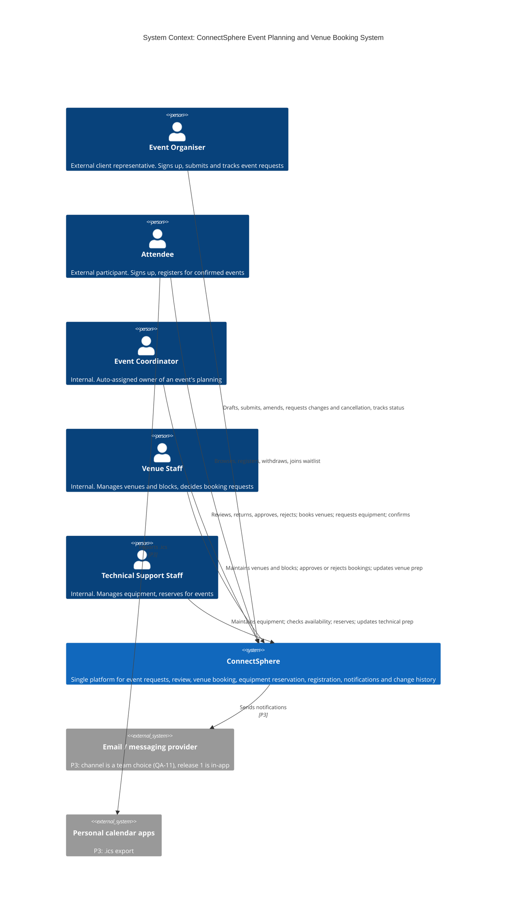
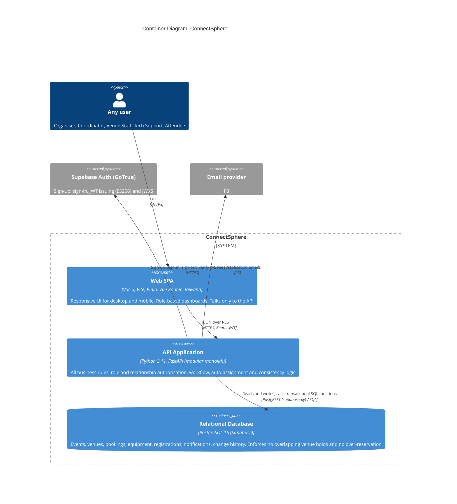
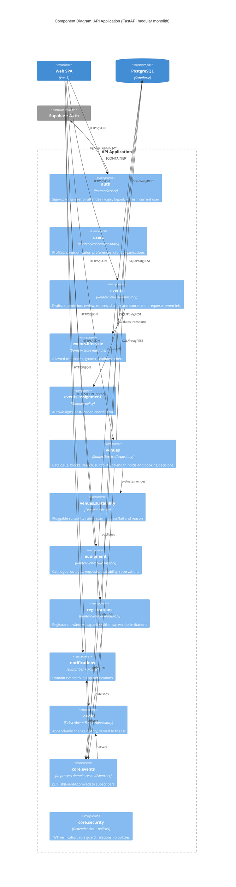
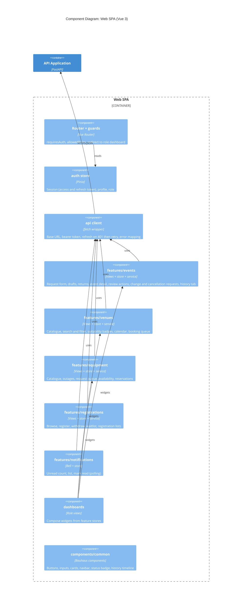
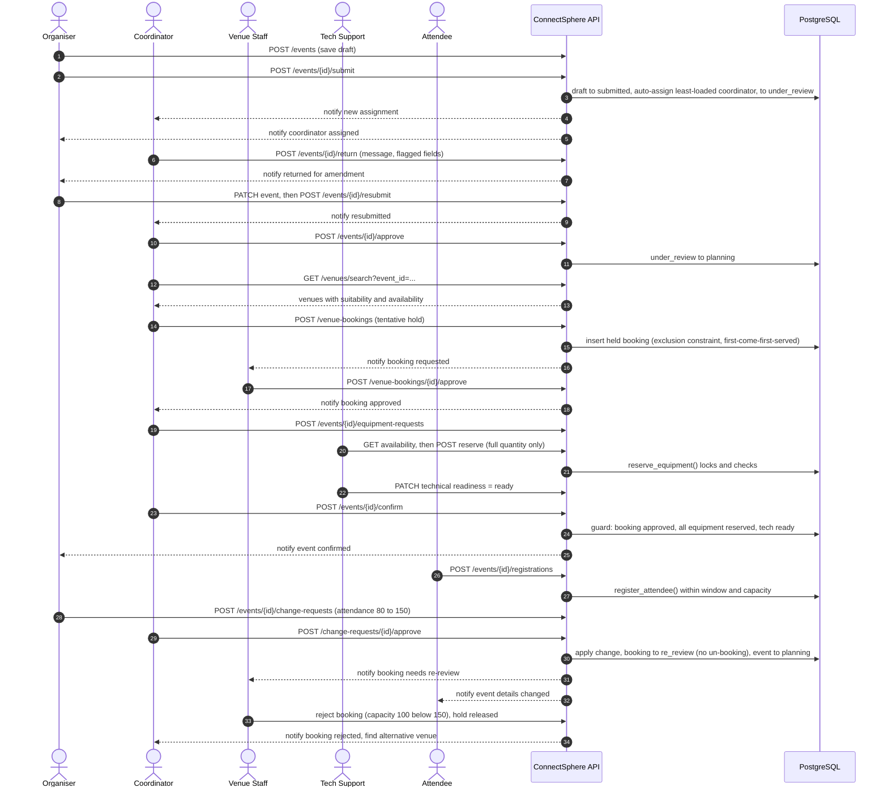
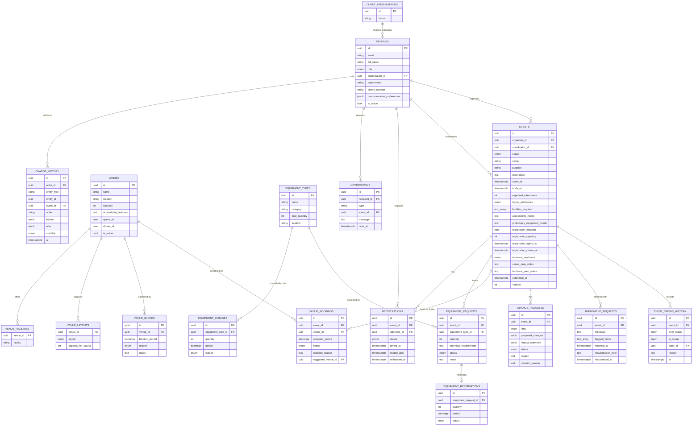
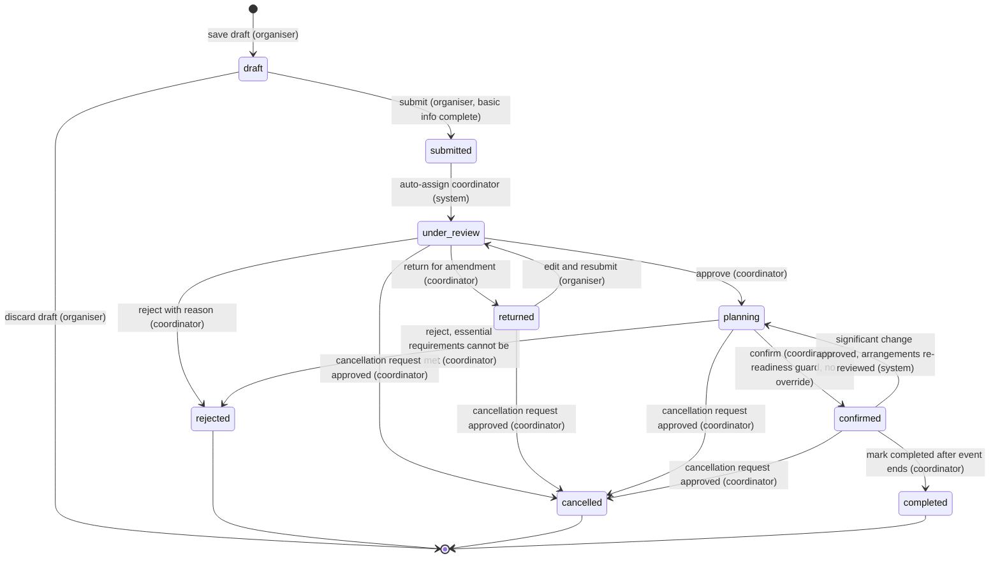

# ConnectSphere — Requirements & System Design

**Status:** living document, v0.2 (13 Sep 2026, Sprint 1). v0.2 applies the Session 1 customer clarifications.

`docs/SCENARIO.md` records what was *built*; this file records what the system *should do*. Update this file whenever the customer clarifies a rule.

**Sources, in priority order (latest clarification wins):**
1. **Session 1 Clarification Answers (G8)**, cited as **`QA-<row>`**, where `<row>` is the spreadsheet row number. For example, QA-18 is the "approved vs confirmed" answer.
2. **Week 4 Project Instructions**: the 20 core features for the Week 12 release, cited as **`W4`**.
3. **Week 1 Customer Briefing**: the full system vision, cited as **`W1 §n`**.

**Standing guidance from the prof:**
- **Change can come at any time and in any form, not only as new features.** The product backlog changes constantly, so the design must absorb new or changed rules without rework. This is why §3 favours configurable rules, a single state machine, and event-driven side effects.
- **Week 1 features that are not among the 20 core features stay in the product backlog at lower priority** (§8).

**How rules are labelled:**
- A rule with a `QA-`, `W4`, or `W1` citation is **customer-confirmed**.
- **[Team decision]**: the customer explicitly left this to us. We chose it, and it is ours to justify.
- **[Assumption]**: not yet answered by the customer. Each one is listed in §9 to ask at the next Q&A.

---

## Contents
1. [Scope and priorities](#1-scope-and-priorities)
2. [Roles, accounts and access rules](#2-roles-accounts-and-access-rules)
3. [System design (C4 model)](#3-system-design-c4-model)
4. [Domain model](#4-domain-model)
5. [Event lifecycle](#5-event-lifecycle)
6. [Core feature behaviour specifications](#6-core-feature-behaviour-specifications)
7. [Cross-feature consistency rules](#7-cross-feature-consistency-rules)
8. [Lower-priority backlog](#8-lower-priority-backlog)
9. [Open questions for the customer](#9-open-questions-for-the-customer)
10. [Non-functional requirements](#10-non-functional-requirements)
11. [Explicitly out of scope](#11-explicitly-out-of-scope)

---

## 1. Scope and priorities

| Priority | Meaning | Contents |
|---|---|---|
| **P1 (Core)** | Must work end-to-end by Friday of Week 12 | The 20 core features (§6) |
| **P2 (Enablers)** | Not listed as core features, but required by them or by explicit clarifications | Change history visible in the UI (QA-70) · coordinator auto-assignment engine (QA-5) · venue and equipment catalogue data entry · role dashboards (QA-51) · CI pipeline |
| **P3 (Backlog)** | Kept in the product backlog but not planned for release 1 | Week 1 features outside the core 20 (§8) |

The release is judged on **coherent end-to-end workflows** (W4). This is the reference workflow it must demonstrate:

1. Organiser drafts and submits a request.
2. **The system auto-assigns** a coordinator.
3. The coordinator reviews it and **returns it for amendment**; the organiser edits and resubmits.
4. The coordinator approves it, and planning begins.
5. The coordinator runs a venue search and suitability check, then submits a booking request, which **tentatively holds** the venue.
6. Venue staff approve the booking.
7. Equipment is requested and **fully reserved** by tech support.
8. Mandatory arrangements are complete, so the coordinator confirms the event.
9. Attendees register within the organiser's registration window.
10. The organiser requests a significant change, the coordinator approves it, and **venue and equipment go back to staff for re-review** (nothing is automatically un-booked). Everyone affected is notified.
11. Alternatively, the organiser requests cancellation, the coordinator approves it, reservations are freed, and attendees are notified.

---

## 2. Roles, accounts and access rules

### 2.1 Accounts

| Rule | Source |
|---|---|
| **ACC-R1:** There is **no system administrator role.** | QA-3 |
| **ACC-R2:** **Event Organisers and Attendees sign up themselves.** At sign-up they choose one of these two roles and nothing else. | QA-3, QA-4 |
| **ACC-R3:** **Internal staff accounts (Coordinator, Venue Staff, Tech Support) are system defaults**: created by seed or migration, never through sign-up. | QA-3 |
| **ACC-R4:** An account has exactly **one role**. A staff member who wants to attend an event uses a separate attendee account. **[Team decision]**, as dual-role capability was left to us (QA-15). | QA-15 |
| **ACC-R5:** An Organiser records an organisation name at sign-up, which links them to a client profile. ConnectSphere maintains client profiles. | QA-90 |
| **ACC-R6:** The authentication mechanism is a team choice. We use Supabase Auth with email and password. | QA-50 |

### 2.2 Access matrix

Access depends on **role** *and* on the user's **relationship to the event** (W4, W1 §8b). A role check alone is not enough.

| Capability | Event Organiser | Event Coordinator | Venue Staff | Tech Support | Attendee |
|---|---|---|---|---|---|
| Create, edit, or discard drafts | Own | – | – | – | – |
| Edit request after return for amendment | Own | – | – | – | – |
| View event (full planning detail) | Own events (QA-25) | Assigned events (full). Other non-draft events are searchable (QA-87). | Events with a booking on any venue (logistics view) | Events with equipment requests (logistics view) | – |
| View event (public info) | – | – | – | – | Confirmed events with registration enabled |
| Edit main event details | Via change request once reviewed (QA-81) | Assigned events (QA-25, QA-81) | Venue preparation section (QA-81) | Technical preparation section (QA-81) | – |
| Approve, return, reject, confirm, complete | – | Assigned coordinator (QA-21) | – | – | – |
| Request change or cancellation | Own events (QA-12) | – | – | – | – |
| Decide change or cancellation | – | Assigned coordinator (QA-12) | – | – | – |
| Venue catalogue, blocks | – | Read and search (W4) | Manage (QA-101, QA-104) | – | – |
| Submit venue booking request | – | Assigned coordinator (W4) | – | – | – |
| Approve or reject booking | – | – | Yes (W4, QA-137) | – | – |
| Equipment catalogue and outages | – | Read | – | Manage | – |
| Submit equipment request | Preliminary needs in the request form (QA-134) | Assigned coordinator (W4) | – | – | – |
| Check availability, reserve, reject equipment | – | Read | – | Yes (QA-8) | – |
| Registration settings (capacity, open/close dates) | Own events (QA-89) | Assigned events | – | – | – |
| Register, withdraw, join waitlist | – | – | – | – | Self |
| View registrations | Own events | Assigned events | – | – | Own |
| View change history | Own events (external-safe fields) | Assigned events | Their sections | Their sections | – |
| Notifications | Own | Own | Own | Own | Own |

**Rules**
- **AUTH-R1:** Organisers never see events of unrelated clients (QA-25, QA-87). **[Team decision]** An organiser sees only events they personally own, even within the same organisation. Cross-visibility inside an organisation was left to us (QA-25), and each request has exactly one organiser (QA-38, QA-119).
- **AUTH-R2:** External users (Organisers and Attendees) never see internal planning details (QA-51). That covers coordinator notes, booking and equipment state beyond "arranged / pending", staff preparation notes, and internal-only history entries.
- **AUTH-R3:** Sign-up metadata can never grant a staff role (ACC-R2, ACC-R3). *Today's trigger violates this; see PROJECT_REVIEW D2.*
- **AUTH-R4:** A request for an existing resource the caller has no relationship to returns `404` for external users (which avoids revealing that the resource exists) and `403` for internal staff. **[Team decision]**
- **AUTH-R5:** **Staff operate as pools.** All Venue Staff can act on all venues, and all Tech Support can act on all equipment requests. Allocation of staff to venues or clusters is not tracked (QA-44). Tech staff are a single pool with no skill tiers (QA-41).

---

## 3. System design (C4 model)

### 3.1 Level 1: System context



### 3.2 Level 2: Containers



**Container decisions**

| Decision | Choice | Why / trade-off |
|---|---|---|
| Architecture style | **Modular monolith**: one FastAPI deployable, one module per domain | A 6-person, 4-sprint team gets one build, one deploy, and in-process calls, while module boundaries stay explicit. A module can be extracted later for the three-year growth (W1 §8e). Microservices would cost more in operations than they return at this scale. The tech stack was left to us (QA-73, QA-74). |
| Authentication | **Supabase Auth**; the API verifies JWTs via JWKS | We don't hand-roll credential storage (QA-50 left the mechanism to us). Vendor coupling is kept to the `auth` module and `core/security.py`. |
| Authorisation | **The API is the single policy-enforcement point.** RLS is a deny-by-default safety net. | Relationship rules ("assigned coordinator", "own event") are easier to test and change in Python. Because the API uses the secret key, the policy checks in each module's service layer are the real security boundary. |
| Integrity | **Postgres guarantees** through an exclusion constraint on venue holds and locking SQL functions for reservations and registrations | The customer requires double-booking to be *impossible*, first-come-first-served, with no overrides (QA-10, QA-113). Check-then-insert in application code races under concurrent requests. |
| Frontend ↔ backend | The SPA calls **only** the API | There is one place for business rules. |

### 3.3 Level 3: Components of the API application



**Module rules**

- Each module keeps the `auth` layout (`router.py`, `schemas.py`, `service.py`, `dependencies.py`) and adds **`repository.py`**. The repository is the only file allowed to touch the Supabase client.
- **Modules never import each other's repositories.** A module reads another module's data through that module's service interface. Reactions to what happens in another module go through domain events. For example, `events` publishes `CancellationApproved`, and `venues` and `equipment` subscribe to free their reservations. This is the Observer pattern: a new customer rule becomes a new subscriber, not an edit to the publisher.
- **Pure domain logic** has no I/O. That covers the lifecycle, assignment policy, suitability rules, overlap and availability arithmetic, and change classification. It is unit-tested to 100%.

### 3.4 Level 3: Components of the Web SPA



### 3.5 Dynamic view: the reference end-to-end workflow



---

## 4. Domain model

This is the target schema. **Only `profiles` has been built so far.** It is 3NF, with UUID primary keys and `timestamptz` stored in UTC and displayed in Asia/Singapore.



**Integrity guarantees enforced in the database**

| ID | Guarantee | Implementation | Source |
|---|---|---|---|
| **DB-1** | **No two events hold or book the same venue for overlapping periods.** First-come-first-served, with no override. | `EXCLUDE USING gist (venue_id WITH =, occupied_period WITH &&) WHERE (status IN ('held','approved','re_review'))`, plus the `btree_gist` extension. `occupied_period = [starts_at, ends_at)`. Because the range is half-open and turnaround is zero, back-to-back events are allowed. | QA-6, QA-10, QA-113, QA-28, QA-62 |
| **DB-2** | An attendee has at most one active registration per event. | Partial unique index on `(event_id, attendee_id) WHERE status IN ('registered','waitlisted','invited')` | [Team decision] |
| **DB-3** | Registrations stop at capacity. | `register_attendee(event_id)` locks the event row, counts `registered`, and inserts `registered` or `waitlisted` | QA-107 |
| **DB-4** | **Reservations are full or nothing** and never exceed availability. | `reserve_equipment(request_id)` locks the equipment-type row, computes availability (§6.16), and reserves the full quantity or raises an error | QA-125, QA-7 |
| **DB-5** | Concurrent edits to an event are detected. | `events.version` optimistic lock | [Team decision] |
| **DB-6** | Records are never hard-deleted once submitted. | Submitted events, bookings, reservations, registrations, and history are soft-deleted or kept. Only never-submitted drafts can be discarded. | QA-123 |

**Design trade-off (equipment tracking):** the customer tracks equipment by type and quantity, though individual items do have IDs, and left the choice to us (QA-7). **[Team decision]** We track by **type + quantity**, with outages recorded as quantities over a period. This keeps availability a single arithmetic query, and it matches how the Week 4 brief phrases availability ("sufficient quantity"). If per-item tracking is needed later, an `equipment_items` table can be added under `equipment_types` without changing the reservation API.

---

## 5. Event lifecycle

**Status set.** The answers conflict. QA-18 says "approved" and "confirmed" refer to the same thing, with process statuses requested / planning / confirmed / completed. QA-56 lists Approved as "initial check passed" and Confirmed as "venue/tech ready". QA-21 lists *approve* and *confirm* as separate coordinator actions. **We reconcile them** by treating *approve* as the action that moves an event into **`planning`**, which the UI labels "Approved – planning". *Confirm* moves `planning` → `confirmed`. That gives two distinct actions (QA-21), a distinct "initial check passed" stage (QA-56), and no separate `approved` status (QA-18). This is §9 Q1 to confirm.



| Transition | Actor | Guard (all must hold) | Side effects (domain events) | Source |
|---|---|---|---|---|
| draft → submitted | Owner organiser | Basic info complete (§6.2) | `EventSubmitted` | QA-19, QA-24 |
| submitted → under_review | **System** | A coordinator exists (§6.5) | `CoordinatorAssigned`: notify coordinator and organiser | QA-5, QA-54 |
| under_review → returned | Assigned coordinator | Message not empty | `EventReturned`: notify organiser | QA-21, QA-22 |
| returned → under_review | Owner organiser | Basic info still complete; resubmission note | `EventResubmitted`: notify coordinator | QA-22, QA-77 |
| under_review → planning | Assigned coordinator | Status is `under_review` (so no open return) | `EventApproved`: notify organiser | QA-21, QA-22 |
| under_review / planning → rejected | Assigned coordinator | Reason not empty | `EventRejected`: notify organiser. From `planning`: frees any held or approved booking and reservations. | QA-23, QA-34, QA-83, QA-95 |
| planning → confirmed | Assigned coordinator | **Readiness (§6.6):** venue booking `approved`; every equipment request `reserved`; `technical_readiness = ready` or `not_required`. **No override.** | `EventConfirmed`: notify organiser, venue staff, tech support | QA-17, QA-49, QA-106, QA-118 |
| confirmed → planning | System | A significant change was approved (§6.19) | `EventReopened` | QA-2, QA-32, QA-98 |
| non-terminal → cancelled | Assigned coordinator, approving the organiser's cancellation request | An open cancellation request exists | `CancellationApproved`: free bookings and reservations, cancel registrations, notify everyone involved | QA-12, QA-33, QA-114 |
| confirmed → completed | Assigned coordinator **[Assumption]** | `now() ≥ ends_at` | `EventCompleted` | W1 Step 14 |

- **LC-R1:** Any transition not in the table returns `409 Conflict` with the message `"Cannot <action> an event that is <status>"`.
- **LC-R2:** Every transition writes `event_status_history` and a `change_history` entry, both **visible in the UI** (QA-70).
- **LC-R3:** Status display labels live in one mapping, so renaming "planning" is a one-line change.
- **LC-R4:** There are no SLA timers or forced review deadlines on any status (QA-55, QA-68).

---

## 6. Core feature behaviour specifications

Format: behaviour, business rules (with sources), edge cases, then acceptance criteria written as Given/When/Then. The acceptance criteria are meant to be copied into Jira and traced to tests (`TC-<AREA>-nnn` in `docs/TEST_CASES.md`).

### 6.1 User authorisation and authentication *(SCRUM-7; partly done by SCRUM-48)*

**Done:** email and password login, `/auth/me`, logout, role dashboard redirect, route guards.

**Remaining behaviour**
- **Sign-up** for Organisers and Attendees only (ACC-R2). Organisers also enter an organisation name and phone. Internal staff accounts are seeded (ACC-R3).
- **Logout** revokes only the caller's own session.
- **Session refresh:** on `401` for an expired token, the SPA calls `POST /auth/refresh` once and retries. If the refresh fails, it logs out with "Your session has expired, please log in again."
- **Relationship-based authorisation** (§2.2) is enforced by policy functions in every module.

**Acceptance criteria**
- **Given** I sign up choosing "Event Organiser", **then** my profile role is `event_organiser`. **Given** any sign-up request that asks for `event_coordinator`, `venue_staff`, or `tech_support`, **then** it is rejected or saved as `attendee`.
- **Given** users A and B are both logged in, **when** A logs out, **then** B's next request still succeeds.
- **Given** my access token has expired but my refresh token is valid, **when** I perform an action, **then** it succeeds without re-login.
- **Given** an organiser, **when** they request another organiser's event by ID, **then** they receive `404` and no data.

### 6.2 Event request creation *(SCRUM-8)*

**Fields** (QA-19, QA-24, QA-53, QA-134, QA-135)

| Field | Required to submit | Validation |
|---|---|---|
| name (event title) | ✔ (QA-24) | 3–150 characters |
| purpose | ✔ (QA-19) | 1–500 characters |
| description | – | ≤ 5000 characters |
| event date + start time + end time (**one date per request**, QA-135) | ✔ (QA-19, QA-24: "preferred dates/times", "duration") | `starts_at` not in the past; `ends_at` > `starts_at`. **No minimum or maximum lead time** (QA-80, QA-91). |
| expected_attendance (pax) | ✔ (QA-19, QA-24) | Integer ≥ 1 |
| layout_preference and venue requirements (location preference, required facilities) | ✔ layout (QA-24: "primary venue/layout preferences") | Layout from a controlled list; facilities from a controlled list |
| accessibility_needs | – (QA-53) | ≤ 1000 characters |
| preliminary_equipment_needs | – (QA-134) | Free text, refined later by coordinator and tech support |
| registration_enabled | – (QA-53) | Boolean, default false |
| registration_capacity, registration_opens_at / closes_at | ✔ if registration is enabled (QA-89) | 1 ≤ capacity; opens < closes ≤ `starts_at` |

**Rules**
- **ER-R1:** Submit validates everything and returns **all** field errors at once.
- **ER-R2:** On submit, the system auto-assigns a coordinator in the same operation (§6.5).
- **ER-R3:** After submission the organiser can't edit directly. They edit only when the request is **returned** (§6.4), or they raise a change request (§6.19). Organisers who "submit and request amendments later" follow this route (QA-94).
- **ER-R4:** Submitting an already-submitted event returns `409`, so a double-click can't create a duplicate.

**Acceptance criteria**
- **Given** a valid draft with title, purpose, date and times, pax, and layout, **when** I submit, **then** its status becomes `under_review`, a coordinator is assigned, both the coordinator and I are notified, and I see my coordinator's name.
- **Given** a draft missing pax and layout, **when** I submit, **then** both field errors show and the status stays `draft`.
- **Given** end time ≤ start time, **when** I submit, **then** I see "End time must be after start time."
- **Given** an event date one day from now, **when** I submit, **then** it is accepted (no lead-time rule).

### 6.3 Draft event requests *(SCRUM-9, SCRUM-65)*

**Rules**
- **DR-R1:** Only `name` is needed to save a draft. Other fields may be partial (QA-94).
- **DR-R2:** Drafts are visible only to their owner and never appear in staff queues, searches, or counts.
- **DR-R3:** Drafts can be edited repeatedly and **discarded**. Discarding is the only deletion allowed (DB-6).
- **DR-R4:** Drafts are clearly distinguishable from submitted requests (W4). **[Team decision]** "My events" has separate Drafts and Requests tabs with status badges. The UI presentation was left to us (QA-52).

**Acceptance criteria**
- **Given** only a title entered, **when** I click "Save draft", **then** it's saved under Drafts with a "Draft" badge.
- **Given** I log out and back in, **when** I open the draft, **then** my values are intact and editable.
- **Given** any staff user, **when** they view any queue or search, **then** no drafts appear.
- **Given** a submitted request, **then** there is no discard option.

### 6.4 Event review and approval *(SCRUM-11: 33, 34, 49, 52)*

**Behaviour**
- The assigned coordinator sees every field, the organiser's profile and organisation, and the organiser's past events.
- **Criteria:** the coordinator evaluates feasibility from attendance, date and time, venue, and equipment availability (QA-23). The review screen shows a venue-availability summary and an equipment-availability summary for the requested date to support that decision.
- **Return for amendment:** the coordinator writes a message and optionally flags fields. The status becomes `returned`. The organiser sees the message with the flagged fields highlighted, **edits the existing request (any field)**, adds a resubmission note, and resubmits. The status goes back to `under_review` with the **same coordinator** (QA-22, QA-34, QA-77).
- **Planning continues only after all requirements are gathered** (QA-22). While an event is `returned`, no venue booking or equipment request can be created.
- **Approve** moves `under_review` → `planning`.
- **Reject** requires a reason, closes the request permanently (`rejected`), and can't be resubmitted (QA-34, QA-95). The organiser sees the reason.

**Edge cases**
- A non-assigned coordinator gets `403`.
- Approve or reject while `returned` returns `409`.
- A whitespace-only reason is blocked.
- The request can be returned more than once; every return and resubmission appears in history.

**Acceptance criteria**
- **Given** an under-review event assigned to me, **when** I return it with a message flagging "expected attendance", **then** the status is `returned`, the organiser is notified, and the flagged field is highlighted for them.
- **Given** a returned request, **when** the organiser edits the attendance and resubmits with a note, **then** the status is `under_review`, I'm still the coordinator, and I'm notified.
- **Given** a returned request, **when** I try to create a venue booking for it, **then** I'm blocked with "Requirements are still being amended."
- **Given** I reject with a reason, **then** the organiser sees "Rejected" with the reason, and no resubmit option exists.

### 6.5 Coordinator assignment *(SCRUM-12, SCRUM-68)*

**Automatic assignment** (QA-5, QA-54, QA-79). Coordinators don't claim requests and no manager exists (QA-3).

- **AS-R1:** On submission, the system assigns the **least-loaded active coordinator**. Load is the number of assigned events in `under_review`, `returned`, `planning`, or `confirmed`. Ties go to whoever was least recently assigned, then to the lowest ID. **[Team decision]** QA-54 says "by system load/availability", and schedules are out of scope (QA-14), so load is the measure.
- **AS-R2:** **Strictly at most one coordinator per event** (QA-5).
- **AS-R3:** Assignment and the status change happen in one transaction, with a lock on the choice, so a burst of submissions spreads across coordinators instead of all going to the same one.
- **AS-R4 (reassignment, W4):** the assigned coordinator selects "Hand over" with a reason. The system re-runs AS-R1, **excluding** that coordinator, and notifies the new coordinator, the previous one, and the organiser. When a coordinator account is deactivated, all of their non-terminal events are reassigned the same way. **[Assumption]** (§9 Q2)
- **AS-R5:** If no active coordinator exists, the event stays `submitted` and appears in an "Awaiting assignment" alert on every coordinator dashboard. The next coordinator activation, or the next submission, triggers assignment. **[Team decision]**
- **AS-R6:** After a handover, the previous coordinator immediately loses action rights (read-only).

**Acceptance criteria**
- **Given** coordinators A (3 active events) and B (1 active event), **when** an organiser submits, **then** B is assigned.
- **Given** A and B both have 2 active events and B was assigned most recently, **when** an organiser submits, **then** A is assigned.
- **Given** 10 simultaneous submissions and 2 equally loaded coordinators, **then** each event has exactly one coordinator, and the split is 5/5 (±1).
- **Given** I hand over an event, **then** another coordinator is assigned, all three parties are notified, and I get `403` on actions.

### 6.6 Event status management and readiness *(SCRUM-13: 65, 68)*

See §5 for the state machine.

**User-facing behaviour**
- A status badge with a plain-language explanation, for example "Approved – planning: your coordinator is arranging venue and equipment" (W1 §7).
- A **status timeline** from `event_status_history`.
- Action buttons derived from the transitions allowed for *this user*.

**Readiness** (QA-17, QA-49, QA-106, QA-118, QA-127, QA-128). An **Arrangements panel** on the event shows:

| Item | Ready when | Who updates it |
|---|---|---|
| Venue | Booking status `approved` | Venue staff, by approving the booking (QA-128) |
| Equipment | Every equipment request `reserved`, or there are no requests | Tech support, by reserving |
| Technical readiness | `technical_readiness` is `ready` (or `not_required` when the event has no equipment or technical needs) | Tech support set it explicitly (QA-128) |
| Programme, registration setup | Shown for information only; **not blocking** (QA-17, QA-133) | Organiser or coordinator |

- **RD-R1:** "Confirm" is enabled only when every blocking item is ready. **No override** (QA-118).
- **RD-R2:** Venue staff may add venue preparation notes, and tech support may add technical preparation notes (QA-81). These notes are internal only (AUTH-R2).

**Acceptance criteria**
- **Given** an approved booking and all equipment reserved, but technical readiness not set, **when** I try to confirm, **then** confirmation is blocked with "Technical readiness not marked ready."
- **Given** all blocking items are ready, **when** I confirm, **then** the status is `confirmed`, and the organiser, venue staff, and tech support are notified.
- **Given** any API call that attempts a transition not in §5, **then** it returns `409` and the status is unchanged.

### 6.7 Event information management and change history *(SCRUM-14: 62; QA-70)*

**Field classification** (QA-13, QA-66, W4). This is configuration held in one place.
- **Significant:** date and time (including duration), expected attendance, venue requirements (layout, facilities, location), equipment requirements. There is no numeric threshold: *any* change to these fields is significant (QA-66).
- **Ordinary:** name, purpose, description, accessibility notes, internal notes. The customer lists accessibility as a suitability *parameter* rather than a significant change (QA-27, QA-66), so it is ordinary. **[Team decision]**

**Who edits what, by status** (QA-25, QA-81, QA-2)

| Status | Organiser | Assigned coordinator | Venue staff / Tech support |
|---|---|---|---|
| draft | Everything | – | – |
| submitted / under_review | Change request only | Ordinary fields directly | – |
| returned | Everything (resubmit) | – | – |
| planning | Change request only | Ordinary fields directly. Significant fields **directly, with an impact confirmation dialog**; the same re-review rules as §6.19 apply. | Their preparation sections |
| confirmed | Change request only | Ordinary fields directly. Significant fields only by approving a change request (post-confirmation changes need re-request/review, QA-2). | Their preparation sections |
| terminal | Read-only | Read-only | Read-only |

**Change history** is visible in the UI (QA-70, W1 §8f):
- **IM-R1:** Every create, update, status change, decision, and preparation update writes `change_history` with actor, timestamp, and before/after values.
- **IM-R2:** A **History tab** on each event lists entries newest first, filterable by field and by actor. External users see only entries marked `external` (status changes, their own edits, decisions with reasons). Staff see everything (AUTH-R2).
- **IM-R3:** Concurrent edits use optimistic locking (DB-5). A stale write returns `409` with "This event was updated by someone else. Reload."

**Acceptance criteria**
- **Given** a planning event, **when** the coordinator edits the description, **then** it saves and the History tab shows the old and new value, the coordinator's name, and the time.
- **Given** a confirmed event, **when** the coordinator tries to PATCH `starts_at` directly, **then** it's rejected with "Changes to a confirmed event need a change request."
- **Given** an organiser viewing History, **then** internal preparation notes and staff-only entries are not shown.

### 6.8 Venue catalogue *(SCRUM-15: 63, 64, 67; view part of 39)*

**Behaviour**
- Venue staff create, edit, deactivate, and reactivate venues (QA-101). Coordinators can browse and search them (W4).
- Attributes: name, location (Singapore), capacity, capacity per layout, supported layouts, facilities, accessibility features, operating hours, and active flag (QA-43, W4).
- **One venue hosts one event at a time** (QA-116). There are no separately bookable sub-rooms or shared spaces (QA-130).

**Rules**
- **VC-R1:** Inactive venues are excluded from search and suitability but remain visible on historic bookings, labelled "Inactive".
- **VC-R2:** Changing capacity, facilities, layouts, or operating hours does **not** automatically change existing bookings (QA-117). The system **lists upcoming bookings that may be affected** in a warning before saving, and after saving notifies those events' coordinators and venue staff. Resolution is manual.
- **VC-R3:** Every edit is recorded in history (§6.7).

**Acceptance criteria**
- **Given** Hall A has an approved booking for 120 pax, **when** venue staff set its capacity to 100, **then** a warning names the affected event before save. After save, the booking is unchanged and the event's coordinator is notified.
- **Given** I deactivate a venue, **then** it no longer appears in search results.

### 6.9 Venue availability calendar *(SCRUM-16: 57, 51, 54)*

**Behaviour**
- Coordinators and venue staff (W4) see a calendar per venue with three distinguishable entry types: **approved booking**, **tentative hold** (a pending request, QA-6), and **block** (with its reason). The exact UI is left to the team (QA-60, QA-61). **[Team decision]** Day, week, and month views, colour plus a pattern for each type.
- **Blocks:** venue staff create a block with a period and reason (maintenance, renovation, safety, internal activity, other). They can shorten or end it early. Blocks show on the calendar (QA-104).

**Rules**
- **CAL-R1:** A block **may** overlap an existing hold or booking, because emergencies happen (QA-102). Saving shows a warning listing the affected events. After saving, those coordinators and venue staff are notified. **Bookings are not automatically cancelled**; resolution is manual (QA-26, QA-97, QA-102).
- **CAL-R2:** A block's end is exclusive. The venue is available from that instant.
- **CAL-R3:** A blocked period makes the venue unavailable for *new* holds (§6.14).

**Acceptance criteria**
- **Given** Hall A is blocked 1–3 Oct for maintenance, **when** a coordinator views October, **then** 1–3 Oct shows as blocked with the reason, and search excludes Hall A for those dates.
- **Given** a confirmed event in Hall A on 2 Oct, **when** venue staff add that block, **then** they see a warning naming the event, the coordinator is notified, and the booking remains `approved` until someone acts on it.

### 6.10 Venue search and filtering *(new story; currently inside SCRUM-39)*

**Behaviour**
- Filters (W4, QA-59): date and time (pre-filled from the event), minimum capacity (pre-filled from pax), location, layout, required facilities, accessibility features.
- Each result shows capacity, layouts, facilities, a **suitability** badge (§6.11), and an **availability** badge.
- Default sort: suitable → suitable with warnings. A "Show unavailable/unsuitable" toggle reveals excluded venues together with the reasons.

**Rules**
- **VS-R1:** By default, results include only venues that are active, have no hard-rule failure, and have no hold, booking, or block overlapping `[starts_at, ends_at)`. **No setup or turnaround buffer** is applied (QA-28, QA-82, QA-93, QA-103).
- **VS-R2:** Results come back in reasonable time. There is no numeric SLA (QA-29); see NFR-P1 for our own target.

**Acceptance criteria**
- **Given** an event on 10 Oct 14:00–17:00 for 150 pax needing a projector, **when** I search with the pre-filled filters, **then** only active venues with capacity ≥ 150, a projector, and no hold, booking, or block overlapping 14:00–17:00 are listed.
- **Given** Hall B has a booking 11:00–14:00 on that day, **then** Hall B *is* listed (back-to-back is allowed).
- **Given** I enable "Show unavailable", **then** excluded venues appear with reasons such as "Capacity 100 < 150" or "Held by another event 13:00–16:00".

### 6.11 Venue suitability checking *(SCRUM-18)*

This is a pure function, `evaluate(event, venue) -> [RuleResult]`, with one class per rule (Strategy/Specification pattern), so new rules plug in.

| Rule | Type | Fails when | Source |
|---|---|---|---|
| Capacity | **Hard (absolute)** | pax > capacity (per-layout capacity if defined) | QA-27, W4 |
| Required facilities | **Hard** | Any required facility is missing | W4 ("…or a required facility is unavailable") |
| Active | **Hard** | The venue is inactive | VC-R1 |
| Layout supported | Parameter (warning) | The preferred layout isn't supported | QA-27 |
| Accessibility | Parameter (warning) | The event lists needs and the venue has no matching feature recorded | QA-27 |
| Operating hours | Parameter (warning) | The event time falls outside operating hours | QA-27 |
| Turnaround / setup | **Not applied** | – | QA-28, QA-82, QA-103 |

- A venue is **Suitable** when every rule passes, **Suitable with warnings** when only parameter rules fail, and **Unsuitable** when any hard rule fails. Every result lists its reasons.
- **Availability is reported separately** (§6.14), so "wrong room" and "right room, wrong time" stay distinguishable.

**Acceptance criteria**
- **Given** pax 150 and capacity 100, **then** the result is Unsuitable with "Capacity 100 is below expected attendance 150."
- **Given** pax exactly equal to capacity, **then** the capacity rule passes (boundary).
- **Given** the theatre layout is unsupported but everything else passes, **then** the result is "Suitable with warnings: theatre layout not supported."
- **Given** a projector is required and the venue has none, **then** the result is Unsuitable.

### 6.12 Venue booking request and tentative hold *(SCRUM-19)*

**Behaviour**
- For an event in `planning`, the assigned coordinator selects a venue from search and submits a booking request, optionally with a note for venue staff.
- **Submitting the request creates a tentative hold** (status `held`) for `[starts_at, ends_at)` (QA-6). Venue staff then decide on it (§6.13).

**Rules**
- **BR-R1:** **One venue per event** (QA-116, QA-135). An event can have at most one booking in `held`, `approved`, or `re_review`. To try another venue, the coordinator cancels the current hold first.
- **BR-R2:** **Two events can't hold the same venue for overlapping times** (QA-6). The first request wins (QA-10, QA-113); later requests are refused with "Venue already held for this time by another event." There is no override (QA-10). DB-1 guarantees this under concurrency.
- **BR-R3:** Requests for Unsuitable venues (a hard-rule failure) are refused. Venues with warnings are allowed after the coordinator acknowledges the warnings.
- **BR-R4:** Holds have **no expiry** (QA-6). **[Team decision]** Venue staff dashboards sort pending holds by age so old ones get attention.
- **BR-R5:** The coordinator can cancel a `held` or `approved` booking, which releases the slot and notifies venue staff.
- **BR-R6:** A booking request can't be made while the event is `under_review` or `returned` (QA-22).

**Acceptance criteria**
- **Given** a planning event and a suitable, free venue, **when** I request it, **then** a `held` booking exists, the calendar shows a tentative hold, and venue staff are notified.
- **Given** event X holds Hall A 14:00–17:00, **when** another coordinator requests Hall A 16:00–18:00 for event Y, **then** it's refused with the conflict message.
- **Given** two coordinators submit overlapping requests for Hall A at the same instant, **then** exactly one hold is created.

### 6.13 Venue booking approval *(SCRUM-20: 36, 38, 47)*

**Behaviour**
- Venue staff see a queue that defaults to `held` and `re_review`, oldest first. It can be filtered by status, venue, date range, and waiting time.
- The detail page shows event timing, pax, layout, facilities, accessibility, and the calendar around the slot.
- **Approve:** `held` → `approved`.
- **Reject:** a reason is required, chosen from a list (unavailable, unsuitable layout, capacity exceeded, operational, other) plus free text. Venue staff can optionally **suggest an alternative venue or arrangement** (QA-137). Rejection releases the hold.
- **No partial approval**, such as approving the date but not the layout (QA-137).

**Rules**
- **BA-R1:** Because holds are already exclusive (DB-1), approval can't create a double booking.
- **BA-R2:** The rejection reason and any suggestion are shown to the coordinator. A suggested venue opens pre-selected in search.
- **BA-R3:** Approving updates the event's Venue readiness item (§6.6).

**Acceptance criteria**
- **Given** a held booking, **when** I approve it, **then** it's `approved`, the calendar shows it as booked, and the coordinator is notified.
- **Given** I reject without a reason, **then** the action is blocked.
- **Given** I reject with "Capacity exceeded" and suggest Hall B, **then** the hold is released, and the coordinator sees the reason plus a link to Hall B.

### 6.14 Booking conflict detection *(SCRUM-21)*

**Definition** (QA-62): two venue reservations are **incompatible** when they are for the same venue and their `[starts_at, ends_at)` ranges overlap. Turnaround is zero (QA-28). Holds (`held`), approved bookings, and bookings under re-review all occupy the venue. Blocks make the venue unavailable.

| Case | Result |
|---|---|
| A 09:00–12:00, B 12:00–15:00 | Compatible (half-open ranges, zero turnaround) |
| A 09:00–12:00, B 11:59–13:00 | Conflict |
| A `held`, B requested overlapping | B refused (first-come-first-served) |
| A `approved`, B requested overlapping | B refused |
| A `rejected`, `cancelled`, or `released` | Ignored |
| Request overlaps a block | Refused ("Venue blocked: maintenance") |
| Overlap on a different venue | Compatible |
| A `re_review`: the event changed date and the new window overlaps B's hold | Venue staff can't re-approve A for the new window; they must reject it (QA-113, first-come-first-served) |

Conflicts are checked when **searching** (as a filter), when **requesting** (DB-1), when **re-reviewing after a change** (DB-1 on the period update), and when **blocking** (a warning, CAL-R1).

**Acceptance criteria:** one automated test per table row, plus the concurrency test in §6.12.

### 6.15 Equipment request management *(SCRUM-22: 45, 40, 41, 44)*

**Behaviour**
- The organiser's **preliminary equipment needs** (free text) are shown to the coordinator (QA-134).
- For an event in `planning`, the assigned coordinator turns those needs into **request lines**: an equipment type from the catalogue, a quantity, and technical requirements.
- Tech support see a queue of pending lines across upcoming events, sortable by event date, event name, and type.
- Formal cross-department approval happens offline. In the system, tech support **review and reserve** (QA-8).

**Line statuses:** `pending` → `reserved` (full quantity) **or** `rejected` (with reason). A line enters `re_review` after a significant change, and becomes `released` when the event is cancelled, rejected, or completed.

**Rules**
- **EQ-R1:** A quantity above the type's **total** inventory shows an immediate warning ("Only 20 exist") but can still be submitted. Window-specific availability is checked by tech support (§6.16).
- **EQ-R2:** **All or nothing:** a line is fully reserved or rejected, never partially filled (QA-125).
- **EQ-R3:** Rejection requires a reason and notifies the coordinator. What happens next is manual negotiation (QA-83): the coordinator may edit the line (for example, lower the quantity, which returns it to `pending`), remove it, or reject the event if essential requirements can't be met (§5).
- **EQ-R4:** The coordinator can edit or delete `pending` lines. Editing a `reserved` line **doesn't release it automatically**; the line goes to `re_review` and keeps its reservation until tech support re-reserve or reject it (QA-2 principle: no automatic un-booking).
- **EQ-R5:** No lead-time restriction applies to requests (QA-105).

**Acceptance criteria**
- **Given** a planning event, **when** I add 4 × wireless microphone, **then** a pending line appears in the tech support queue and they're notified.
- **Given** a reserved line of 4, **when** I change it to 6, **then** the line is `re_review`, the 4 units stay reserved, and tech support are notified.
- **Given** tech support reject a line with "Only 3 available", **then** I'm notified with the reason, and the event can't be confirmed.

### 6.16 Equipment availability checking *(SCRUM-23)*

For an equipment type and the event window W = `[starts_at, ends_at)`:

```
available(type, W) = total_quantity
                   − max concurrent outage quantity overlapping W       (damaged / maintenance)
                   − max concurrent reserved quantity overlapping W     (reservations with status reserved or re_review)
```

- Equipment has **no transit, setup, or teardown time** (QA-126). "Incompatible" means the same limited equipment is committed to overlapping events (QA-62).
- **AV-R1:** The result shows **Sufficient** (available ≥ requested) or **Insufficient**, with a breakdown: "Requested 6 · Available 4 (20 total, 2 in maintenance, 14 reserved by 3 overlapping events)". The overlapping events are listed for tech support only.
- **AV-R2:** Availability uses the **worst moment** within W. Using the maximum concurrent usage, rather than a simple sum, avoids undercounting when overlapping reservations don't overlap each other.

**Acceptance criteria**
- **Given** 20 projectors, 2 in maintenance, and 14 reserved by an overlapping event, **when** I check 6, **then** the result is "Insufficient: 4 available."
- **Given** the same data and a non-overlapping window, **then** 18 are available.
- **Given** reservations of 10 at 09:00–11:00 and 10 at 11:00–13:00 and a window of 09:00–13:00, **then** 10 are available, not 0 (worst moment).
- Boundary: requested equal to available is "Sufficient".

### 6.17 Equipment reservation *(SCRUM-24)*

**Behaviour:** from a pending line, tech support click **Reserve**. `reserve_equipment` (DB-4) runs atomically. On success, the line is `reserved` and the coordinator is notified. When all equipment is arranged, tech support set **technical readiness = ready** (§6.6, QA-128).

**Rules**
- **RS-R1:** A reservation immediately reduces availability for overlapping windows, and stays linked to its event (W4).
- **RS-R2:** Simultaneous reservations are first-come-first-served (QA-113). Two reservations that together exceed availability can't both succeed.
- **RS-R3:** Reservations are **freed** only when the event is cancelled (QA-33), rejected, or completed, or when a line is deleted or rejected. They are **never auto-released** because of a change (QA-2, QA-32).
- **RS-R4:** If an outage (damage or maintenance) drops availability below what's already reserved, reservations are kept, affected events show "Equipment issue", and tech support and coordinators are notified. There is no automatic substitution (QA-31).

**Acceptance criteria**
- **Given** 5 available, **when** two tech staff simultaneously reserve 3 for two overlapping events, **then** exactly one succeeds and the other sees "Insufficient: 2 available."
- **Given** a confirmed event with reserved equipment, **when** its cancellation is approved, **then** the equipment is available again for that window.
- **Given** 10 projectors are reserved and 3 break (outage), **then** reservations are unchanged, and tech support and the coordinator are notified of the shortfall.

### 6.18 Attendee registration *(SCRUM-25: 43, 55, 56, 35, 59)*

**Settings** (organiser, per event, QA-89, QA-108, QA-136): registration enabled, capacity, opens-at, closes-at, withdrawal allowed until (default: event start), re-registration allowed (default: yes). **[Team decision]** Withdrawal and re-registration were left "at the organiser's discretion", so they are per-event settings.

**Registration fields** are a team choice (QA-84). We collect name, email, and phone from the profile, plus optional accessibility and dietary notes. Registration is a web form behind login; QR codes and shareable links are P3 (QA-64, QA-85).

**Behaviour**
- Attendees browse `confirmed` events with registration enabled that haven't started. They see public information only (AUTH-R2).
- **Register** shows the result immediately: "Registered", "Waitlisted", "Registration not open yet", or "Registration closed".
- **My registrations** separates upcoming and past events.
- **Withdraw** is allowed until the withdrawal cutoff.
- Organisers (own events) and assigned coordinators see registered, waitlisted, and withdrawn counts, remaining places, and the attendee list.

**Rules**
- **RG-R1:** Registration is possible only when the event is `confirmed`, registration is enabled, and now is between `opens_at` and `closes_at` (QA-89, W1 Step 11).
- **RG-R2:** **Registrations stop at capacity** (QA-107). Capacity is enforced atomically (DB-3).
- **RG-R3:** A duplicate active registration is refused (DB-2). Re-registering after withdrawal is allowed only if the event setting permits it (QA-136).
- **RG-R4:** When the event is cancelled, registrations are cancelled and attendees notified (QA-114). When the event is rescheduled, attendees **stay registered** and are notified. **[Team decision]** Reconfirmation was left to us (QA-124).
- **RG-R5 (waitlist; P3 but specified by the customer):**
  - A registration made when the event is full becomes `waitlisted`, in first-come-first-served order (QA-9, QA-129).
  - When a place frees up, the **earliest waitlisted attendee is notified and invited** (`invited`, `invited_until = now + 24h`). They are **not registered automatically** (QA-30, QA-40, QA-78).
  - If they don't accept by `invited_until`, the invitation passes to the next waitlisted attendee. **[Team decision]** The 24-hour window was left to us (QA-121).
  - While an invitation is open, that place is reserved for the invitee.

**Acceptance criteria**
- **Given** capacity 50 with 49 registered, **when** two attendees register simultaneously, **then** exactly one is `registered` and the other is `waitlisted`.
- **Given** registration opens tomorrow, **when** I try to register, **then** I see "Registration opens on <date>."
- **Given** I'm registered, **when** I withdraw before the cutoff, **then** a place frees up and I see a withdrawal confirmation. If someone is waitlisted, they're invited and notified, and not registered automatically.
- **Given** an organiser of event X, **when** they open event Y's registrations, **then** they receive `404`.

### 6.19 Event change requests *(SCRUM-26: 32, 37)*

**Kinds:** **change** or **cancellation**. The organiser can request either at any time after submission (QA-12). The assigned coordinator decides.

**Behaviour**
- The organiser opens "Request a change", edits the proposed values, and gives a reason.
- The system classifies the change (§6.7) and computes an **impact preview**:
  - whether the current venue is still suitable for the new pax, layout, or facilities;
  - whether the new time conflicts with another hold or a block;
  - equipment shortfalls in the new window;
  - how many registered attendees will be notified.
- The coordinator sees current vs proposed values and the impact, then approves or rejects with a reason.

**On approval of a significant change** (QA-2, QA-32, QA-98, QA-117)
- New values are applied in one transaction and recorded in history.
- **Nothing is un-booked automatically.** The venue booking and affected equipment lines move to **`re_review`**, keeping their hold or reservation, and venue staff and tech support are notified to review again against the new details.
  - **Venue re-review:** venue staff *approve* (the booking period moves to the new window, re-checked by DB-1) or *reject* with a reason, which releases the hold. Capacity overflow is absolute and must be rejected (QA-27).
  - **Equipment re-review:** tech support *re-reserve* for the new window (full quantity) or *reject*.
- If the event was `confirmed`, it returns to **`planning`** and must be re-confirmed after re-review (readiness guard).
- Registered attendees are notified of date, time, or venue changes (RG-R4).

**On approval of an ordinary change:** values are applied, with no re-review and no status change.

**On approval of a cancellation:** the event becomes `cancelled`; the booking and reservations are **freed** (QA-33); registrations are cancelled; everyone involved is notified (QA-114). Financial handling is out of scope (QA-36).

**Rules**
- **CR-R1:** An event has at most one open request of each kind. A cancellation request supersedes (closes) an open change request. **[Team decision]**
- **CR-R2:** The impact is recomputed at approval time, because other bookings may have changed.
- **CR-R3:** Rejection requires a reason, and the organiser is notified.
- **CR-R4:** Requests are refused on `draft` (edit directly), `rejected`, `cancelled`, and `completed` events.

**Acceptance criteria**
- **Given** a confirmed event in Hall A (capacity 100), **when** the organiser proposes 150 pax, **then** the coordinator's preview shows "Venue capacity 100 < 150: venue re-review required."
- **Given** that change is approved, **then** pax = 150, the booking is `re_review` (still holding Hall A), the event is `planning`, venue staff are notified, and the booking is **not** released until venue staff reject it.
- **Given** a change moving the event to a time when Hall A is held by another event, **when** venue staff try to re-approve, **then** it fails with the conflict message, and they must reject.
- **Given** a confirmed event with 30 registrations and reserved equipment, **when** its cancellation is approved, **then** the booking and equipment are freed, registrations are cancelled, and 30 attendees are notified.

### 6.20 Notification system *(SCRUM-27: 69, 53)*

The delivery channel is a team choice (QA-11, QA-39). **[Team decision]** Release 1 is **in-app**: a bell with an unread count (polling every 30 seconds), a list, mark-read and mark-all-read, and deep links. Email is P3, delivered by a second subscriber on the same domain events. The `communication_preferences` profile field (SCRUM-50) records the preferred channel for when email is added (QA-46).

| Domain event | Recipients | Source |
|---|---|---|
| CoordinatorAssigned / HandedOver | Organiser; new coordinator; previous coordinator | QA-5 |
| EventReturned / EventResubmitted | Organiser / coordinator | QA-22 |
| EventApproved / EventRejected (with reason) | Organiser (+ venue staff and tech support if holds were freed) | W1 §6 |
| VenueBookingRequested | Venue staff | W1 §6 |
| VenueBookingApproved / Rejected | Coordinator | W1 §6 |
| EquipmentRequested / LineChanged | Tech support | W1 §6 |
| EquipmentReserved / Rejected | Coordinator | W1 §6 |
| EventConfirmed | Organiser; venue staff; tech support | W1 §6 |
| ChangeRequested / CancellationRequested | Coordinator | QA-12 |
| ChangeApproved / Rejected | Organiser (+ venue staff and tech support when re-review is needed) | QA-2 |
| ArrangementNeedsReReview | Venue staff / tech support | QA-32 |
| EventDetailsChanged (date, time, venue) | Registered attendees | QA-124 |
| EventCancelled | Organiser; coordinator; venue staff; tech support; registered attendees | QA-114 |
| VenueChangedAffectsBooking / VenueBlockedAffectsBooking | Affected coordinators; venue staff | QA-26, QA-117 |
| EquipmentOutageAffectsReservation | Tech support; affected coordinators | QA-31 |
| RegistrationFull | Organiser; coordinator | W1 §6 |
| WaitlistInvitation | The invited attendee | QA-30 |

**Rules**
- **NT-R1:** The actor is never notified of their own action.
- **NT-R2:** Notification text never exposes information the recipient's role can't see (AUTH-R2).
- **NT-R3:** A notification is created in the same transaction as its action (or through an outbox table), so an action never succeeds without its notification.

**Acceptance criteria**
- **Given** a coordinator approves an event, **then** the organiser's unread count increases within 30 seconds, and clicking the notification opens the event.
- **Given** I perform an action myself, **then** I receive no notification for it.

### 6.21 Role dashboards *(P2; SCRUM-70–73 in Sprint 1; QA-51)*

Each dashboard composes widgets from the feature stores. **Build a widget only when its data exists**; until then, show an empty state.

| Role | Widgets (in priority order) |
|---|---|
| Organiser | Drafts · Returned requests needing my amendment · My requests with status · Upcoming confirmed events · Decided change requests |
| Coordinator | My events needing action (resubmitted, change or cancellation requested, booking or equipment decided, re-review outcomes, issues) · My events by status · Readiness gaps in the next 14 days · "Awaiting assignment" alert (AS-R5) |
| Venue staff | Pending holds (oldest first) · Bookings in re-review · Active and upcoming blocks · Venues (active/inactive). **All venues**, since staff are a pool (AUTH-R5). |
| Tech support | Pending and re-review equipment lines · Events needing technical readiness · Equipment in maintenance · Upcoming reservations (7 days) |
| Attendee | My upcoming registrations and waitlist invitations · Browse open events |

---

## 7. Cross-feature consistency rules

The customer's principle: **the system detects and notifies; staff decide.** It never silently un-books or substitutes anything (QA-2, QA-26, QA-31, QA-32, QA-97, QA-117). The only automatic freeing happens on **cancellation, rejection, or completion** (QA-33).

| Trigger | Venue booking | Equipment | Registrations | Event status | Notify |
|---|---|---|---|---|---|
| **Significant change approved:** date, time, or duration | `re_review` (hold kept). Venue staff re-approve for the new window (DB-1) or reject. | Affected lines `re_review` (reservation kept). Tech support re-reserve or reject. | Kept (RG-R4) | confirmed → planning | Venue staff, tech support, attendees |
| **Significant change approved:** pax, layout, or facilities | `re_review`. Capacity overflow must be rejected (QA-27). | – | Kept. If `registration_capacity` > new pax, the coordinator is warned. | confirmed → planning | Venue staff |
| **Significant change approved:** equipment requirements | – | Edited lines `re_review`; new lines `pending` | – | confirmed → planning | Tech support |
| **Ordinary change** | – | – | – | – | – |
| **Venue attributes edited** (capacity, facilities, hours) | **Unchanged.** Affected upcoming events are listed and flagged "Venue changed – check suitability". | – | – | Unchanged | Affected coordinators, venue staff |
| **Venue blocked** over existing bookings | **Unchanged.** Flagged "Venue blocked". | – | – | Unchanged | Affected coordinators, venue staff |
| **Equipment outage** below reserved quantity | – | **Unchanged.** Flagged "Equipment issue". | – | Unchanged | Tech support, affected coordinators |
| **Cancellation approved** | **Freed** | **Freed** | Cancelled | cancelled | Everyone involved, attendees |
| **Rejected from planning** | **Freed** | **Freed** | – | rejected | Organiser, venue staff, tech support |
| **Completed** | Kept (history) | Freed | Kept (attendance recording is P3) | completed | – |

**Consistency invariant (NFR-R1):** users never see *contradictory* information. There are two parts:
1. Any flag raised on an event ("Venue blocked", "Venue changed", "Equipment issue", `re_review`) is shown on the event page, its Arrangements panel, and the relevant staff dashboards until someone resolves it.
2. An event can only be **confirmed**, or re-confirmed, while the readiness guard holds. Because the customer rules out automatic recalculation, a confirmed event that later gets a flag **keeps** its status but displays the flag prominently.

---

## 8. Lower-priority backlog

These are the Week 1 features outside the core 20. They stay in Jira at `priority = Low` (prof guidance). Any clarifications gathered so far are included.

| Feature | Behaviour sketch (with clarifications) | Fits into |
|---|---|---|
| User profile management (edit) | Edit name, phone, communication preferences (QA-46) | `users` |
| Client management | Client profiles maintained; organisers linked; deletion policy TBD (QA-90) | `client_organisations` |
| Event categories | Category list maintained by system defaults (no admin, QA-3) | `events.category` |
| Event programme and agenda | Sessions and breaks. Timing changes that move the event window are significant (QA-98). | `event_sessions` |
| Multi-session events | Different timings per session; venue rules TBD after Week 4 (QA-115). Release 1 is one venue and one date per event (QA-116, QA-135). | `event_sessions` |
| Recurring or similar events | Clone a past event's baseline data; each copy keeps its own dates and requirements (QA-99, QA-120). Filtering rules are a team choice; retrigger rules pending (QA-57, QA-63). SCRUM-66. | `events` service |
| Comments and discussion | Attached to the event record; offline conversations recorded manually by staff (QA-100); @mentions and resolve are optional (QA-131, QA-132); **not** progression blockers (QA-133). SCRUM-61. | `event_comments` |
| Supporting documents | Attachments (Supabase Storage) | `event_documents` |
| Tentative venue holding | **Now core behaviour** (§6.12, QA-6) | – |
| Setup and turnaround time | **Assumed zero** by the customer (QA-28); a future rule plugs into §6.11 and §6.14 | – |
| Venue unavailability management | Covered by blocks (§6.9) | – |
| Room layout management | Covered by `venue_layouts` | – |
| Event capacity management | Covered by §6.11 capacity rule and §7 | – |
| Equipment catalogue (full CRUD) | Add, edit, retire types; view-only is P2 | `equipment` |
| Equipment maintenance status | Covered by `equipment_outages` (§6.16) | – |
| Technical support requests | Coordinator describes on-site support needs | `events` |
| Technical staff assignment | **Auto-assigned** from a single pool, no skill matching, schedules out of scope (QA-35, QA-41, QA-14, QA-42); reuse the §6.5 load policy | `events.assignment` |
| Event readiness tracking | Core subset in §6.6. Full checklist (programme, registration) is P3 (QA-127). | – |
| Outstanding action tracking | Cross-event "incomplete arrangements" list | Dashboards |
| Registration period | **Now core behaviour** (§6.18, QA-89) | – |
| Attendee waiting list | Specified in RG-R5 (QA-9, QA-30, QA-121, QA-129); build if time permits | `registrations` |
| Attendance recording | Distinguish registered from attended; method is a team choice (QA-16) | `registrations.attended` |
| Rescheduling | Covered by change requests (§6.19) | – |
| Cancellation management | **Core behaviour** in §6.19 | – |
| Reminder system | Upcoming events and incomplete arrangements | Scheduled worker |
| Event calendar | Role-filtered calendar of events | SPA |
| Search and filtering (events) | Role-restricted: organisers see only their own; staff see relevant events (QA-87) | `events` |
| Activity history / change history (UI) | **Promoted to P2** because the UI is required (QA-70); see §6.7 | `audit` |
| Event reports, venue usage reports, registration reports, export | Venue usage covers bookings, utilisation, and activity over a period (QA-67). Registration export uses participant lists; consent mechanism is a team choice (QA-109). | `reports` |
| Email / SMS / WhatsApp notifications; .ics export | Channel is a team choice (QA-11, QA-39); SCRUM-69, SCRUM-58 | `notifications` |

---

## 9. Open questions for the customer

These are still unanswered after Session 1. Bring them to the next Q&A, and record each answer against its **[Assumption]**.

1. **Statuses:** QA-18 says "approved" and "confirmed" are the same; QA-56 defines them as different stages. Is our model acceptable: *approve* moves the event to "Approved – planning", and *confirm* moves it to "Confirmed" once venue and technical arrangements are complete (§5)?
2. **Reassignment:** coordinators are auto-assigned and there is no admin. Who triggers a reassignment when responsibilities or availability change? Our assumption is that the current coordinator hands over, and the system re-assigns to the least-loaded other coordinator (AS-R4).
3. **Completion:** who marks an event completed, and is it automatic once the end time passes?
4. **Cancellation by staff:** can a coordinator cancel an event *without* an organiser request, for example when a venue is destroyed and no alternative exists? Or must that be a rejection (QA-83)?
5. **Readiness updates:** QA-128 says Venue Staff and Tech Staff update readiness. Is venue booking approval enough for "venue ready", or should venue staff also mark physical preparation complete before confirmation?
6. **Organiser edits under review:** QA-25 says organisers edit their own requests, and QA-2 says post-confirmation changes need review. Can an organiser edit directly while the request is `under_review` (before approval), or only when it's returned?
7. **Significant fields:** QA-13 and QA-66 differ slightly (venue requirements vs room layout). Is our list (date and time, duration, pax, venue requirements including layout and facilities, equipment requirements) correct? Is an accessibility change significant?
8. **Waitlist:** is the waitlist wanted in release 1 even though it's not one of the 20 core features? If so, is a 24-hour invitation window acceptable (RG-R5)?
9. **"Important notifications" (QA-122):** we'll clarify. Our meaning is cancellations and confirmation. Do these need read acknowledgement?

---

## 10. Non-functional requirements

| ID | Requirement | How we meet and verify it | Source |
|---|---|---|---|
| NFR-P1 | Reasonable response time; no numeric SLA. **[Team decision]** Our target is < 1 s at p95 on seed data (about 50 venues, 500 events). | GiST indexes on ranges, foreign-key indexes, pagination; timing assertion in integration tests | QA-29, QA-69, W1 §8a |
| NFR-S1 | Access depends on role *and* relationship | Policy functions per module; authorisation-matrix tests (§2.2) in CI | W1 §8b, QA-25, QA-87 |
| NFR-S2 | No privilege escalation through sign-up; secrets never reach the SPA | Trigger restricts roles (ACC-R2); a CI check greps the SPA build for secret-key prefixes | QA-3, QA-4 |
| NFR-U1 | Desktop and mobile friendly; no device sizes mandated; theme open | Responsive Tailwind; plain-language statuses (§6.6) | QA-71, QA-72, W1 §7 |
| NFR-R1 | No contradictory information; conflicts prevented first-come-first-served | §7 invariant; DB-1 to DB-4; concurrency tests | W1 §8d, QA-10, QA-113 |
| NFR-A1 | What changed, who changed it, and when, **viewable in the UI** | `change_history` + History tab (§6.7) | W1 §8f, QA-70 |
| NFR-A2 | Data persists after events end | Soft delete (DB-6) | QA-123 |
| NFR-M1 | Rules can change without a rebuild | Single state machine; pluggable suitability rules; configurable field classification; domain events | W1 §8g, prof guidance |
| NFR-SC1 | Supports three-year growth (unquantified) | Stateless API; indexed Postgres; paginated lists | W1 §8e, QA-88 |
| NFR-Q1 | Quality gates (graded) | CI on every PR: lint, unit and integration tests, coverage (target 100% of domain code, exclusions justified), frontend build | W4 rubric |

---

## 11. Explicitly out of scope

| Item | Source |
|---|---|
| Pricing, invoices, cancellation fees, any financial transaction | QA-36 |
| External surveys, predictive or ML analysis | QA-75 |
| Staff schedules, skill or specialisation matching, on-site workload tracking | QA-14, QA-41, QA-42, QA-54 |
| Geographic staff clusters | QA-44 |
| Separate booking of foyers, corridors, catering areas (recorded as special requests instead) | QA-130 |
| Multiple bookable rooms inside one venue | QA-116 |
| Multiple alternative dates in one request | QA-135 |
| Partial equipment fulfilment; partial booking approval | QA-125, QA-137 |
| Automatic substitution of venues or equipment; automatic re-booking | QA-26, QA-31, QA-97 |
| Workflow SLAs, review deadlines, submission lead times | QA-55, QA-68, QA-80 |
| Setup, turnaround, or equipment transit buffers | QA-28, QA-126 |
| Verifying attendee-supplied information (system relies on user input) | QA-110 |
