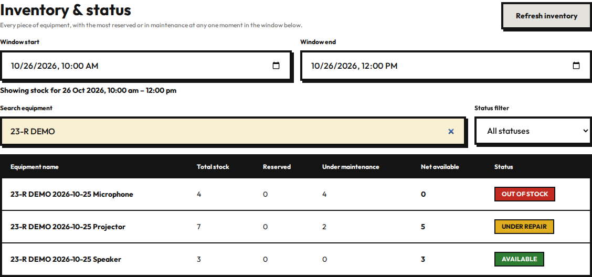
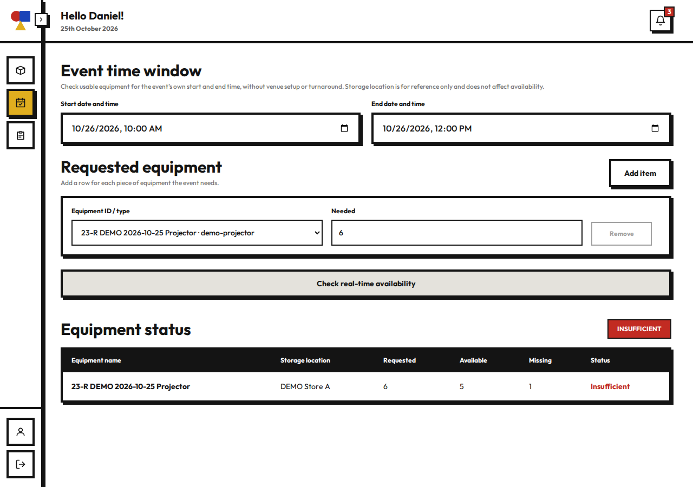
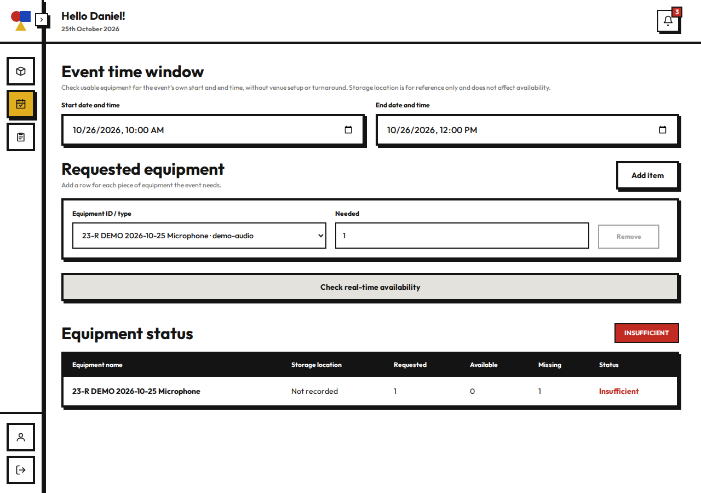
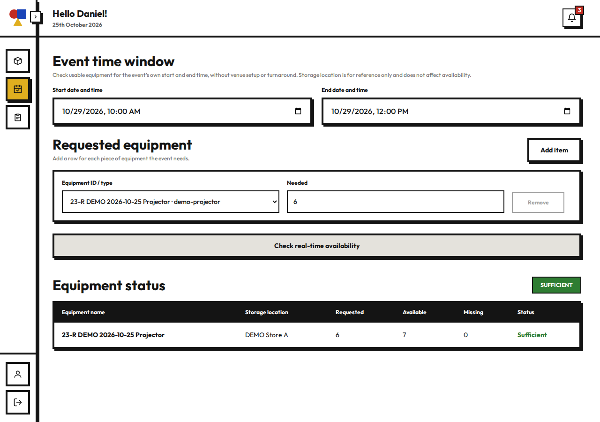
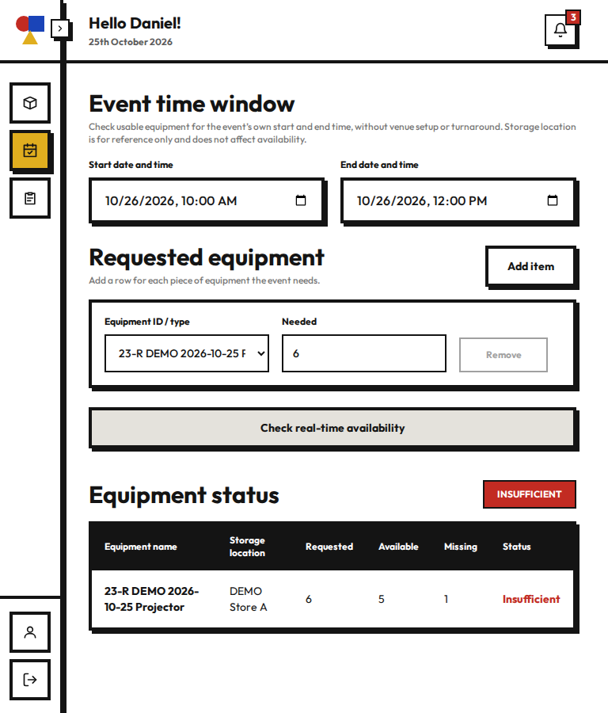
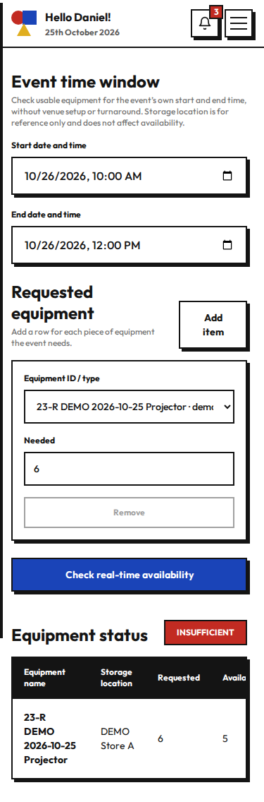
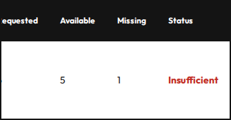
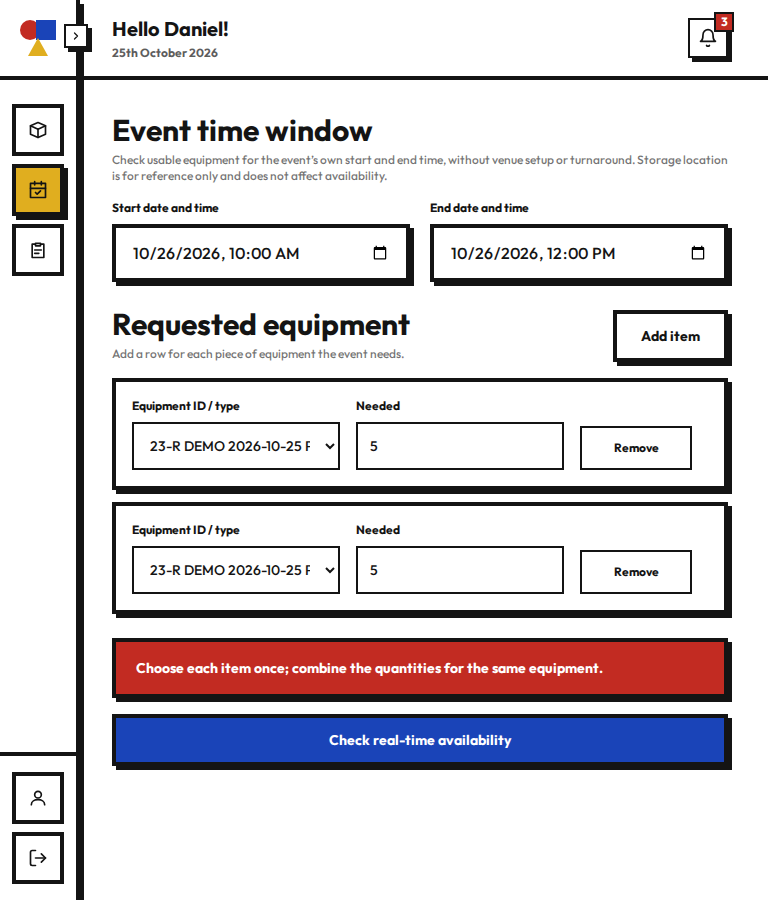

# 23-R PR screenshot evidence

Captured by headless Chromium153 against the actual branch frontend/backend and deployed Supabase, using synthetic `23-R DEMO` equipment. All times are Singapore time; the main scenario is26 Oct2026 10:00–12:00. User manual pass and independent automated checks are recorded separately in the runs folder.

These images contain seeded/synthetic UI data only, no authentication tokens or developer tools. Screenshots1–6 are desktop1280px,7 and10 tablet768px,8–9 phone375px.

| Screenshot | What it demonstrates |
|---|---|
| [01-inventory-three-states-desktop.png](01-inventory-three-states-desktop.png) | Inventory: under repair, out of stock and available |
| [02-shortage-desktop.png](02-shortage-desktop.png) | Shortage: requested6, available5, missing1 |
| [03-sufficient-desktop.png](03-sufficient-desktop.png) | Sufficient: requested5, available5, missing0 |
| [04-maintenance-no-location-desktop.png](04-maintenance-no-location-desktop.png) | All units unavailable and location Not recorded |
| [05-boundary-outage-desktop.png](05-boundary-outage-desktop.png) | Time boundary: Speaker unavailable09:00–10:00 |
| [06-outage-ended-desktop.png](06-outage-ended-desktop.png) | After outage ends: Projector available7 |
| [07-shortage-tablet.png](07-shortage-tablet.png) | Tablet768px: contained form and shortage result |
| [08-shortage-phone.png](08-shortage-phone.png) | Phone375px: form and table in scroll frame |
| [09-phone-result-quantities.png](09-phone-result-quantities.png) | Phone: table scrolled to quantity/status columns |
| [10-duplicate-validation-tablet.png](10-duplicate-validation-tablet.png) | Duplicate rows: combine quantities; no request |

**Inventory: under repair, out of stock and available**

**Shortage: requested6, available5, missing1**

**Sufficient: requested5, available5, missing0**

**All units unavailable and location Not recorded**

**Time boundary: Speaker unavailable09:00–10:00**

**After outage ends: Projector available7**

**Tablet768px: contained form and shortage result**

**Phone375px: form and table in scroll frame**

**Phone: table scrolled to quantity/status columns**

**Duplicate rows: combine quantities; no request**

